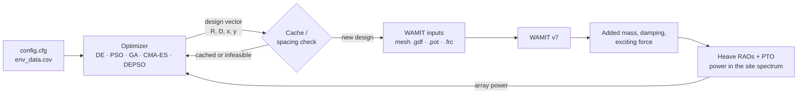

<div align="center">

# WEC Array Shape & Layout Optimization

**Simultaneous geometry and layout optimization of heaving point-absorber wave energy converters (WECs) in front of a vertical wall, with WAMIT hydrodynamics and metaheuristic optimizers.**

[](https://github.com/onibini/Optimization-Process/actions/workflows/python-tests.yml)


[](https://docs.astral.sh/ruff/)
[](LICENSE)

[**User manual (Korean)**](docs/manual_ko.md) · [Architecture](docs/architecture.md) · [Algorithms](docs/algorithms_and_problems.md) · [Changelog](CHANGELOG.md)


</div>

---

## Why this project

Five heaving buoys in front of a breakwater interact with each other and with the waves reflected by the wall. The best buoy **shape** depends on the **layout** and the other way round, so optimizing them one after the other misses designs that only a **simultaneous** search finds. This repository searches both at once: radius *R*, cylinder draft *D* and the positions of the WECs, scored by the time-averaged power of the whole array in the irregular sea of a real site.

## Highlights

| | |
| :--- | :--- |
| **Optimizers** | Differential Evolution (default), PSO, GA, CMA-ES and DEPSO (the DE + PSO hybrid of [Lee et al., 2026](#citation)) |
| **Hydrodynamics** | WAMIT v7 radiation/diffraction with a vertical wall (`IWALLX0`), iterative solver, automatic cubed-sphere hemisphere + cylinder mesh |
| **Power model** | Coupled heave RAOs of all bodies, linear PTO damping tuned to the heave resonance, JONSWAP (ITTC / Goda) or Pierson-Moskowitz spectrum |
| **Search space** | Symmetric layouts on a 0.1 m grid; canonical ordering removes duplicate layouts; an evaluation cache never runs WAMIT twice for the same design |
| **Speed options** | Adaptive frequency grid around the resonance (`FreqGrid`), several WAMIT processes at the same time (`Workers`), remote runs on a compute PC over SSH |
| **Validation** | Re-evaluates the published optimal designs and keeps a regression reference ([docs/validation](docs/validation/README.md)); 200+ unit tests run without WAMIT |

## How it works



1. The optimizer proposes a design vector `[R, D, X1, X2, Y2, X3, Y3]` (WEC1 on the centre line, two mirrored pairs).
2. Infeasible layouts (minimum spacing) are rejected without WAMIT; known designs come from the cache.
3. WAMIT computes the hydrodynamic coefficients of the five bodies near the wall.
4. The coupled heave equations give the RAOs; the PTO damping of each body equals its radiation damping at the heave resonance.
5. The power spectral density is integrated over the site spectrum (Simpson's rule) and the total array power is returned.

## Quick start

> Requires Python ≥ 3.10. WAMIT v7 (commercial, not included) is needed for real runs on Windows; the tests run anywhere.

```bash
git clone https://github.com/onibini/Optimization-Process.git
cd Optimization-Process
pip install -r requirements.txt
python -m unittest discover -s tests     # no WAMIT needed
python main.py                           # runs the optimization defined in config.cfg
```

The WAMIT executable is found from `WAMITPath` in `config.cfg`, then the `WAMIT_EXE` environment variable, then `C:\WAMITv7\WAMIT.exe`.

## Configuration at a glance

Everything is set in [`config.cfg`](config.cfg) (`value  name  - comment` per line). The full list with recommendations is in the [user manual](docs/manual_ko.md#4-설정-파일-configcfg).

| Section | Key | Meaning (default) |
| :--- | :--- | :--- |
| `[Simulation]` | `OptMode` | 1 geometry, 2 layout, 3 geometry + layout |
| | `Algorithm` | 1 DE, 2 PSO, 3 GA, 4 CMA-ES, 5 DEPSO |
| | `WaveSpec` | 1 JONSWAP ITTC (default), 2 JONSWAP Goda, 3 Pierson-Moskowitz |
| `[WEC Parameters]` | `NumWECs`, `MinSpacing` | 1, 3 or 5 WECs; minimum centre distance = `MinSpacing` × R (4) |
| `[AlgorithmSettings]` | `PopSize`, `MaxIter`, `F`, `CR`, `w`, `c1`, `c2`, `SigmaInit`, `DEUpdate` | population, generations and optimizer parameters |
| `[Constraints]` | `RadiusMin/Max`, `DraftMin/Max`, `WECn_X/YMin/Max`, `StepSize` | search ranges (all positive) and grid step (0.1 m) |
| `[Environment]` | `SiteID` | row of [`data/env_data.csv`](data/env_data.csv) (Hs, Tp, γ, depth) |
| `[WAMIT Settings]` | `MeshPanels` (120), `Solver` (0), `OmegaMax` (3.0), `FreqGrid` (0), `Workers` (1), `NCPU` | mesh, solver, frequency grid and parallel runs |

Sites included: **Buan** (Hs 1.07 m, Tp 5.46 s, 50 m), **Chilbaldo** (0.87 m, 4.48 s, 33 m), **Yeongilmanhang** (0.92 m, 6.66 s, 13 m).

## Results

**Reproducing the published optima.** The optimal designs of the simultaneous-optimization study, re-evaluated with this code (ITTC spectrum), agree with the published array power within 1–2 % for Buan and Chilbaldo:

| Site | Strategy | Published (kW) | This code (kW) |
| :--- | :--- | ---: | ---: |
| Buan | sequential | 47.52 | 47.15 (−0.8 %) |
| Buan | simultaneous | 50.36 | 50.02 (−0.7 %) |
| Chilbaldo | sequential | 31.33 | 31.01 (−1.0 %) |
| Chilbaldo | simultaneous | 31.91 | 31.69 (−0.7 %) |

Details and the regression reference: [docs/validation](docs/validation/README.md).

**Optimizers on coupled (rotated) test functions** with the same design-variable grid as the WEC problem and an equal budget of 20,000 evaluations — mean rank (1 = best): CMA-ES 2.4, PSO 2.5, DE 2.6, DEPSO 3.0, GA 4.5 ([report](docs/reports/2026-10-23_18_rotated-benchmark.md)).

<p align="center"></p>

## Repository layout

```
├── main.py / config.cfg        # entry point and settings
├── data/env_data.csv           # wave conditions of the sites
├── src/
│   ├── algorithms/             # DE, PSO, GA, CMA-ES, DEPSO + cache, logging, parallel evaluation
│   ├── problems/               # geometry, layout and joint problems
│   ├── physics/                # WAMIT I/O, mesh, RAO, wave spectra, power
│   └── utils/                  # config parser, validation, symmetric layout mapping
├── scripts/                    # remote runs on a compute PC (remote.ps1) and experiments
├── tests/                      # unit tests (no WAMIT needed)
├── docs/                       # manual, design notes, validation, update reports with figures
└── report/                     # plain-language (Korean) notes for every change
```

Run outputs go to `logs/` (per run: config, every evaluated design, best per generation, summary) and WAMIT files to `workspace/`; both are ignored by Git.

## Documentation

- [User manual (Korean)](docs/manual_ko.md) — installation, every setting, outputs, remote runs, troubleshooting
- [Algorithms and problems](docs/algorithms_and_problems.md) · [Architecture](docs/architecture.md) · [Conventions](docs/conventions.md)
- [Frequency-grid design](docs/frequency_grid_design.md) · [Remote compute](docs/remote_compute.md) · [Validation](docs/validation/README.md)
- [Update reports](docs/reports/) and [Changelog](CHANGELOG.md)

## Development

```bash
pip install -r requirements-dev.txt
python -m unittest discover -s tests
ruff check . && ruff format --check .
```

GitHub Actions runs lint and tests on Python 3.10 and 3.12 for every push and pull request. See [CONTRIBUTING.md](CONTRIBUTING.md).

## Citation

If you use this code, please cite:

> Lee, O.-B., Heo, S., Koo, W. (2026). Metaheuristic-based layout optimization of multiple heaving point-absorber wave energy converters near a vertical wall. *Ocean Engineering*, 355, 125173. https://doi.org/10.1016/j.oceaneng.2026.125173

```bibtex
@article{Lee2026WECLayout,
  author  = {Lee, O.-B. and Heo, S. and Koo, W.},
  title   = {Metaheuristic-based layout optimization of multiple heaving point-absorber wave energy converters near a vertical wall},
  journal = {Ocean Engineering},
  volume  = {355},
  pages   = {125173},
  year    = {2026},
  doi     = {10.1016/j.oceaneng.2026.125173}
}
```

## License

[MIT](LICENSE). WAMIT is a commercial product of WAMIT, Inc. and is not distributed with this repository.
