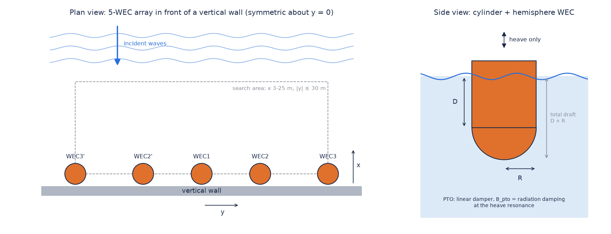

# 사용 설명서

이 문서는 WEC(파력발전기) 배열의 형상·배치 최적화 프로그램을 설치하고, 설정하고, 실행하고, 결과를 읽는 방법을 설명합니다. 프로젝트 소개는 [README](../README.md)에 있습니다.

## 목차

1. [프로그램 개요](#1-프로그램-개요)
2. [설치](#2-설치)
3. [빠른 시작](#3-빠른-시작)
4. [설정 파일 config.cfg](#4-설정-파일-configcfg)
5. [해역 데이터 env_data.csv](#5-해역-데이터-env_datacsv)
6. [실행 중 화면 읽기](#6-실행-중-화면-읽기)
7. [결과 파일](#7-결과-파일)
8. [권장 설정과 팁](#8-권장-설정과-팁)
9. [부가 도구](#9-부가-도구)
10. [문제 해결](#10-문제-해결)
11. [자주 묻는 질문](#11-자주-묻는-질문)

> WAMIT이 Windows 프로그램이므로 명령 예시는 Windows 명령 프롬프트(cmd) 기준입니다. 테스트와 벤치마크처럼 WAMIT이 필요 없는 작업은 macOS·Linux에서도 같은 `python` 명령으로 실행됩니다.

---

## 1. 프로그램 개요



### 1-1. 무엇을 하나요?

수직벽(방파제 등) 앞에 놓인 heave(상하 운동)형 point-absorber WEC 1·3·5기의 **형상**과 **배치**를 최적화합니다. 목표는 지정한 해역의 불규칙파에서 **배열 전체의 시간 평균 발전량(W)을 최대화**하는 것입니다.

- **형상**: 원통 + 반구 바닥. 반지름 *R*과 원통부 길이 *D*로 정합니다(총 흘수 = *D* + *R*).
- **배치**: 각 WEC의 수평 좌표. 배열은 벽에 수직인 축(y = 0)에 대해 대칭입니다.
- **최적화 모드**: 1 형상만(1기, 개방 해역), 2 배치만(형상 고정), 3 형상과 배치를 동시에.

### 1-2. 계산 과정

1. 최적화 알고리즘이 설계(형상·배치)를 하나 제안합니다.
2. WEC 사이 최소 간격을 어기는 설계는 해석 없이 벌점을 받습니다. 이미 계산한 설계는 저장된 값을 씁니다.
3. 형상에 맞는 표면 격자(mesh)를 자동으로 만들고, WAMIT으로 부가질량·방사감쇠·가진력을 계산합니다(수직벽 반사 포함).
4. 모든 WEC의 heave 운동을 함께 풀어 RAO(응답 진폭)를 구합니다. PTO(발전기) 감쇠는 선형 감쇠기로 두고, 각 WEC의 heave 공진 주파수에서의 방사감쇠 값을 씁니다.
5. 파랑 스펙트럼과 곱해 주파수에 대해 적분(Simpson)한 배열 발전량을 알고리즘에 돌려줍니다.

### 1-3. 설계 변수와 WEC 번호

5기 동시 최적화의 설계 변수는 다음 7개입니다.

```
[R, D, X1, X2, Y2, X3, Y3]
```

| WEC | 위치 |
| --- | --- |
| WEC1 | (X1, 0) — 중심선 위 |
| WEC2 쌍 | (X2, +Y2), (X2, −Y2) |
| WEC3 쌍 | (X3, +Y3), (X3, −Y3) |

- x는 벽에서 바다 쪽으로의 거리, y는 벽을 따라가는 방향입니다.
- 두 쌍은 바꿔도 같은 배치이므로, 프로그램이 항상 (X2, Y2) ≤ (X3, Y3)가 되도록 순서를 정리합니다. 그래서 같은 배치를 두 번 계산하지 않습니다.
- 3기는 `[R, D, X1, X2, Y2]`, 1기(형상 최적화)는 `[R, D]`입니다.
- 모든 변수는 양수이고, 정해진 간격(기본 0.1 m)의 격자 위에서만 움직입니다.

### 1-4. 최적화 알고리즘

| 번호 | 알고리즘 | 특징 |
| --- | --- | --- |
| 1 | DE (Differential Evolution, DE/rand/1/bin) | 기본값. 안정적이고 파라미터가 적음 |
| 2 | PSO (Particle Swarm Optimization) | 관성 가중치형 |
| 3 | GA (Genetic Algorithm) | 토너먼트 선택, 균일 교차, 엘리트 보존 |
| 4 | CMA-ES | 변수 사이의 상관을 학습. 개체 수를 넉넉히(50~100) |
| 5 | DEPSO | DE와 PSO를 섞은 방법(Lee 등, 2026) |

## 2. 설치

1. **Python 3.10 이상**을 설치합니다.
2. 이 저장소를 받습니다.

   ```cmd
   git clone https://github.com/onibini/Optimization-Process.git
   cd Optimization-Process
   ```

3. 필요한 패키지를 설치합니다(numpy, scipy).

   ```cmd
   pip install -r requirements.txt
   ```

4. **WAMIT v7**을 설치합니다. WAMIT은 WAMIT, Inc.의 상용 프로그램이라 이 저장소에 포함되어 있지 않으며, 별도 라이선스가 필요합니다. 실행 파일은 다음 순서로 찾습니다.
   1. `config.cfg`의 `WAMITPath` (경로에 공백이 없어야 함)
   2. 환경 변수 `WAMIT_EXE`
   3. `C:\WAMITv7\WAMIT.exe`

   경로에 공백이 있으면 환경 변수를 씁니다.

   ```cmd
   setx WAMIT_EXE "D:\Program Files\WAMIT\WAMIT.exe"
   ```

5. 설치가 잘 되었는지 테스트로 확인합니다(WAMIT 없이 실행됨).

   ```cmd
   python -m unittest discover -s tests
   ```

## 3. 빠른 시작

1. `config.cfg`를 엽니다. 예를 들어 3번 해역에서 5기의 형상과 배치를 DE로 함께 최적화하려면 다음 값을 씁니다.

   ```
   3     OptMode
   1     Algorithm
   5     NumWECs
   3     SiteID
   ```

2. 실행합니다.

   ```cmd
   python main.py
   ```

   다른 설정 파일을 쓰려면 파일 이름을 넘깁니다.

   ```cmd
   python -c "import main; main.main('my_config.cfg')"
   ```

3. 끝나면 최적 설계(발전량, R, D, 총 흘수, 각 WEC 좌표)가 화면에 나오고, `logs` 폴더에 기록이 남습니다.

처음에는 `PopSize`와 `MaxIter`를 작게(예: 10 × 5) 해서 끝까지 한 번 돌려 보고, 평가 1회에 걸리는 시간을 확인한 뒤 본 계산을 하세요.

## 4. 설정 파일 config.cfg

한 줄은 `값  이름  - 설명` 형식입니다. `#`로 시작하는 줄은 주석이고, 값에는 공백이 없어야 합니다. 없는 선택 항목은 기본값을 씁니다.

### 4-1. [Simulation]

| 키 | 값 | 설명 |
| --- | --- | --- |
| `OptMode` | 1, 2, 3 | 1 형상(1기, 개방 해역), 2 배치(`FixedRadius`, `FixedDraft` 고정), 3 형상 + 배치 |
| `Algorithm` | 1~5 | 1 DE, 2 PSO, 3 GA, 4 CMA-ES, 5 DEPSO |
| `WaveSpec` | 1~3 | 1 JONSWAP(ITTC 형식, **기본**), 2 JONSWAP(Goda 근사식), 3 Pierson-Moskowitz |

`WaveSpec` 2(Goda 근사식)는 γ = 1.4에서 적분한 유의파고가 입력보다 약 4% 커서 발전량이 약 8% 크게 나옵니다. 특별한 이유가 없으면 1을 쓰세요.

### 4-2. [WEC Parameters]

| 키 | 설명 |
| --- | --- |
| `NumWECs` | 1, 3, 5 |
| `MinSpacing` | WEC 중심 사이 최소 거리 = `MinSpacing` × R. 어기면 해석 없이 벌점을 받습니다. |
| `FixedRadius`, `FixedDraft` | 배치 최적화(`OptMode 2`)에서 쓰는 고정 형상 |

수직벽은 모드 2, 3에서 자동으로 켜집니다. 벽은 x = 0에 있고, WEC와 벽의 간격은 x 하한(`WECn_XMin`)으로 정합니다. 예를 들어 x ≥ 3.0 m이고 R = 2.5 m이면 최소 간격은 0.5 m입니다.

### 4-3. [AlgorithmSettings]

| 키 | 쓰는 알고리즘 | 설명 (기본값) |
| --- | --- | --- |
| `PopSize` | 전체 | 개체(입자) 수 (30) |
| `MaxIter` | 전체 | 세대 수 (300). 조기 종료는 없습니다. |
| `F`, `CR` | DE, DEPSO | 변이 가중치 (0.5), 교차 확률 (0.9) |
| `DEUpdate` | DE | 0: 같은 세대 안에서 바로 교체(기본), 1: 세대 단위로 교체(`Workers`로 병렬 평가 가능) |
| `w`, `c1`, `c2` | PSO, DEPSO | 관성 (0.5), 개인 최고 쪽 (1.5), 전체 최고 쪽 (1.5) |
| `MutationRate` | GA | 자식마다 돌연변이가 일어날 확률 (0.1) |
| `SigmaInit` | CMA-ES | 처음 탐색 폭, 범위 대비 비율 (0.3, 0 초과 1 이하) |

### 4-4. [Constraints]

| 키 | 설명 |
| --- | --- |
| `StepSize` | 모든 변수의 격자 간격 (0.1). 변수별로 다르게 하려면 `RadiusStep`, `WEC2_YStep` 같은 줄의 `#`을 지웁니다. |
| `RadiusMin/Max`, `DraftMin/Max` | 형상 범위 (기본 R 0.5~2.5, D 0.5~5.0) |
| `WEC1_XMin/Max` … `WEC3_YMin/Max` | 배치 범위 (기본 x 3~25, y 0.1~30) |

모든 범위는 **0 < Min < Max**여야 하고, 간격은 0보다 크고 (Max − Min) 이하여야 합니다. 어기면 시작할 때 틀린 변수를 모두 알려 주고 멈춥니다. (Max − Min)이 간격으로 나누어떨어지지 않으면 실제로 닿을 수 있는 상한을 경고로 알려 줍니다.

### 4-5. [Environment]

| 키 | 설명 |
| --- | --- |
| `SiteID` | `data/env_data.csv`의 `SiteID` 값. 해역 조건(Hs, Tp, γ, 수심)을 고릅니다. |

### 4-6. [WAMIT Settings]

| 키 | 기본 | 설명 |
| --- | --- | --- |
| `NCPU` | 8 | WAMIT 실행 하나가 쓰는 CPU 코어 수 |
| `RAMGBMAX` | 16 | WAMIT 메모리 한도 (GB) |
| `WAMITPath` | (없음) | WAMIT 실행 파일 경로 (선택) |
| `MeshPanels` | 120 | WEC 1기당 1/4 모델 패널 수. 5기 배열에서 대부분 총 발전량 0.5% 이내입니다. 가늘고 긴 형상(작은 R, 큰 D)이나 촘촘한 배치는 160 이상, 1기는 150~250을 권장합니다. 계산 시간은 패널 수의 약 2.5~3제곱으로 늘어납니다. |
| `Solver` | 0 | 0 반복 솔버(빠르고 메모리 적음), 1 직접 솔버, N ≥ 2 블록 반복 솔버 |
| `OmegaMax` | 3.0 | 주파수 격자 상한 (rad/s). 격자는 0.5 rad/s부터 0.05 간격입니다. 작은 부표는 높은 주파수에서 공진하므로, 탐색 범위에 작은 부표가 있으면 3.0 이상을 유지하세요. |
| `FreqGrid` | 0 | 0 균일 격자, 1 공진 부근만 촘촘한 적응형 격자. 1은 좁은 공진을 정확히 잡지만(오차 약 0.1% 이내) 평가 시간이 1.5~2.5배입니다. |
| `Workers` | 1 | 동시에 실행하는 WAMIT 수. `Workers × NCPU`가 PC 코어 수를 넘지 않게 맞춥니다(예: 8코어면 2 × 4). |

**32-bit WAMIT의 메모리 한계**: (`MeshPanels` × WEC 수)가 약 1,100~1,300을 넘으면 메모리 할당 오류가 날 수 있습니다(1,000을 넘으면 경고). `NCPU`를 줄이면 여유가 조금 생깁니다.

**`Workers`가 효과를 내는 경우**: 초기 개체군(모든 알고리즘)과, 세대 전체를 한꺼번에 평가하는 GA·CMA-ES·`DEUpdate=1`인 DE입니다. PSO와 DEPSO는 세대 안에서 순서대로 평가하므로 초기 개체군만 빨라집니다. 결과는 `Workers` 값과 관계없이 같습니다.

## 5. 해역 데이터 env_data.csv

```
SiteID,SiteName,Hs,Tp,Gamma,Depth
1,Buan,1.07,5.46,1.4,50
2,Chilbaldo,0.87,4.48,1.4,33
3,Yeongilmanhang,0.92,6.66,1.4,13
```

| 열 | 뜻 |
| --- | --- |
| `Hs` | 유의파고 (m) |
| `Tp` | 첨두주기 (s) |
| `Gamma` | JONSWAP 첨두증폭계수 (PM에서는 쓰지 않음) |
| `Depth` | 수심 (m), WAMIT에 그대로 들어감 |

새 해역은 행을 추가하고 `config.cfg`의 `SiteID`로 고르면 됩니다. 기본으로 들어 있는 세 해역은 한국 연안(부안, 칠발도, 영일만항)의 2024년 관측 평균입니다.

## 6. 실행 중 화면 읽기

```
해양 환경: [Yeongilmanhang] - Hs: 0.92 m, Tp: 6.66 s, Depth: 13.0 m, Spectrum: JONSWAP (ITTC)
WAMIT: Solver=0, 51 frequencies up to 3 rad/s, MeshPanels=120
Algorithm: [Differential Evolution]
 Gen 12 | Best: 38.1234 kW | Hits: 35 | WAMIT: 1180 | Penalty: 210
```

| 항목 | 뜻 |
| --- | --- |
| `Best` | 지금까지 가장 좋은 배열 발전량 |
| `Hits` | 이미 계산한 설계라 저장된 값을 쓴 횟수 (WAMIT 실행 없음) |
| `WAMIT` | 실제 WAMIT 실행 횟수 |
| `Penalty` | 간격 제약을 어겨 해석 없이 버린 설계 수 |

**경고 메시지**

| 메시지 | 뜻과 대처 |
| --- | --- |
| `reached MAXITT` | 반복 솔버가 일부 주파수에서 수렴하지 못했습니다. 자주 나오면 `Solver=1` |
| `Power density is not negligible at the highest WAMIT frequency` | 공진이 `OmegaMax` 위에 있습니다(작은 부표). `OmegaMax`를 높이세요. |
| `... panels exceeds 1000` | 32-bit WAMIT 메모리 한계에 가깝습니다. `MeshPanels`를 줄이세요. |

## 7. 결과 파일

실행마다 `logs` 폴더에 `{해역}_{알고리즘}_{날짜_시각}`으로 시작하는 파일 네 개가 생깁니다. 서로 덮어쓰지 않습니다.

| 파일 | 내용 |
| --- | --- |
| `*_config.json` | 실행에 쓴 설정 (범위, 환경, WAMIT 설정) |
| `*_trial_history.csv` | 평가한 모든 고유 설계와 발전량 (WEC별 포함). `penalized` = 1이면 제약 위반 |
| `*_generation_history.csv` | 세대별 최고 설계·발전량·소요 시간 |
| `*_summary.json` | 최종 최적 설계, 완료한 세대 수, WAMIT·캐시·패널티 횟수 (중간에 멈춰도 기록) |

- 발전량 단위는 W입니다(화면 출력은 kW).
- 수렴 곡선은 `generation_history.csv`의 `fitness`를 `iter`에 대해 그리면 됩니다.
- WAMIT 입출력 파일은 `workspace` 폴더에 남습니다(다음 평가가 덮어씀).

## 8. 권장 설정과 팁

- **처음 쓸 때**: 작은 `PopSize`·`MaxIter`로 끝까지 돌려 평가 1회 시간을 재고, 전체 시간을 (개체 수 × 세대 수 × 평가 시간)으로 어림합니다. 캐시와 패널티 덕분에 실제로는 더 짧습니다.
- **정확도 우선**: `FreqGrid=1`, 가늘고 긴 형상이 범위에 있으면 `MeshPanels` 160 이상.
- **속도 우선**: `Workers`를 2~4로 하고 GA, CMA-ES 또는 `DEUpdate=1`인 DE를 씁니다. `scripts/experiments/parallel_wamit_bench.py`로 내 PC에서 가장 빠른 `Workers × NCPU` 조합을 먼저 찾으세요.
- **알고리즘**: 기본 DE(개체 100, F 0.5, CR 0.9)가 무난합니다. CMA-ES는 개체 수가 작으면(10 이하) 국소해에 갇히기 쉬우므로 50~100을 권장합니다.
- **탐색 범위**: 범위가 넓을수록 시간이 늘어납니다. 물리적으로 의미 있는 범위(벽과의 간격, 최소 간격)를 먼저 정하세요.

## 9. 부가 도구

`scripts` 폴더에 있습니다.

| 도구 | WAMIT | 용도 |
| --- | --- | --- |
| `experiments/parallel_wamit_bench.py` | 필요 | `Workers × NCPU` 조합별 처리 속도 측정 |
| `experiments/run_sites.py` | 필요 | 같은 설정으로 여러 해역을 차례로 실행 (`--sites 1 2 3`) |
| `experiments/freq_grid_study.py` | 필요 | 주파수 격자에 따른 정확도·시간 비교 |
| `experiments/paper_check.py` | 필요 | 발표된 최적해(Lee 등)를 다시 계산하고, `--reference`로 코드 변경 전후 결과를 비교 |
| `experiments/algorithm_benchmark.py` | 불필요 | 최적화 알고리즘을 벤치마크 함수로 비교 (`--rotate`, `--plot`) |
| `remote.ps1` | 필요 | (선택) SSH로 다른 Windows PC에 계산을 보내고 결과를 받아오기. 설정 방법은 [remote_compute.md](remote_compute.md) |

예: 여러 해역을 차례로 실행합니다.

```cmd
python scripts\experiments\run_sites.py --sites 1 2 3 --config config.cfg
```

## 10. 문제 해결

| 증상 | 원인과 해결 |
| --- | --- |
| `WAMIT executable not found` | `WAMITPath`나 `WAMIT_EXE`를 확인합니다. |
| `WamitRunError` (메모리 할당 오류) | 패널이 너무 많습니다. `MeshPanels`나 `NCPU`를 줄입니다. |
| WAMIT이 아무 출력 없이 끝남 | 작업 폴더 경로가 너무 길 수 있습니다. 짧은 경로(예: `C:\wec`)에 저장소를 두세요. |
| `ConfigValidationError` | 범위가 0 < Min < Max가 아니거나 간격이 잘못되었습니다. 메시지에 나온 변수를 고칩니다. |
| `WaveSpec must be one of ...` | `WaveSpec`은 1, 2, 3 중 하나여야 합니다. |
| 같은 설정인데 결과가 매번 다름 | 최적화 알고리즘은 난수를 씁니다. 여러 번 돌려 비교하세요. |

## 11. 자주 묻는 질문

**Q. WAMIT 없이 무엇을 할 수 있나요?**
테스트, 알고리즘 벤치마크, 설정 검증, 코드 수정은 할 수 있습니다. 발전량 계산에는 WAMIT이 필요합니다.

**Q. 같은 설계를 두 번 계산하나요?**
아니요. 격자 위의 같은 점(대칭으로 같은 배치 포함)은 저장된 값을 씁니다.

**Q. 계산 시간은 얼마나 걸리나요?**
5기, 패널 120, 주파수 51개에서 평가 1회는 8코어 PC로 약 8~12초입니다. 개체 100 × 300세대이면 캐시를 고려해도 하루 이상 걸릴 수 있습니다. `Workers`로 줄일 수 있습니다.

**Q. 다른 형상이나 다른 개수의 WEC를 쓸 수 있나요?**
현재는 원통 + 반구 형상, 1·3·5기 대칭 배치만 지원합니다. 형상은 `src/physics/mesh_axisymmetric_shape.py`, 배치 규칙은 `src/utils/mapper.py`에서 바꿀 수 있습니다.

**Q. 인용은 어떻게 하나요?**
[README의 Citation](../README.md#citation)을 보세요.
