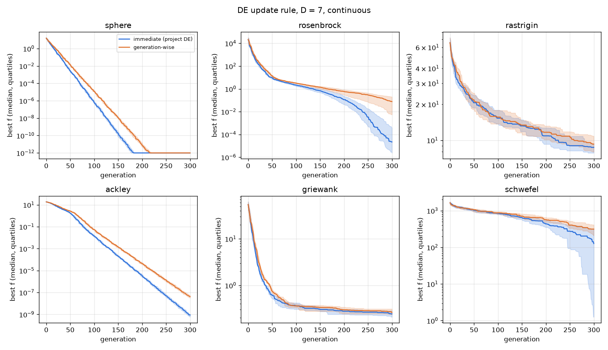
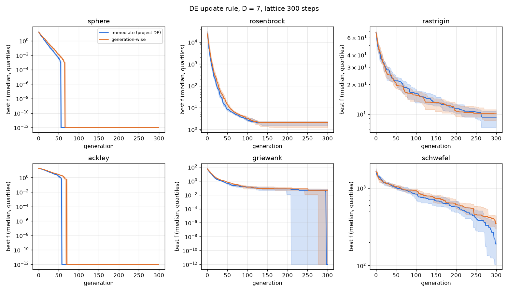

# 업데이트 보고서: DE 교체 방식(즉시 교체 대 세대 단위) 벤치마크

- 날짜: 2026-10-23
- 범위: `scripts/experiments/de_update_benchmark.py`(신규), `tests/test_de_update_benchmark.py`(신규), `CLAUDE.md`(보고서 이미지 규칙), `docs/reports/images/`, `report/images/`. `src/` 변경 없음.

## 1. 개요

프로젝트의 DE(`run_de`, DE/rand/1/bin)는 한 세대 안에서 개체 i의 시험 벡터가 더 좋으면 **즉시** 개체군을 바꾸고, 다음 개체의 변이에 바뀐 개체군을 쓴다(immediate, 비동기·steady-state DE). WAMIT 여러 개를 동시에 돌려 한 세대를 병렬 평가하려면 세대의 시험 벡터를 모두 옛 개체군에서 만들고 평가 후 한꺼번에 바꾸는 **세대 단위** 방식(generation-wise, Storn–Price의 원래 형태)이어야 한다. 두 방식의 성능 차이를 대표 벤치마크 함수로 비교했다.

## 2. 변경 내용

- `de_update_benchmark.py`: 두 방식을 같은 연산자·같은 난수 호출 순서로 구현(교체 시점만 다름). 즉시 교체 방식은 `run_de`와 같은 결과를 낸다(테스트로 확인). 함수 6개(sphere, rosenbrock, rastrigin, ackley, griewank, schwefel; 최소값 0) × 차원 7·20 × 연속/격자(변수당 300칸, WEC 변수의 0.1 m 격자와 비슷한 해상도) × 방식 2 × 30회. DE 설정은 논문과 같다: 개체 100, 300세대, F 0.5, CR 0.9. 같은 시드에서 두 방식은 같은 초기 개체군을 쓴다. `--workers`로 실행을 CPU 코어에 나눠 돌린다(실행마다 자기 시드를 써서 결과는 병렬 여부와 무관). `--plot`은 matplotlib 필요(프로젝트 의존성 아님).
- `CLAUDE.md` §3, §3-1: 보고서에 가능하면 이미지를 넣고 `docs/reports/images/`, `report/images/`에 둔다는 규칙 추가(사용자 요청).

## 3. 호환성 영향

없음(새 시험 스크립트, 문서 규칙).

## 4. 검증 (결과)

1,440회 실행, 이 PC 20개 프로세스로 234초(순차로는 약 40분 예상). 원본: 스크립트 출력 `de_update_final.csv`, `de_update_curves.csv`(이 보고서용 실행은 임시 폴더에 저장; 같은 명령 `--grid 300 --plot`으로 재현).

**최종값 중앙값(30회)과 Mann–Whitney U 검정:**

| 함수 | 차원 | 연속: 즉시 / 세대 (p) | 격자 300: 즉시 / 세대 (p) |
| --- | --- | --- | --- |
| sphere | 7 | 1.7e-21 / 7.1e-18 (3e-11) | 0 / 0 (같음) |
| sphere | 20 | 5.9e-5 / 3.6e-4 (3e-11) | 0 / 0 (같음) |
| rosenbrock | 7 | 2.2e-5 / 7.7e-2 (2e-9) | 2.12 / 2.07 (0.13) |
| rosenbrock | 20 | 16.6 / 17.8 (1e-6) | 22.2 / 23.5 (5e-5) |
| rastrigin | 7 | 8.7 / 9.3 (0.30) | 9.3 / 10.1 (0.30) |
| rastrigin | 20 | 111 / 116 (0.26) | 121 / 115 (0.17) |
| ackley | 7 | 8.8e-10 / 4.2e-8 (3e-11) | 4e-16 / 4e-16 (같음) |
| ackley | 20 | 0.077 / 0.199 (4e-11) | 4e-16 / 4e-16 (같음) |
| griewank | 7 | 0.244 / 0.264 (0.14) | 0 / 0.047 (0.14) |
| griewank | 20 | 0.387 / 0.678 (2e-6) | 1.018 / 1.028 (0.03) |
| schwefel | 7 | 127 / 314 (0.003) | 190 / 347 (0.002) |
| schwefel | 20 | 4127 / 4262 (0.43) | 4337 / 4408 (0.36) |

- 24개 경우 중 **즉시 교체가 유의하게 좋음(p<0.05) 11개**, 차이 없음 13개(완전히 같음 5개), **세대 단위가 유의하게 좋은 경우는 없음**.
- 차이는 대부분 **수렴 속도**다: 같은 중앙값에 도달하는 데 세대 단위는 중앙값 **1.15배**(0.96~1.41배)의 세대가 필요했다(아래 그림 3; 즉시 교체가 아직 개선 중인 100~200세대 구간 기준).
- 다봉 함수(rastrigin, schwefel D20)에서는 두 방식 모두 국소해에 머물러 차이가 없었다. 격자에서는 쉬운 함수가 두 방식 모두 정확한 최적점(0)에 도달한다.

*그림 1. D=7 연속: 세대별 최적값 중앙값(선)과 사분위(띠). 파랑 = 즉시 교체(프로젝트 DE), 주황 = 세대 단위.*

*그림 2. D=7 격자(변수당 300칸).*

*그림 3. 같은 중앙값에 도달하는 데 필요한 세대 수의 비(세대 단위 / 즉시). 1보다 크면 세대 단위가 느리다.*

추가 그림: [D=20 연속](images/2026-10-23_10_de_update_curves_D20.png), [D=20 격자](images/2026-10-23_10_de_update_curves_D20_grid300.png), 최종값 상자그림 [D=7](images/2026-10-23_10_de_update_final_D7.png) · [D=20](images/2026-10-23_10_de_update_final_D20.png) · [D=7 격자](images/2026-10-23_10_de_update_final_D7_grid300.png) · [D=20 격자](images/2026-10-23_10_de_update_final_D20_grid300.png).

- 단위 테스트: 즉시 교체 구현이 `run_de`와 같은 격자 문제·같은 시드에서 같은 최종값, 두 방식이 같은 초기 개체군에서 시작해 다르게 진행, 함수 최소값 0, 작은 실행의 표 작성, 실행 재현성. `ruff check .`, `ruff format --check .`, 전체 테스트 통과.

## 5. 남은 이슈 / 후속 작업

**해석:** 같은 세대 수라면 즉시 교체(현재 방식)가 약간 낫거나 같다. 세대 단위가 같은 품질에 도달하려면 약 15%(최대 약 40%) 더 많은 세대가 필요하다. 따라서 WAMIT 동시 실행으로 한 세대 평가가 **1.15~1.4배보다 빨라지면** 세대 단위 DE가 같은 시간에 더 좋은 결과를 낸다. 동시 실행 이득(2~3배 예상)이 이보다 크면 병렬화가 유리하다.

- 벤치마크 함수는 WEC 문제와 다르다(WEC 문제는 대칭 정렬·간격 패널티·경계 최적해가 있음). 실제 효과는 WAMIT 동시 실행 속도 측정과 함께 판단해야 한다.
- 세대 단위 DE를 쓰면 논문의 DE와 동작이 달라지므로 논문 결과와의 연속성을 사용자가 판단해야 한다.
- 후속: CMA-ES 작업이 끝나면 계산용 PC에서 WAMIT 동시 실행 수(1×8, 2×4, 4×2, 8×1)별 처리량 측정.
