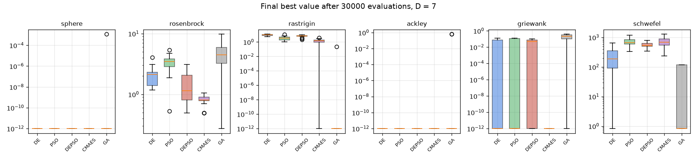
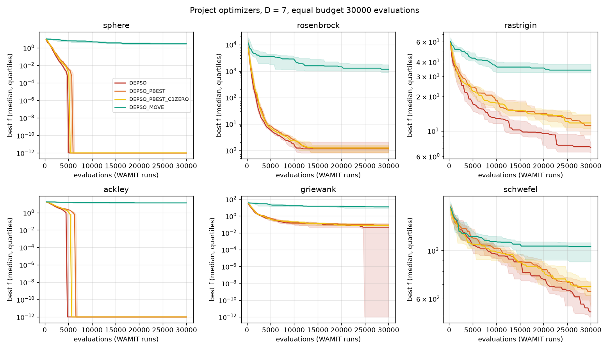

# 업데이트 보고서: DEPSO 추가와 최적화 알고리즘 벤치마크

- 날짜: 2026-10-23
- 범위: `src/algorithms/depso.py`(신규), `src/algorithms/__init__.py`, `main.py`(`Algorithm=5`), `config.cfg`·`config_test.cfg`(주석), `scripts/experiments/algorithm_benchmark.py`(신규), `tests/test_depso.py`·`tests/test_algorithm_benchmark.py`(신규), `tests/test_fixes.py`, `README.md`, `docs/algorithms_and_problems.md`, `docs/architecture.md`, `docs/conventions.md`

## 1. 개요

사용자의 DEPSO(Lee, Heo, Koo, 2026, *Ocean Engineering* 355, 125173)를 프로젝트에 추가했다. 사용자의 예전 코드(`optimization_main.py`) 중 **갱신 규칙만** 옮기고, 초기화·격자·제약·캐시·로그는 프로젝트 공통 기능을 쓴다. 옮기기 전에 원래 코드를 검토했고, 갱신 규칙을 바꾼 변형 두 가지(pbest, move)를 만들어 원래 규칙과 함께 벤치마크 함수로 비교했다. 결과에 따라 **원래 규칙(greedy)을 기본값**으로 정했다.

## 2. 변경 내용

- **`run_depso` (`Algorithm=5`, 파라미터 `F`, `CR`, `w`, `c1`, `c2`)**: 입자마다 (1) PSO 속도 갱신(범위의 10%로 제한)과 이동점 m = x + v, (2) 다른 입자 셋의 현재 위치로 DE/rand/1 변이, (3) **이동점을 기준 벡터로** 이항 교차, (4) 평가 1회와 탐욕 선택(더 좋을 때만 이동), pbest·gbest 갱신. 같은 세대 안 즉시 갱신(DE와 같음). 평가는 대칭 정렬된 사본으로(PSO와 같음).
- **원래 코드 검토 결과** (옮기면서 해결): 대칭 정렬 후 위치만 바뀌고 속도는 그대로인 문제(입자 순간이동) → 사본 평가로 해결; 초기 속도가 모두 양수 → ±로; 거리 제약 재추출 무한 반복 가능성 → 프로젝트 패널티로; 격자 기준점(0 기준 반올림 대 하한 기준 생성) 불일치 → 프로젝트 격자. 원래 규칙에서는 위치가 더 좋을 때만 바뀌어 **pbest가 늘 현재 위치와 같고 c1 항이 0**이다(검토에서 지적, 벤치마크로 영향 확인). 참고로 같은 파일의 PSO 함수는 `velocities[i]`·`positions[i]`를 복사 없이 저장해 거리 제약 실패 때 되돌리기가 작동하지 않는다(DEPSO와 무관, 옮기지 않음).
- **비교용 변형(`update` 인자, config 항목 없음)**: `"pbest"` = 변이 재료를 pbest에서 뽑고 입자는 항상 이동(c1 작동); `"move"` = 변이 재료는 현재 위치, 입자는 PSO처럼 항상 이동.
- **`algorithm_benchmark.py`**: 프로젝트 최적화기(격자 스냅·캐시 포함)를 벤치마크 함수 6개(D=7, 20, 변수당 300칸 격자)에서 **같은 평가 횟수(30,000회 = WAMIT 실행 수, 캐시 적중 제외)**로 비교. 실행마다 최적화 로그를 끄고(작업 프로세스 안에서만), CPU 코어에 나눠 돌린다. `--plot`은 matplotlib 필요.

## 3. 호환성 영향

- `config.cfg`의 `Algorithm`에 5(DEPSO)가 추가되었다. F·CR(DE와 공유), w·c1·c2(PSO와 공유)를 쓴다. 기존 알고리즘 1~4와 WAMIT 입력은 바뀌지 않았다.
- 로그 파일 이름의 알고리즘 부분은 `depso`다.

## 4. 검증

- 단위 테스트: DEPSO의 세 규칙 각각이 규칙을 그대로 옮긴 참조 구현과 같은 최종값(시드 3개), 기본값 = greedy, 입자당 평가 1회, 격자 유지, PopSize<4 거부, 알 수 없는 규칙 거부; 기존 테스트(대칭 정렬된 결과·수렴, 알고리즘별 로그 파일)에 DEPSO 추가; 벤치마크 실행이 예산에서 멈추고 단조 감소, 재현성, 로그 파일 없음. `ruff check .`, `ruff format --check .`, 전체 테스트 통과.
- **벤치마크**(20회 반복, 같은 시드, Mann–Whitney U, 이 PC 20 프로세스; 전체 약 54분 + 추가 변형 약 14분):

**알고리즘별 평균 순위** (12개 경우, 평균 최종값 기준, 1이 가장 좋음): CMA-ES(λ=72) 2.67, DE 2.75, PSO 3.33, **DEPSO 3.42**, GA 4.42 (변형 포함 순위에서 DEPSO-pbest 4.42, DEPSO-move 7.0).

*그림 1. 30,000회 평가 후 최종값(D=7). [D=20](images/2026-10-23_11_main_algorithm_final_D20.png), 수렴 곡선 [D=7](images/2026-10-23_11_main_algorithm_curves_D7.png) · [D=20](images/2026-10-23_11_main_algorithm_curves_D20.png).*

**DEPSO 규칙 비교** (12개 경우에서 유의한 차이):

| 비교 | 결과 |
| --- | --- |
| greedy(원래) 대 pbest | greedy가 좋음 7, 같음 5, pbest가 좋음 0 |
| pbest(c1=0) 대 pbest | c1=0이 좋음 3(Ackley·Griewank·Rosenbrock D20), 같음 9 |
| pbest(c1=0) 대 greedy | greedy가 좋음 4(Rastrigin D7·D20, Griewank D7, Schwefel D7), 같음 8 |
| move 대 나머지(greedy, pbest, PSO, DE) | 12개 모두 move가 나쁨(Sphere D7도 평균 3.11로 수렴 실패) |

*그림 2. DEPSO 규칙별 수렴(D=7). [D=20](images/2026-10-23_11_depso_algorithm_curves_D20.png), 최종값 [D=7](images/2026-10-23_11_depso_algorithm_final_D7.png) · [D=20](images/2026-10-23_11_depso_algorithm_final_D20.png).*

**해석**: c1을 살리는 쪽(pbest, move)으로 바꿀수록 나빠졌다. 고차원에서는 c1 항 자체가 해롭고(c1=0으로 일부 회복), 그 외의 차이는 "항상 이동"이 엘리트 보존을 잃게 하기 때문이다. CR=0.9에서는 시험 벡터의 약 90%가 DE 변이에서 오는데, 위치가 흩어진 채 남으면(move) 차분이 줄지 않아 무작위 탐색처럼 된다. 원래 규칙의 탐욕 선택(위치 = 지금까지의 최고)이 수렴에 핵심이다.

## 5. 남은 이슈 / 후속 작업

- **벤치마크 편향**: GA가 Rastrigin·Schwefel에서 거의 정확한 최적점을 찾았는데, 이 함수들은 변수끼리 독립(분리 가능)이라 좌표별 변이에 유리하다. 최적점이 격자점(0) 위에 있는 것도 유리하다. WEC 문제는 변수가 얽혀 있으므로 **회전시킨(비분리) 함수**로 다시 비교하는 것이 공정하다.
- **CMA-ES 수치 경고**: 한 실행에서 보폭 갱신 `exp(...)`가 overflow했다(보폭에 하한만 있고 상한 없음). 상한(예: 정규화 공간 1.0) 추가가 필요하다(별도 수정 필요, 아직 안 함).
- DEPSO의 F, CR 기본값: 원래 코드는 F 0.7, CR 0.3, 프로젝트 config는 F 0.5, CR 0.9(DE와 공유). 논문 재현에는 논문 값으로 config를 바꿔야 한다. 이번 벤치마크는 0.5/0.9.
- 실제 WEC 문제에서 DEPSO와 DE 비교는 계산용 PC에서 별도로 해야 한다.
