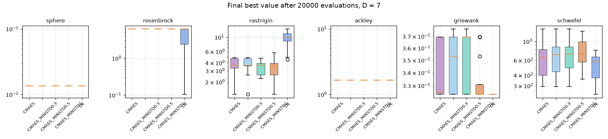

# 업데이트 보고서: CMA-ES 변수별 최소 탐색 폭 시험과 3개 해역 재제출

- 날짜: 2026-10-23
- 범위: `src/algorithms/cma_es.py`(`raise_min_std`, `min_std_factor`, 기본 끔), `scripts/experiments/algorithm_benchmark.py`(`--grid 0` = WEC 문제의 격자, CMA-ES 비교 변형), 계산용 PC 작업 재제출

## 1. 개요

CMA-ES 보폭 상한 수정(`2026-10-23_12`) 후, 돌던 3개 해역 작업(`20261023_161543_cmaes_sites`, 수정 전 코드, 부안 21세대)을 멈추고 수정된 코드로 다시 제출했다. 다시 내기 전에, 정규화 공간에서 변수마다 격자 한 칸 크기가 달라(R 0.05, D 0.022, x 0.0045, y 0.0033) 수렴 후반에 격자 칸이 큰 변수의 탐색이 멈출 수 있는 문제를 줄이는 옵션을 시험했다.

## 2. 변경 내용

- `raise_min_std(C, sigma, min_std)`: 좌표별 표준편차 `sigma·sqrt(C_ii)`가 `min_std_factor × (격자 한 칸/범위)`보다 작으면 그 대각 성분만 키운다(pycma `minstd` 방식). `run_cma_es(..., min_std_factor=MIN_STD_FACTOR)`, **기본 0(끔)**.
- 벤치마크 `--grid 0`: 변수마다 WEC 문제와 같은 격자 칸 수(R 20, D 45, x 220, y 299, 반복)를 쓴다. 비교 변형 `cmaes_minstd0.3`, `cmaes_minstd0.5`, `cmaes_minstd1`.
- 계산용 PC 작업 재제출: `20261023_190757_cmaes_sites2`(개체 72, 300세대, σ0 0.3, ITTC, 3개 해역 순서대로, 메쉬 120, 균일 0.05 격자). 최소 탐색 폭 옵션은 끈 상태.

## 3. 호환성 영향

없음(새 옵션은 기본 끔). 이전 작업의 결과는 쓰지 않는다(중간에 멈춤).

## 4. 검증

벤치마크(함수 6개 × D 7·20, WEC 격자, 평가 20,000회, 20회 반복, 20 프로세스 21분):

| 변형 (끈 상태 대비) | 좋아짐 | 같음 | 나빠짐 | 평균 순위(5개 중) |
| --- | --- | --- | --- | --- |
| CMA-ES (끔) | - | - | - | **1.83** |
| 계수 0.3 | 0 | 12 | 0 | 2.42 |
| 계수 0.5 | 1 | 11 | 0 | 3.25 |
| 계수 1.0 | 0 | 8 | 4 | 3.67 |
| DE (참고) | 2 | 5 | 5 | 3.83 |

*그림 1. WEC 격자에서 최종값(D=7). [D=20](images/2026-10-23_13_cmaes_minstd_final_D20.png), [D=20 수렴](images/2026-10-23_13_cmaes_minstd_curves_D20.png).*

- 최소 탐색 폭은 효과가 없거나(0.3, 0.5) 해로웠다(1.0: 고차원에서 수렴이 무뎌짐). 그래서 끈 상태로 제출했다. 이 함수들에서는 격자 정체가 성능을 크게 제한하지 않았다.
- 참고: WEC와 같은 격자 조건과 평가 20,000회에서 CMA-ES(λ=72)가 DE보다 평균 순위가 좋았다(Rastrigin·Schwefel·Ackley D20, Rosenbrock D20에서 우세; Rosenbrock·Schwefel D7은 DE 우세).
- 새 작업이 수정된 코드로 시작한 것을 원격 로그로 확인했다(부안, 51 주파수, 메쉬 120, 72 × 300).
- `ruff check .`, `ruff format --check .`, 전체 단위 테스트 통과.

## 5. 남은 이슈 / 후속 작업

- 예상 시간: 이전 작업의 진행 속도(세대당 약 7분)로 해역당 약 35시간, 3곳 약 4.5일.
- 벤치마크 함수는 분리 가능한 것이 섞여 있어 WEC 문제와 다르다. 실제 결과로 판단해야 한다.
- 결과 비교 기준: 논문 DE 최적해를 현재 프로세스(ITTC, 메쉬 120)로 계산한 값(부안 50.02, 칠발도 31.69, 영일만항 35.83 kW; 영일만항은 수심 오류로 최적화된 설계라 공정한 기준 아님).
