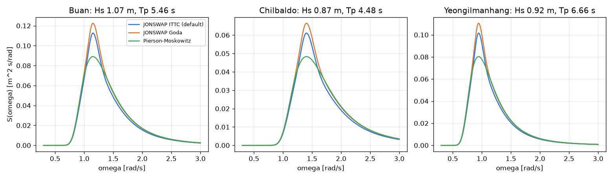

# 업데이트 보고서: 파랑 스펙트럼 기본값을 JONSWAP ITTC로, Pierson-Moskowitz 추가

- 날짜: 2026-10-23
- 범위: `src/physics/wave_spectrum.py`, `main.py`, `config.cfg`(기본 `WaveSpec=1`), `config_test.cfg`(주석), `tests/test_wave_spectrum.py`(신규), `tests/test_paper_check.py`, `README.md`, `docs/algorithms_and_problems.md`, `docs/architecture.md`, `docs/validation/README.md`

## 1. 개요

논문 재현 확인(`2026-10-23_06`)에서 코드의 JONSWAP Goda 형식은 적분한 유의파고가 입력보다 약 4% 커서 발전량이 약 8% 크게 나오고, ITTC 형식은 입력 Hs와 맞고 논문 수치와도 일치했다. 사용자 결정에 따라 기본 스펙트럼을 ITTC 형식으로 바꾸고 Pierson-Moskowitz(PM)를 추가했다.

## 2. 변경 내용

- `WaveSpec`: 1 JONSWAP ITTC(**기본**), 2 JONSWAP Goda(비교용으로 유지, 설명에 Hs 과대 명시), **3 Pierson-Moskowitz**(Hs·Tp로 쓴 Bretschneider 형식, S = 5/16·Hs²·ωp⁴·ω⁻⁵·exp(−1.25(ωp/ω)⁴), γ 무시; ITTC 형식에서 γ=1인 것과 같음).
- `check_wave_spec`, `WAVE_SPECTRA`, `DEFAULT_WAVE_SPEC`. `main.py`가 시작할 때 값을 검증하고(잘못되면 오류 후 종료), 시작 출력에 스펙트럼 이름을 표시한다. `WaveSpec`이 없으면 1.
- `config.cfg`의 `WaveSpec`을 2에서 **1**로 바꿨다.

*그림 1. 세 해역의 스펙트럼(γ=1.4). Goda 형식이 ITTC보다 전체적으로 약 8% 높다. PM은 봉우리가 낮고 넓다.*

## 3. 호환성 영향

- **기본 결과가 달라진다**: 같은 설계의 발전량이 이전 기본값(Goda)보다 약 8% 낮다(논문 수치와는 1% 이내로 맞음). 이전 로그·결과와 비교할 때 주의.
- 계산용 PC에서 돌고 있는 CMA-ES 작업(`20261023_190757_cmaes_sites2`)은 처음부터 ITTC로 설정되어 있어 영향 없음.
- `docs/validation`의 기준 CSV는 스펙트럼별 행을 모두 가지고 있어 그대로 쓴다.

## 4. 검증

- 테스트 7건: ITTC·PM은 세 해역에서 적분 Hs가 입력과 0.3% 이내, Goda는 약 4.1% 큼, PM = ITTC(γ=1), 봉우리가 ωp, ω=0에서 0, 값 검증, 프로젝트 기본값 1. 기존 `paper_check` 테스트는 설정된 스펙트럼을 따르도록 고쳤다.
- `ruff check .`, `ruff format --check .`, 전체 단위 테스트 통과.

## 5. 남은 이슈 / 후속 작업

- Goda 형식의 과대 원인(원 식의 근사 한계인지 옮긴 식의 문제인지)은 확인하지 않았다(사용하지 않으므로 비교용으로만 둠).
- PM은 완전 발달한 해를 가정해 γ가 없는 스펙트럼이다. 국내 연안(γ=1.4)에는 JONSWAP이 맞고, PM은 비교·민감도 분석용이다.
