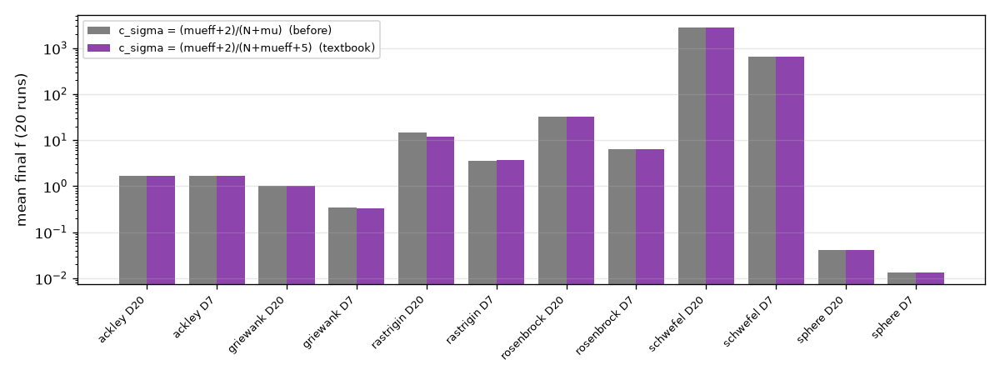

# 업데이트 보고서: 최적화 알고리즘 점검(교과서 형태와 비교)과 CMA-ES c_σ 수정

- 날짜: 2026-10-23
- 범위: `src/algorithms/cma_es.py`(c_σ 식), 점검 결과(다른 알고리즘은 코드 변경 없음)

## 1. 개요

사용자 요청으로 프로젝트의 최적화 알고리즘(DE, PSO, GA, CMA-ES, DEPSO)이 교과서 형태대로 구현되었는지 점검했다. 식이 틀린 곳은 CMA-ES의 보폭 학습률 c_σ 하나였고 고쳤다. 나머지는 의도된 변형이거나 선택의 문제라 목록으로 정리하고 고치지 않았다(논문 결과와의 일관성 때문에 사용자 판단 필요).

## 2. 변경 내용

- **CMA-ES c_σ**: `cs = (mueff + 2) / (N + mu)` → `(mueff + 2) / (N + mueff + 5)`(Hansen, "The CMA Evolution Strategy: A Tutorial", 2016). λ=72(μ=36, μ_eff≈19.3, N=7)에서 0.49 → 0.68, λ=9에서 0.42 → 0.32. `damps`는 c_σ를 쓰므로 함께 바뀐다. 나머지 상수(c_c, c_1, c_μ, damps, h_σ, 가중치)는 교과서와 같았다.

**점검 결과 (고치지 않은 것):**

| 알고리즘 | 교과서와 같은 점 | 다른 점 (영향) |
| --- | --- | --- |
| DE | DE/rand/1/bin, r1≠r2≠r3≠i, j_rand 교차, 탐욕 선택 | ① 같은 세대 안 즉시 교체(비동기 DE, 논문과 같음; `DEUpdate=1`로 동기식 선택 가능). ② 같은 값이면 교체하지 않음(`>`; Storn–Price는 같은 값도 받아들임) — 격자 위 평평한 곳에서 이동이 줄어듦. ③ 범위 밖 변이는 격자 스냅이 잘라 냄(투영) |
| PSO | 관성 가중치 gbest PSO, 속도 상한(범위 20%) | ① gbest 즉시 갱신(비동기). ② 범위 끝에서 위치만 잘리고 속도는 그대로(벽에 붙은 입자가 계속 밖으로 밀림; 보통은 속도를 0으로 하거나 반사). ③ 매 걸음 위치를 격자에 스냅 |
| GA | 크기 2 토너먼트, 균일 교차, 엘리트 1, 세대 교체 | ① 교차 확률 1(항상 교차). ② 돌연변이: 자식마다 확률 0.1로 일어나고, 일어나면 유전자마다 0.5 확률로 ±10% 범위 안의 격자 칸만큼 이동(0칸 포함) — 보통의 "유전자마다 돌연변이 확률"과 다른 방식(유효 유전자 확률 약 0.05) |
| CMA-ES | 표준 갱신식(위 수정 후), 양의 가중치만(고전형, active CMA 아님) | ① 샘플을 [0, 1]로 잘라 그 잘린 값으로 평균·공분산 갱신(수리 후 벌점 없음) — 최적점이 범위 끝(R=2.5, x=3)일 때 보폭 적응이 약간 왜곡될 수 있음. ② 초기 평균이 무작위(보통은 중앙). ③ 보폭 하한(격자 한 칸)·상한(1.0)·한 세대 변화량 상한(프로젝트 추가) |
| DEPSO | 논문(Lee 등, 2026)의 갱신 규칙 | 논문과 같음(pbest = 위치, c1 항 0) |

## 3. 호환성 영향

- CMA-ES 결과가 같은 난수에서도 달라질 수 있다(보폭 적응 속도가 다름).
- 계산용 PC에서 돌고 있는 CMA-ES 작업(`20261023_190757_cmaes_sites2`)은 수정 전 c_σ로 돌고 있다. 아래 벤치마크에서 차이가 없어 다시 시작하지 않았다.

## 4. 검증

- WEC 격자 벤치마크(함수 6개 × D 7·20, 평가 20,000회, 20회 반복): 수정 전후 12개 경우 모두 유의한 차이 없음(Mann–Whitney p ≥ 0.14). 평균은 Rastrigin D20 14.9 → 11.9, 나머지는 거의 같음.

*그림 1. CMA-ES(λ=72) 수정 전후의 평균 최종값.*

- 전체 단위 테스트, `ruff check .`, `ruff format --check .` 통과.

## 5. 남은 이슈 / 후속 작업

- 사용자 판단 후 고칠 수 있는 것: DE 같은 값 받아들이기, PSO 경계에서 속도 0, GA 돌연변이를 유전자별 확률로, CMA-ES 수리 벌점. 모두 논문 결과(DE)와의 연속성에 영향이 있으므로 옵션으로 넣는 것을 권한다.
