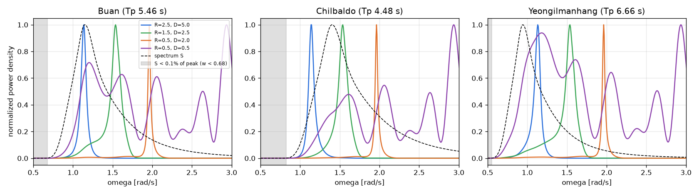

# 업데이트 보고서: 해역 스펙트럼에 맞춘 주파수 범위 줄이기 검토

- 날짜: 2026-10-23
- 범위: 검토만(코드 변경 없음). 계산: 주파수 격자 시험 덤프(`results/20261023_140955_fgrid_quick4/logs/dump_*_A_ref_uniform_0.00625.csv`, 설계 4개, 배치 A)로 이 PC에서 계산

## 1. 개요

사용자 제안: 대상 해역이 정해져 있으므로 스펙트럼 에너지가 거의 없는 주파수(특히 0에 가까운 낮은 쪽)는 WAMIT에서 빼고, 에너지가 있는 구간만 계산하자. WAMIT 실행 없이, 기존 덤프의 RAO와 `B_pto`로 해역별 ITTC 스펙트럼을 다시 곱해 발전 밀도를 만들고, 구간을 잘랐을 때 잃는 발전량을 계산했다.

## 2. 변경 내용

없음(검토). 기준: 스펙트럼이 최대값의 ε배 이상인 구간 [ω_lo, ω_hi]만 남김(ε = 1e-4, 1e-3, 1e-2).

**결과** (설계 4개 중 최대 손실, 현재 격자 0.5~3.0 rad/s, 51점 기준):

| 해역 (Tp) | ε | 남는 구간 | 아래쪽 손실 | 위쪽 손실 | 줄어드는 점 |
| --- | --- | --- | --- | --- | --- |
| 부안 (5.46 s) | 1e-3 | 0.68 ~ 5.5 | ≤ 0.0002% | 0 (위는 3.0이 먼저 자름) | 4 / 51 |
| 칠발도 (4.48 s) | 1e-3 | 0.82 ~ 6.0 | ≤ 0.0004% | 0 | 7 / 51 |
| 영일만항 (6.66 s) | 1e-3 | 0.55 ~ 4.51 | ≤ 0.0003% | 0 | 2 / 51 |
| 영일만항 | 1e-2 | 0.60 ~ 2.84 | ≤ 0.005% | **최대 25.7%** (R=0.5, D=0.5) | 6 / 51 |

*그림 1. 설계별 발전 밀도(최대값으로 정규화)와 스펙트럼(점선). 회색은 S < 최대값의 0.1%인 아래쪽 구간.*

**해석**
1. **아래쪽 자르기는 안전하다.** ε = 1e-3이면 손실이 모든 설계에서 0.0005% 미만이다. JONSWAP은 낮은 주파수에서 exp(−1.25(ωp/ω)⁴)로 아주 빨리 0이 되기 때문이다. 공진(비제어 RAO 피크, `B_pto`를 정하는 곳)은 이 설계 범위에서 약 1.1 rad/s 이상이라, 아래를 잘라도 `B_pto` 선택은 바뀌지 않는다.
2. **위쪽 자르기는 위험하다.** 스펙트럼 꼬리가 ω⁻⁵로 천천히 줄어 3.0 rad/s에서도 에너지가 남는다. 작은 부표(R=0.5, D=0.5)는 3 rad/s 근처에서 공진해(그림 보라색) 발전량의 상당 부분이 높은 주파수에서 나온다. 위를 자르면 발전량을 크게 잃고(영일만항 ε=1e-2에서 25.7%), 공진이 범위 밖으로 나가 `B_pto` 선택도 바뀐다. 현재도 이 설계는 3.0에서 잘리고 있다(`OmegaMax` 절단 경고 대상).
3. **절약 효과는 작고 해역마다 다르다.** 점 수가 4~14% 줄지만, WAMIT은 주파수를 NCPU개씩 묶어 계산하므로 실제 시간은 묶음 수가 줄 때만 준다. NCPU=8에서 51점은 7묶음이다. 부안 47점과 칠발도 44점은 6묶음이 되어 약 14% 빨라지고, 영일만항 49점은 7묶음 그대로라 거의 효과가 없다. `Workers`로 NCPU를 줄이면 묶음 효과는 더 작아진다.

## 3. 호환성 영향

없음.

## 4. 검증

- 계산 스크립트: 이 보고서용 임시 스크립트(덤프 → ITTC 스펙트럼으로 발전 밀도 재구성, Simpson 적분, 구간 밖 비율). 덤프는 한 배치(A)와 그 시험의 수심 조건의 RAO다. 낮은 쪽 결론은 스펙트럼이 사실상 0인 데서 나오므로 설계·수심이 달라도 같다.

## 5. 남은 이슈 / 후속 작업

- 권장: **아래쪽만** 해역 스펙트럼으로 자르는 옵션(예: `OmegaMinAuto`, ε = 1e-3, 0.05 격자에 맞춰 내림; 기본 끔)을 두고, 위쪽은 `OmegaMax`(3.0) 그대로 둔다. 시간 이득은 해역·NCPU에 따라 0~14%다.
- 위쪽은 오히려 작은 부표에서 3.0보다 높여야 할 수도 있다(`OmegaMax` 자동 확장, 설계안의 선택 옵션).
- 적응형 격자(`FreqGrid=1`)와 함께 쓰면 낮은 쪽 성긴 점 몇 개가 더 빠진다.
