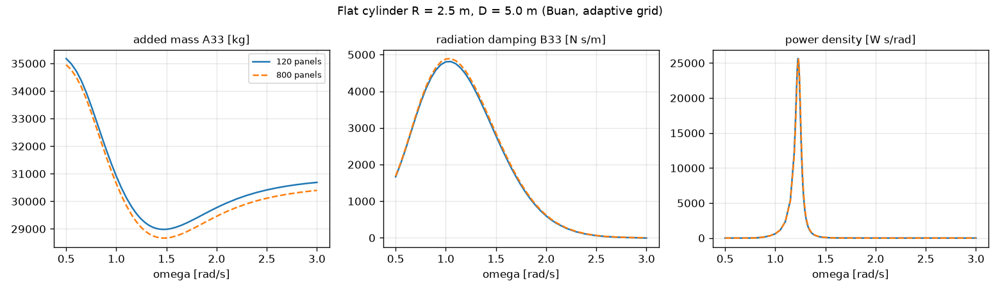

# 업데이트 보고서: 평평한 바닥 원통 1기 메쉬 시험(WAMIT)과 메쉬 개선

- 날짜: 2026-10-23
- 범위: `src/physics/mesh_axisymmetric_shape.py`(간격), `src/physics/wamit_handler.py`(`highest_heave_omega0`), `main.py`(경고), `scripts/experiments/shape_mesh_check.py`(신규), `tests/test_cylinder_shape.py`, `docs/manual_ko.md`
- 실행: **사용자 요청에 따라 이 PC의 WAMIT v7**(C:\WAMITv7, NCPU 8)으로 1기 시험. 평가 1회 약 0.5 s(120 패널) ~ 2 s(800 패널).

## 1. 개요

새로 추가한 평평한 바닥 원통(`Shape=2`, `2026-10-23_21`)을 WAMIT으로 처음 계산했다. 개방 해역(벽 없음)의 WEC 1기로 형상 5개와 패널 6~7단계를 계산해, 부피·복원력이 맞는지와 발전량이 패널 수에 따라 수렴하는지를 확인했다. 해역은 부안(Hs 1.07 m, Tp 5.46 s, 수심 50 m), 스펙트럼은 ITTC다(칠발도·영일만항도 같은 경향).

## 2. 변경 내용

- **메쉬 간격**: 옆면 행(z)과 바닥 둘레 층을 바닥 모서리 쪽으로 촘촘하게 바꿨다(사인 간격). 모서리 근처는 유동 변화가 크다. 시험에서 균일 간격 대비 120 패널 오차가 R=2.5·D=5.0에서 −3.1% → −2.4%(균일 주파수 격자, 800 패널 대비)로 줄었다. 패널 수와 위상(n, n_z)은 그대로다.
- **분할 선택 확인**: 약 120 패널에서 가능한 모든 (n, n_z)를 매우 촘촘한 기준(약 1,860 패널)과 비교했다. 현재 `choose_cylinder_grid`의 선택(R=2.5·D=5.0에서 n=4, n_z=11)은 가장 좋은 분할과 0.3%p 이내였다. 그래서 선택 규칙은 바꾸지 않았다.
- **시작 경고**: 탐색 범위에서 가장 작은 설계의 공진 주파수 어림(`highest_heave_omega0`; 원통 √(g/D_min), 원통 + 반구 √(g/(D_min + 2R_min/3)))이 주파수 상한보다 높으면 `main.py`가 경고하고 `OmegaMax` 값을 제안한다.
- **시험 스크립트** `shape_mesh_check.py`: 형상·설계·패널 수·해역·주파수 격자를 고르고, WAMIT 부피·복원력 대 정확값, 발전량, 최고 패널 대비 변화를 CSV로 쓴다(`--dump`로 주파수별 A33·B33·F3·RAO·발전 밀도).

## 3. 호환성 영향

- `Shape=2`의 메쉬가 바뀌었다(같은 패널 수, 간격만 다름). 형상 1은 그대로다.
- 시작할 때 경고가 새로 나올 수 있다(기본 설정에서도 R=0.5, D=0.5 형상의 공진 약 3.4 rad/s > 3.0).

## 4. 검증

**부피·복원력**: WAMIT 부피와 C33의 정확값 비는 120 패널 0.989~0.997, 800 패널 0.998~0.9996이다(다각형 근사, 패널이 늘면 1에 수렴).

**발전량 수렴** (800 패널 대비, %):

| 설계 (R, D) | 공진 어림 | 균일 격자 120 / 200 | 적응형 격자 120 / 200 |
| --- | --- | --- | --- |
| 2.5, 5.0 | 1.40 | −2.4 / −1.2 | **−0.7 / −0.4** |
| 1.5, 2.5 | 1.98 | −0.9 / −0.5 | **−0.7 / −0.4** |
| 0.5, 2.0 | 2.21 | +3.7 / +4.4 (흔들림) | **−1.0 / −0.4** |
| 2.5, 1.0 | 3.13 (상한 위) | −0.9 / −0.5 | −0.9 / −0.5 |
| 0.5, 0.5 | 4.43 (상한 위) | −1.2 / −0.7 | −1.2 / −0.7 |

*그림 1. 패널 수에 따른 발전량 변화. 왼쪽 균일 0.05 rad/s 격자, 오른쪽 적응형 격자. 회색 띠는 ±1%.*

- 적응형 격자에서는 모든 설계가 120 패널에서 약 1%, 200 패널에서 0.5% 이내로 매끄럽게 수렴한다. 이는 원통 + 반구(같은 총 흘수, 120 대 800: −0.5~−1.6%)와 비슷한 수준이다.
- 균일 격자의 흔들림(특히 R=0.5·D=2.0)은 메쉬가 아니라 **좁은 공진을 0.05 간격 격자가 놓치는 문제**다(`docs/frequency_grid_design.md`). 메쉬가 공진을 조금 옮기면 격자점과의 위치 관계가 바뀌어 값이 튄다. 이 설계는 균일 격자에서 발전량이 적응형보다 약 15% 크게 나온다.
- **공진이 격자 위에 있는 설계**(R=2.5·D=1.0, 공진 3.13 rad/s): 비제어 RAO 최대가 격자 끝(0.5 rad/s)에서 잡혀, PTO 감쇠가 공진이 아닌 곳에서 정해진다. 위 표의 값은 그 상태의 수렴만 보여 준다. 이 때문에 시작 경고를 넣었다.
- **같은 총 흘수에서 형상 비교**(적응형 격자, 800 패널): 평평한 바닥 원통이 원통 + 반구보다 발전량이 11~14% 컸다(총 흘수 5.0 m·R 2.5: 2.53 대 2.24 kW, 2.5 m·R 1.5: 0.66 대 0.59 kW, 2.0 m·R 0.5: 0.049 대 0.044 kW). 부피(질량)가 커서 공진이 낮아지고 해역 첨두(1.15 rad/s)에 가까워지기 때문으로 보인다(점성 효과 제외).

*그림 2. R=2.5·D=5.0의 A33, B33, 발전 밀도(120 대 800 패널). 매끄럽고 불규칙 주파수에 의한 튐이 보이지 않는다(3 rad/s까지).*

- 테스트 2건 추가(공진 어림 함수, 시험 스크립트 설정). 전체 단위 테스트, `ruff check .`, `ruff format --check .` 통과. 이 PC의 임시 작업 폴더(`C:\wec_mesh_check`)는 실행 후 지웠다.

## 5. 남은 이슈 / 후속 작업

- 5기 배열과 수직벽 조건의 메쉬 수렴은 계산용 PC에서 확인하는 것이 좋다(패널 수 × 5기의 32-bit 메모리 한계 포함).
- 공진이 격자 위에 있는 설계의 PTO 감쇠 선택 규칙(격자 끝 대신 공진 어림값에서 B33을 쓰는 방법 등)은 형상 1에도 해당하는 문제라 별도 검토가 필요하다.
- `OmegaMax`를 3.0 위로 올리면 불규칙 주파수(R=2.5에서 약 3.1 rad/s 이상)를 확인해야 한다.
