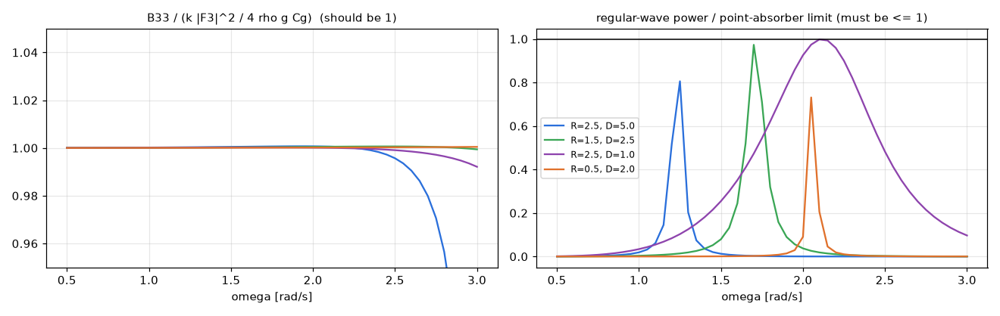

# 업데이트 보고서: 평평한 바닥 원통 검증 — 반해석해, Haskind 관계, 에너지 관계

- 날짜: 2026-10-23
- 범위: `scripts/experiments/cylinder_validation.py`(신규), `tests/test_cylinder_validation.py`(신규). `src/` 변경 없음.
- 실행: 사용자 요청에 따라 이 PC의 WAMIT v7(C:\WAMITv7)로 1기 계산(16회, 각 1~2 s). 임시 폴더 `C:\wec_cyl_check`는 실행 후 지움.

## 1. 개요

앞 보고서(`2026-10-23_22`)의 수렴 확인은 "답이 안정적"인지만 보여 준다. 이번에는 "답이 맞는지"를 세 가지 독립적인 방법으로 확인했다(사용자가 고른 1~3번).

1. **반해석해**: 평평한 바닥 원통의 heave 부가질량 A33·방사감쇠 B33을 고유함수 정합법(Yeung, 1981, *Applied Ocean Research* 3(3)의 방법)으로 직접 풀어 WAMIT과 비교했다.
2. **Haskind 관계**: 산란 문제로 구한 가진력(`wec.3`)과, 방사 포텐셜로 구한 가진력(Haskind, `wec.2`)이 같은지 비교했다.
3. **에너지 관계**: 축대칭 heave에서 B33 = k|X3|²/(4ρgC_g)(Newman, *Marine Hydrodynamics*)가 성립하는지 보았다. 또 규칙파 흡수 발전량이 point-absorber 한계 ρgC_g/(2k)(포획폭 1/k)를 넘지 않는지 확인했다.

## 2. 변경 내용

- **`cylinder_validation.py`**
  - `cylinder_heave_radiation(R, D, h, ω)` (반해석해)
    - 영역 I(물체 아래 r < a): 특수해 ((z+h)² − r²/2)/(2(h−d)) + cos(nπ(z+h)/(h−d)) 모드 (I0).
    - 영역 II(r > a): 진행파(Hankel H0) + 소멸파(K0) 모드.
    - r = a에서 포텐셜과 반경 방향 속도를 정합한다. 사영 적분은 모두 닫힌 식으로 계산한다.
    - 모드 수는 약 6h/min(a, d)로 자동 설정한다(40~800). 모서리를 풀기 위함이다.
  - `wamit_single`: 1기(벽 없음)로 WAMIT을 돌려 `wec.2`·`wec.3`을 모두 받는다.
  - 결과 CSV: 주파수별 A33·B33(WAMIT 대 반해석해), |F3|(산란 대 Haskind), 에너지 관계로 구한 B33, 규칙파 발전량과 한계. 요약 CSV에는 각 항목의 최대 오차를 담는다.
- **테스트 6건**: 분산 관계 근, 군속도 극한, 반해석해의 모드 수렴(400 모드 대비 0.5% 이내), 감쇠 > 0, 심해 극한(수심 50 대 100 m), WAMIT 800 패널 값과 1% 이내, 바닥에 닿는 원통 거부.

## 3. 호환성 영향

없음(시험 스크립트와 테스트).

## 4. 검증 (결과)

설계 4개(R, D) × 수심 2개(50 m, 13 m) × 패널 2개(120, 800), 주파수 0.5~3.0 rad/s(51점). 오차는 각 양의 최대값 대비 최대 차이(감쇠·가진력은 고주파에서 0에 가까워져 상대 오차가 의미 없기 때문)다.

| 설계 (R, D) | 패널 | A33 대 반해석해 | B33 대 반해석해 | Haskind 대 산란 | 에너지 관계 | 발전량 / 한계 (최대) |
| --- | --- | --- | --- | --- | --- | --- |
| 2.5, 5.0 | 120 / 800 | 1.5–1.8% / 0.35–0.7% | 2.1% / 0.4% | 0.8% / 0.12% | 0.35% / 0.03% | 0.76–0.83 |
| 1.5, 2.5 | 120 / 800 | 1.4–1.7% / 0.25–0.6% | 2.1–2.2% / 0.3–0.45% | 0.07% / 0.01% | 0.17% / 0.03% | 0.97–0.99 |
| 2.5, 1.0 | 120 / 800 | 1.6–1.7% / 0.3–0.4% | 1.9% / 0.3–0.4% | 0.33% / 0.10% | 1.1% / 0.31% | 0.998 |
| 0.5, 2.0 | 120 / 800 | 0.5–0.8% / 0.2–0.45% | 2.6–2.7% / 0.4–0.45% | 0.05% / 0.01% | 0.12% / 0.02% | 0.73–0.78 |

(범위는 수심 50 m와 13 m)

*그림 1. 위: R=2.5·D=5.0, 아래: R=0.5·D=2.0(수심 50 m). 왼쪽부터 A33, B33, |F3|. 점은 WAMIT(주황 120, 파랑 800 패널), 선은 반해석해(A33, B33)와 산란 가진력(800).*

*그림 2. 왼쪽: B33 / (k|F3|²/4ρgC_g), 1이어야 함. 오른쪽: 규칙파 흡수 발전량 / point-absorber 한계, 1 이하여야 함(800 패널, 수심 50 m).*

**해석**
1. **WAMIT 원통 결과는 독립적인 해석해와 맞는다.** 800 패널에서 A33·B33이 반해석해와 0.7% 이내다. 패널이 늘수록 오차가 줄어드는 방향도 맞다. 따라서 메쉬 방향(법선), 단위 변환(ρ, ρω, ρg), 형상 치수에 오류가 없다.
2. **120 패널**(기본값)에서는 A33·B33 오차가 약 1.5~2.7%다. 하지만 발전량 오차는 약 1% 이내다(앞 보고서). 오차가 일정한 방향으로 생겨 발전량에서 일부 상쇄되기 때문이다.
3. **Haskind와 산란 가진력**이 800 패널에서 0.12% 이내로 같다. 두 독립 계산이 일치하므로 메쉬 품질이 충분하다는 뜻이다.
4. **에너지 관계**(B33 ↔ |F3|)가 0.3% 이내로 성립한다. 흡수 발전량은 모든 주파수에서 이론 한계 이하다(최대 0.998).
5. **최대값 0.998(R=2.5·D=1.0)에 대해**: 이 설계는 공진(3.1 rad/s)이 격자 밖이라 PTO 감쇠가 0.5 rad/s의 B33으로 정해진다. 그 주파수 근처에서 PTO 감쇠가 방사감쇠와 같아져 한계에 거의 닿는다. 한계를 넘지는 않으므로 물리적으로는 맞다. 다만 이 경우 PTO 설정 규칙의 의도(공진에서 조정)와 다르다는 점은 앞 보고서와 같다.
6. 반해석해는 모드 수가 부족하면 가늘고 깊은 경우에 틀렸다. 처음 40 모드로 했을 때 R=0.5·D=2.0·수심 50 m에서 A33이 22% 틀렸다. 그래서 모드 수를 수심과 형상에 맞춰 자동으로 늘렸다(약 6h/min(a,d)). 이는 반해석해 쪽의 문제였고 WAMIT 결과와는 관계없다.

- 전체 단위 테스트, `ruff check .`, `ruff format --check .` 통과.

## 5. 남은 이슈 / 후속 작업

- 이 검증은 1기·개방 해역·heave 1자유도다. 5기 배열과 수직벽 조건은 WAMIT 수렴 확인(계산용 PC)이 남아 있다.
- 원통 + 반구 형상에는 같은 방식의 해석해가 없어(바닥이 곡면), 이번 반해석해 검증은 형상 2에만 해당한다. Haskind·에너지 관계 검사는 형상 1에도 쓸 수 있다.
- 바닥 모서리의 유동 박리(점성 감쇠)는 포텐셜 유동의 한계로 검증하지 않았다.
