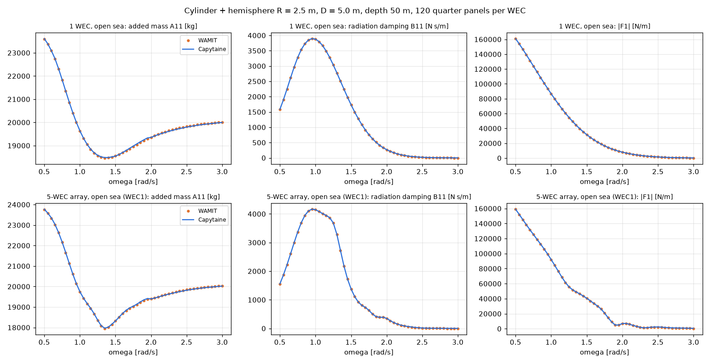

# 업데이트 보고서: 수력 해석기 분리와 Capytaine(개방 해역) 추가

- 날짜: 2026-10-23
- 범위: `src/physics/hydro.py`(신규), `src/physics/solvers.py`(신규), `src/physics/rao_calc.py`, `src/physics/wamit_handler.py`, `src/physics/mesh_axisymmetric_shape.py`, `src/problems/*.py`, `main.py`, `config.cfg`, `scripts/experiments/solver_compare.py`(신규), `tests/test_solvers.py`(신규), `README.md`, `docs/manual_ko.md`, `docs/architecture.md`
- 실행: 비교 계산은 이 PC에서 WAMIT v7과 Capytaine 3.0.0(py311 환경에 설치)으로 했다. 임시 폴더는 실행 후 지웠다.

## 1. 개요

오픈소스 해석기(Nemoh 계열)도 쓸 수 있도록, 사용자 계획에 따라 두 단계로 진행했다.
1. 계산 흐름에서 WAMIT을 분리했다.
2. Capytaine을 두 번째 해석기로 추가했다. 사용자 결정에 따라 Capytaine에는 수직벽을 넣지 않고 **개방 해역만** 계산한다(이미지법 벽은 이후 과제).

## 2. 변경 내용

- **`HydroData`** (`hydro.py`): 해석기가 돌려주는 공통 형식이다. 주파수, heave 부가질량·방사감쇠(n × N × N), 가진력(n × N, 복소수), 질량·복원 강성 행렬이 들어 있다. 시간 의존성은 WAMIT 기준 exp(+iωt)다.
- **`rao_calc.py`**: WAMIT 파일 읽기(`read_wamit_hydro`)와 RAO·PTO 계산(`rao_from_hydro`)을 나눴다. 계산 순서와 식은 그대로다. `calculate_rao_matrix(workspace, N)`는 두 함수를 이어 붙인 것으로 남아 기존 스크립트가 그대로 동작한다.
- **`solvers.py`**:
  - `solve_hydrodynamics(vector, config, positions, workspace)`가 `HydroSolver`에 따라 해석기를 고른다.
    - WAMIT: 입력 쓰기 → 실행 → `read_wamit_hydro`.
    - Capytaine: `capytaine_hydrodynamics`.
  - Capytaine 구현:
    - 이 프로젝트의 1/4 메쉬를 x·y 대칭으로 펼쳐 전체 메쉬로 만들고(WAMIT과 같은 패널), WEC마다 그 WEC 패널만 움직이는 heave 자유도를 정의한다.
    - `method="direct"`로 푼다. 처음 시험에서 `indirect`(기본)는 모서리가 있는 원통에서 감쇠가 2.5% 작았다.
    - 문제는 `NCPU`개 프로세스(`n_jobs`, 프로세스당 1 스레드)로 나눈다.
    - Capytaine은 exp(−iωt) 기준이라(`post_pro/impedance.py`에서 확인) 가진력을 켤레 복소수로 바꿨다.
    - 질량·수선면적은 WAMIT처럼 메쉬로 계산한다.
  - `check_solver_settings`: Capytaine을 수직벽과 함께 쓰려 하면 시작할 때 막고, Capytaine이 설치되지 않았으면 설치 방법을 알려 준다.
- **수직벽 스위치**: `[WEC Parameters] VerticalWall`(기본 1)을 추가했다. OptMode 2·3에서 1이면 지금처럼 x = 0 벽, 0이면 개방 해역이다. OptMode 1은 항상 개방 해역이다. WAMIT `IWALLX0`에 반영된다.
- **해석기 선택**: `[Simulation] HydroSolver`(기본 1 WAMIT, 2 Capytaine). 시작 출력에 해석기와 벽 여부를 표시한다.
- **문제 평가 함수**(형상·배치·동시): 모두 `solve_hydrodynamics` → `rao_from_hydro` → `calculate_power`로 계산한다.
- **`solver_compare.py`**: 같은 설계를 두 해석기로 계산해 계수·발전량·시간을 비교한다.

## 3. 호환성 영향

- 기본값(`HydroSolver` 1, `VerticalWall` 1)에서는 WAMIT 입력·결과가 이전과 같다.
  - 분리 전 계산 순서를 그대로 옮긴 참조 구현과 RAO·PTO 감쇠가 **비트 단위로 같음**을 테스트로 확인했다.
  - WAMIT 입력 파일 테스트도 모두 그대로 통과한다.
- Capytaine은 선택 의존성이다(`pip install capytaine`). `requirements.txt`에는 넣지 않았고, CI에서는 관련 테스트를 건너뛴다.

## 4. 검증

**WAMIT 대 Capytaine** (같은 메쉬, 1/4 모델 120 패널/기, 수심 50 m, 개방 해역, 주파수 51개, 부안 스펙트럼):

| 경우 | 형상 (R, D) | A 최대 차 | B 최대 차 | F 최대 차(위상 포함) | 발전량 차 (총 / WEC별 최대) | 시간 WAMIT / Capytaine |
| --- | --- | --- | --- | --- | --- | --- |
| 1기 | 1 (2.5, 5.0) | 0.18% | 0.11% | 0.13% | +0.28% | 0.5 / 10.8 s |
| 1기 | 1 (1.0, 2.0) | 0.06% | 0.09% | 0.12% | +0.43% | 0.5 / 4.7 s |
| 1기 | 2 (2.5, 5.0) | 0.15% | 0.18% | 0.14% | +0.31% | 0.5 / 10.8 s |
| 5기 | 1 (2.5, 5.0) | 0.19% | 0.09% | 0.21% | +0.01% / 0.72% | 7.6 / 103 s |
| 5기 | 1 (1.0, 2.0) | 0.07% | 0.12% | 0.12% | +0.40% / 0.93% | 8.4 / 103 s |
| 5기 | 2 (2.5, 5.0) | 0.15% | 0.19% | 0.21% | +0.09% / 0.74% | 9.4 / 103 s |

(계수 차이는 각 양의 최대값 대비. 5기 배치: WEC1 (10, 0), WEC2 쌍 (10, ±12), WEC3 쌍 (16, ±26))

*그림 1. 위: 1기, 아래: 5기 배열의 WEC1. 부가질량, 방사감쇠, 가진력 크기.*

- 두 해석기가 계수 0.2%, 발전량 0.5% 이내로 같다(5기 WEC별 1% 이내). 배열의 상호작용(그림 아래)까지 맞으므로 메쉬 펼치기, 자유도, 시간 규약(켤레 변환) 모두 맞다.
- **속도**: Capytaine 5기 평가는 8 프로세스로 약 100초다(WAMIT 약 8초의 13배). 프로세스 수를 바꿔 보면 4개 125 s, 8개 103 s, 16개 86 s다. 1기도 약 5~11초로 프로세스 시작 비용이 크다.
- **테스트 10건**
  - 분리 전 계산과 비트 단위 동일.
  - WAMIT backend가 실행 후 파일을 읽음(모의 실행).
  - 벽 스위치가 `IWALLX0`에 반영됨.
  - 벽 여부 판정, 해석기 값 검증과 Capytaine + 벽 거부, 프로젝트 기본값.
  - 펼친 메쉬의 부피·수선면적·법선, 주파수 목록.
  - Capytaine 1기 에너지 관계 B = k|F|²/(4ρgC_g)가 3% 이내(시간 규약 확인), 2기 상호성 A12 = A21, 벽 거부.
- 전체 단위 테스트 245건(skip 3), `ruff check .`, `ruff format --check .` 통과.

## 5. 남은 이슈 / 후속 작업

- **Capytaine 속도 개선**:
  - 같은 주파수의 문제를 한 프로세스에 묶어 행렬을 다시 만들지 않기.
  - 대칭 메쉬(`ReflectionSymmetricMesh`) 쓰기.
  - `Workers`와 조합하기.
- **수직벽(이미지법)**: 거울상 WEC를 더하고 대칭 자유도를 쓰는 방식으로 이후에 추가한다. WAMIT `IWALLX0` 결과와 비교해 검증한다.
- Capytaine의 불규칙 주파수 제거(`lid_mesh`)는 쓰지 않았다(현재 상한 3.0 rad/s 안에서는 문제 없음).
- Nemoh(Fortran)는 Capytaine이 같은 계열이라 따로 연결하지 않았다.
