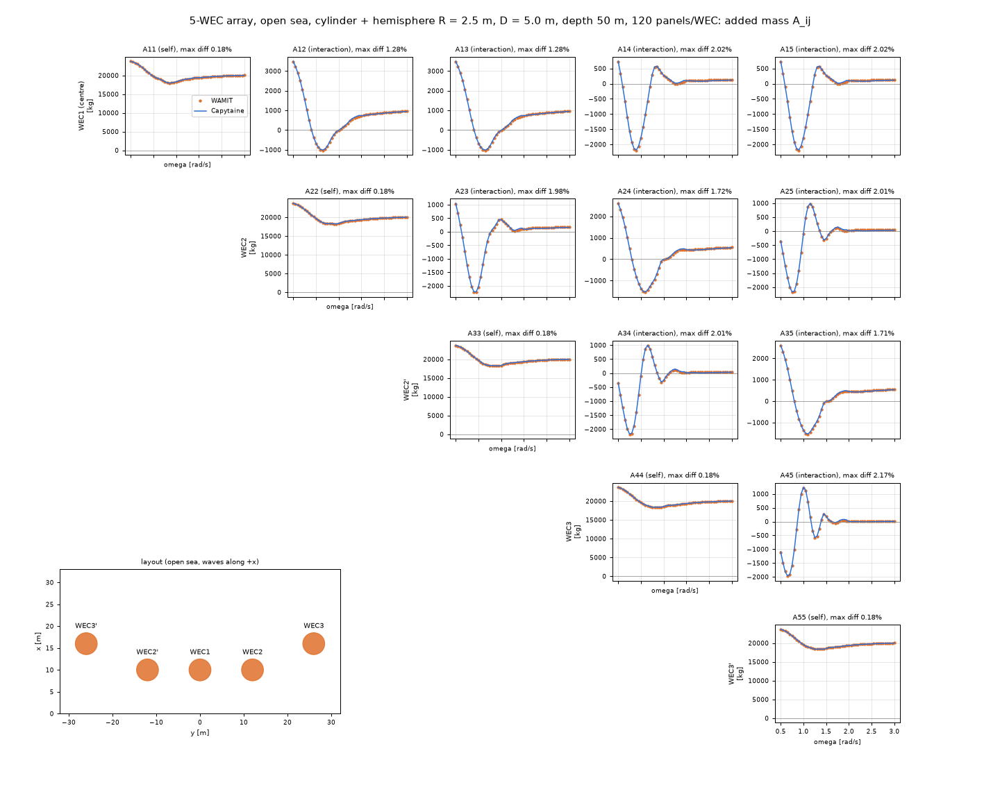
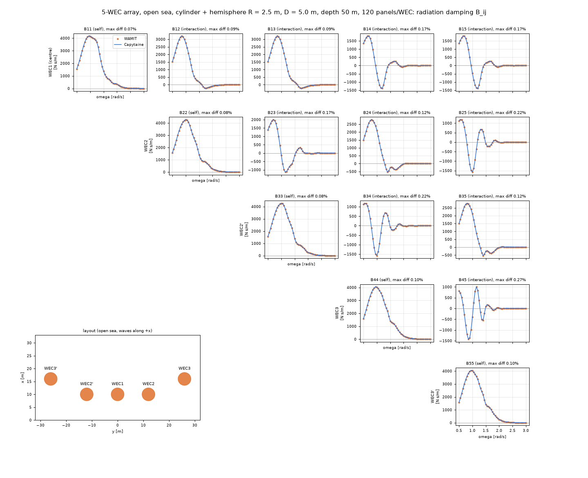
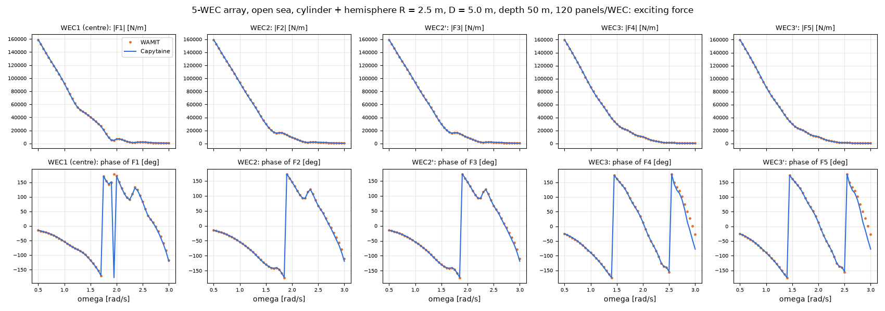
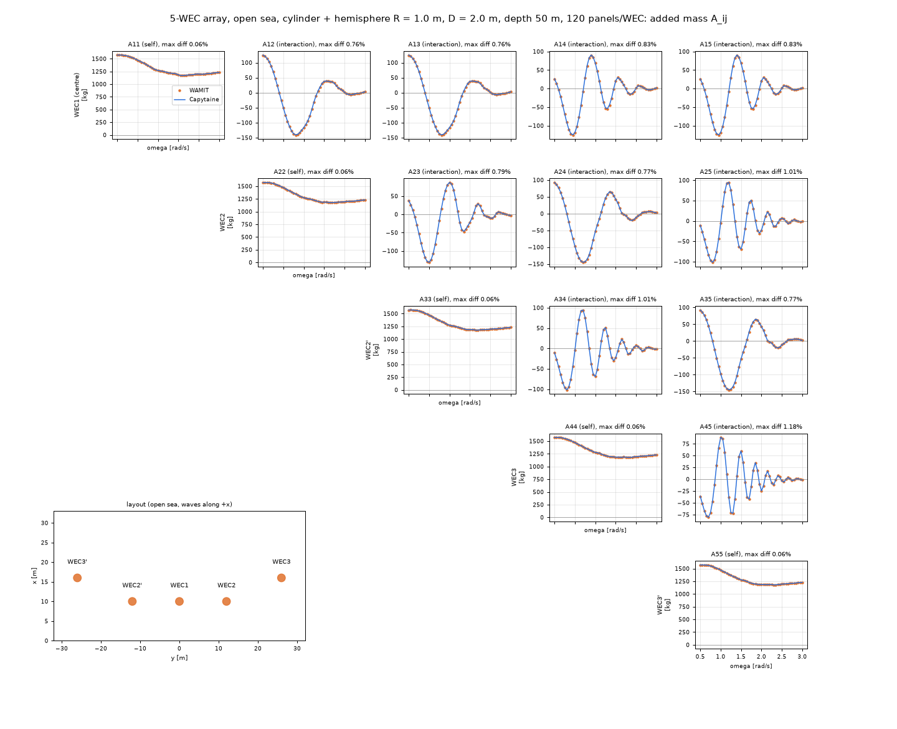
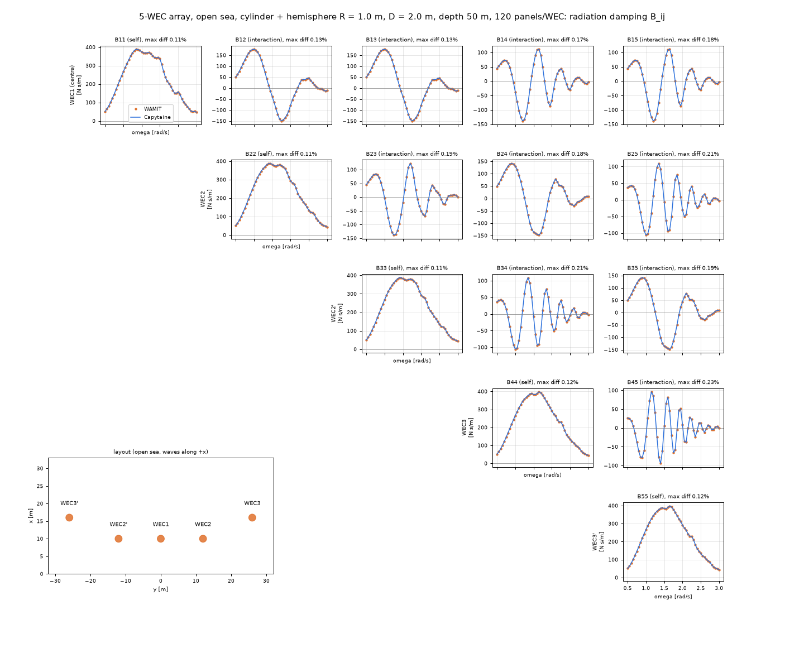
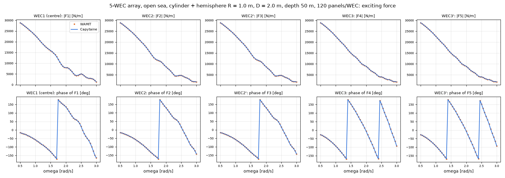

# 업데이트 보고서: 5기 배열 상호작용 항 비교 (WAMIT 대 Capytaine)

- 날짜: 2026-10-24
- 범위: `scripts/experiments/solver_compare.py`(전체 행렬 `.npz` 저장 추가), 그림 6장
- 실행: 이 PC에서 WAMIT v7과 Capytaine 3.0.0으로 다시 계산했다. 임시 폴더는 실행 후 지웠다.

## 1. 개요

[보고서 24](2026-10-23_24_solver-split-capytaine.md)에서는 5기 배열을 WEC1의 대각 항(A11, B11, F1)으로만 비교했다. 배열 계산에서는 WEC 사이의 상호작용(비대각 A_ij, B_ij)과 WEC마다 다른 가진력도 맞아야 한다. 그래서 heave 행렬 전체와 5기의 가진력을 두 해석기로 비교해 그림으로 정리했다.

## 2. 변경 내용

- **`solver_compare.py`**: 경우마다 `solver_compare_<case>_<R>_<D>.npz`를 추가로 저장한다.
  - 내용: `omegas`, `positions`, `wamit_A/B/F`, `capytaine_A/B/F`.
  - A·B는 (주파수 × N × N), F는 (주파수 × N) 복소수이고 WAMIT 시간 규약을 따른다.
  - 기존 CSV 출력은 그대로다.
- **그림** (`docs/reports/images/2026-10-24_01_*`):
  - A·B 행렬: 위 삼각 5 × 5 격자. 대각은 자기 항, 나머지는 상호작용 항이다. 칸 제목의 "max diff"는 그 항의 최대 절대값 대비 최대 차이다. 왼쪽 아래에 배치도가 있다.
  - F: WEC별 |F|와 위상.

## 3. 호환성 영향

- 해석 코드와 WAMIT 입력은 바뀌지 않았다. 실험 스크립트가 파일을 하나 더 쓸 뿐이다.

## 4. 검증

**조건**: Shape 1(원통 + 반구), 1/4 모델 120 패널/기, 수심 50 m, 개방 해역, 주파수 0.5~3.0 rad/s 51개. 배치는 WEC1 (10, 0), WEC2·2' (10, ±12), WEC3·3' (16, ±26)이고 파는 +x 방향이다.

| 설계 (R, D) | 자기 항 A / B | 상호작용 A (각 항 최대값 대비) | 상호작용 A (자기 항 최대값 대비) | 상호작용 B (각 항 최대값 대비) | F (복소 차, WEC별) | F 위상 (|F| > 최대의 5%) |
| --- | --- | --- | --- | --- | --- | --- |
| (2.5, 5.0) | 0.18% / 0.07~0.10% | 1.28~2.17% | 0.19% | 0.09~0.27% | 0.20~0.21% | 1.6° 이내 |
| (1.0, 2.0) | 0.06% / 0.11~0.12% | 0.76~1.18% | 0.07% | 0.13~0.23% | 0.12% | 0.5° 이내 |

*그림 1. 부가질량 A_ij, R = 2.5 m, D = 5.0 m. 점: WAMIT, 선: Capytaine.*

*그림 2. 방사감쇠 B_ij, R = 2.5 m, D = 5.0 m.*

*그림 3. WEC별 가진력 크기와 위상, R = 2.5 m, D = 5.0 m.*

*그림 4. 부가질량 A_ij, R = 1.0 m, D = 2.0 m.*

*그림 5. 방사감쇠 B_ij, R = 1.0 m, D = 2.0 m.*

*그림 6. WEC별 가진력 크기와 위상, R = 1.0 m, D = 2.0 m.*

**해석**

- 모든 상호작용 항이 주파수에 따른 진동 모양(부호 변화와 위치)까지 겹친다. 그래서 WEC 사이의 거리와 위상 관계가 두 해석기에서 같다.
- 상호작용 A는 각 항 기준으로 1~2%로 다른 항보다 차이가 크다.
  - 상호작용 A 자체가 자기 항의 9~15% 크기로 작다. 그래서 자기 항 최대값 기준으로는 0.07~0.19%에 불과하다.
  - 발전량 차이(보고서 24: 총 0.4% 이내, WEC별 1% 이내)와도 맞는다.
- 상호작용 B는 자기 항의 45~75% 크기로 크지만 차이는 0.3% 이내다.
- F 위상: R2.5 설계에서 2.7~3.0 rad/s의 WEC3·3' 위상이 최대 51° 벌어진다.
  - 그 주파수에서 |F|는 최대값의 0.2% 정도로 거의 0이다. 그래서 위상이 수치 오차에 민감하다.
  - 복소 차이는 WEC별 0.21% 이내다. 스펙트럼 에너지도 거의 없는 구간이라 발전량에는 영향이 없다.

**검사**: `ruff check .`, `ruff format --check .`, 전체 단위 테스트 241건(skip 3) 통과. 이 스크립트는 WAMIT과 Capytaine이 모두 필요하므로 단위 테스트는 추가하지 않았다(바뀐 부분은 결과 저장뿐).

## 5. 남은 이슈 / 후속 작업

- 벽이 있는 경우(이미지법)의 상호작용 비교는 Capytaine 벽 구현 후에 한다.
- 그림을 그린 스크립트는 저장소에 넣지 않았다. `.npz`만 있으면 matplotlib으로 바로 그릴 수 있다.
