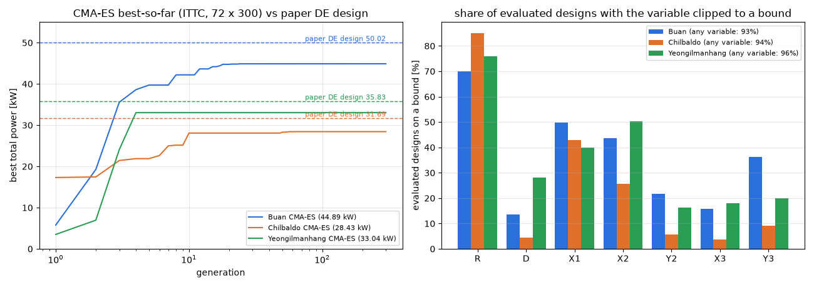

# 업데이트 보고서: CMA-ES 세 해역 동시최적화 결과

- 날짜: 2026-10-24
- 범위: 결과 분석만 (코드 변경 없음). 계산용 PC 작업 `20261023_190757_cmaes_sites2`(`results/`에 가져옴, gitignore)
- 그림: `docs/reports/images/2026-10-24_02_cmaes_sites.png`. 데이터는 위 작업의 `logs/*_generation_history.csv`, `*_trial_history.csv`

## 1. 개요

[보고서 13](2026-10-23_13_cmaes-minstd-and-rerun.md)에서 보낸 CMA-ES 동시최적화(부안, 칠발도, 영일만항 13 m)가 끝났다. 논문 DE 최적해를 현재 프로세스로 다시 계산한 값과 비교하고, 수렴 과정을 분석했다.

- 설정: 개체 72, 세대 300, σ0 = 0.3, ITTC 스펙트럼, 메쉬 120, 보폭 상한(`MAX_SIGMA` 1.0), `min_std_factor` 0.
- 걸린 시간: 부안 4.6 h, 칠발도 8.7 h, 영일만항 4.8 h.

## 2. 변경 내용

코드 변경은 없다. 결과와 분석만 기록한다.

| 해역 | CMA-ES [kW] | 최적 벡터 [R, D, X1, X2, Y2, X3, Y3] | 논문 DE 설계(현재 프로세스) [kW] | 차이 | 마지막 개선 세대 | 캐시 적중 |
| --- | --- | --- | --- | --- | --- | --- |
| 부안 | 44.89 | [2.5, 4.6, 3.0, 3.0, 29.2, 22.0, 30.0] | 50.02 | −10.3% | 35 | 89% |
| 칠발도 | 28.43 | [2.5, 2.0, 3.0, 3.0, 24.4, 13.0, 24.9] | 31.69 | −10.3% | 66 | 78% |
| 영일만항 | 33.04 | [2.5, 5.0, 3.0, 3.0, 14.7, 25.0, 30.0] | 35.83* | −7.8% | 4 | 89% |

\* 영일만항 논문 설계는 수심 33 m에서 최적화된 것을 13 m로 다시 계산한 값이다. 13 m 최적값은 이보다 크거나 같으므로, CMA-ES가 모자란 정도는 7.8% 이상이다.

논문 DE 설계(이 저장소 벡터 순서)는 다음과 같다. 다섯 기가 모두 벽 가까이(x = 3) 한 줄로 선다.
- 부안: [2.5, 3.8, 3, 3, 13.9, 3, 30]
- 칠발도: [2.5, 2.4, 3, 3, 10.8, 3, 23.5]

CMA-ES는 바깥 쌍(WEC3)을 벽에서 13~25 m 떨어진 곳에 둔 다른 골짜기에 머물렀다.

*그림 1. 왼쪽: 세대별 최고값(로그 축)과 논문 DE 설계 값(점선). 오른쪽: 평가한 설계 중 변수가 경계에 붙은 비율.*

## 3. 호환성 영향

없음.

## 4. 검증 (분석)

**조기 정체**: 세 해역 모두 4~66세대에 최고값이 멈췄고, 이후 200세대 이상 개선이 없었다. 캐시 적중이 78~89%다. 이는 개체들이 격자 위 같은 점으로 모였다는 뜻이다(σ가 격자 한 칸까지 줄어듦).

**원인: 경계 잘라내기(clipping)가 분포 학습에 그대로 들어감**
- `cma_es.py`는 샘플을 [0, 1]로 자른 뒤 그 **잘린 점**(`arx`)으로 평균·진화 경로·공분산을 갱신한다.
- 이 문제의 좋은 해는 경계에 있다(R = 2.5 최대, x = 3 최소). 그래서 평가한 설계의 93~96%가 적어도 한 변수가 경계에 붙어 있었다. R은 70~85%, X1·X2는 26~50%다.
- 경계에 붙은 좌표는 상위 개체들 사이에서 분산이 0이 된다. 그러면 공분산이 그 방향으로 무너지고, 진화 경로 길이가 줄어 σ도 작아진다. 이후에는 남은 방향으로도 탐색이 거의 일어나지 않는다.
- 표준 CMA-ES의 권장 방식은 다르다(Hansen 튜토리얼, pycma). **평가는 고친 점으로 하되, 갱신에는 원래 샘플을 쓰고 경계 밖 거리만큼 벌점**을 주거나(BoundPenalty), 변환으로 경계를 처리한다(BoundTransform).

**결론**: 지금 구현의 CMA-ES는 이 문제(해가 경계에 있는 혼합 문제)에서 DE보다 7.8~10.3% 이상 낮은 해에 일찍 수렴한다. 하이퍼파라미터보다는 경계 처리 방식의 문제로 본다.

## 5. 남은 이슈 / 후속 작업

- CMA-ES 경계 처리 수정 후보 (사용자 확인 후 진행):
  1. 갱신에 자르기 전 샘플을 쓰고 경계 밖 거리에 이차 벌점을 준다(BoundPenalty).
  2. 반사(mirror) 또는 pycma식 BoundTransform을 쓴다.
- 경계에 최적해가 있는 벤치마크(WAMIT 불필요)로 수정 전후를 비교한 뒤 세 해역을 다시 계산한다.
- 영일만항 13 m의 DE 기준값이 없다. DE로 한 번 계산해 두면 공정한 비교 기준이 된다.
