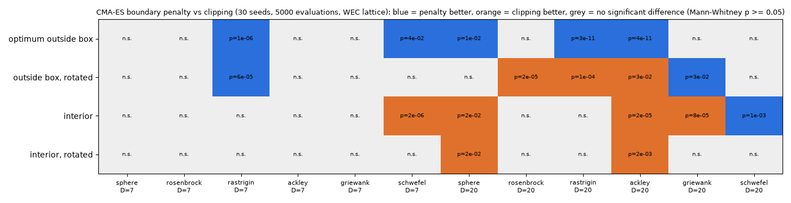

# 업데이트 보고서: CMA-ES 경계 처리를 표준 벌점 방식으로 변경

- 날짜: 2026-10-24
- 범위: `src/algorithms/cma_es.py`, `scripts/experiments/algorithm_benchmark.py`, `tests/test_cma_es_boundary.py`(신규), `tests/test_algorithm_benchmark.py`, `docs/algorithms_and_problems.md`
- 그림: `docs/reports/images/2026-10-24_03_cmaes_bound_penalty.png`. 이 PC에서 아래 4개 명령으로 계산했고(약 15분), 결과 표는 각 `--out` 폴더의 `algorithm_final.csv`다. 그림과 유의성 검정은 그 표로 따로 그렸다(스크립트는 저장소에 넣지 않음).

## 1. 개요

[보고서 02](2026-10-24_02_cmaes-sites-result.md)에서 CMA-ES가 세 해역 모두 일찍 정체했다. 원인 후보로 경계 처리를 지목했다. 그때까지는 샘플을 [0, 1]로 자른 뒤, **잘린 점으로** 분포를 갱신했다.

사용자 요청에 따라 표준 방식으로 바꿨다.
- 평가는 고친 점에서 하고, 분포 갱신에는 원래 샘플을 쓴다.
- 경계 밖으로 나간 거리만큼 벌점을 준다.

바꾼 뒤 벤치마크로 전후를 비교했다.

## 2. 변경 내용

- **`BoundPenalty`** (`cma_es.py`)
  - Hansen et al. (2009, IEEE TEC 13(1))의 경계 벌점을 pycma 4.4 `BoundPenalty`의 갱신 규칙 그대로 구현했다(pycma 소스와 대조).
  - 순위: `f(x_feas) − Σ γ_i (x_i − x_feas,i)² / N` (최대화 문제).
  - γ 초기값: 평균이 처음 범위를 벗어날 때와 2세대째에 2·dfit로 정한다.
    - dfit는 최근 20 + 3N/λ 세대의 값 중앙값이다.
    - 각 세대 값은 적합도 IQR을 mean(σ²C_ii)로 나눈 것이다.
  - γ 갱신:
    - 평균이 3·max(1, √N/μ_eff) 표준편차보다 더 벗어나면 키운다.
    - 5·dfit보다 크면 줄인다.
  - 적합도가 무한대인 샘플은 IQR 계산에서 뺀다.
- **`run_cma_es(..., boundary="penalty")`**
  - 기본은 새 방식이고, `"clip"`은 이전 방식이다(비교용).
  - 평균·진화 경로·공분산 갱신에 고치기 전 샘플을 쓴다.
  - 기록되는 최적해와 적합도는 벌점이 없는 실제 평가값이다.
- **처음 구현의 실패 (고친 것)**
  - 처음에는 2009 논문 서술대로 만들었다.
    - γ는 처음 한 번 정한 뒤 키우기만 했다.
    - 좌표 척도 ξ_i를 쓰고, N으로 나누지 않았다.
  - 그 결과 초기 IQR로 정한 γ가 너무 커서, 평균이 경계에서 떨어진 채 머물렀다.
  - 그래서 경계 밖 최적해 sphere D=20에서 clip보다 크게 나빴다(regret 중앙값 0.70 대 0.002).
  - pycma 4.x 규칙(정규화된 dfit, γ 감소, /N)으로 바꾸자 0.0으로 좋아졌다.
- **벤치마크** (`algorithm_benchmark.py`)
  - `cmaes_clip`(이전 방식)을 추가했다.
  - `--bounded` 옵션을 추가했다. 최소점을 변수 2/3에서 상자 밖(범위의 10%)으로 옮긴다: k%3 = 0은 위쪽, 1은 아래쪽.
    - 그러면 가능한 최선점이 경계에 놓인다. WEC 문제의 R 최대, x 최소와 같은 상황이다.
    - 보고 값은 regret이다. 같은 함수·차원에서 어느 실행이든 찾은 최선값과의 차이다.
- **테스트 9건 추가**
  - 벌점 계산, γ 초기화·증감, 무한 적합도 무시.
  - 경계 밖 최적해에서 경계점에 도달하는지.
  - 회전된 경계 최적 문제를 푸는지.
  - 재현성, 잘못된 모드 거부.
  - 벤치마크 `--bounded`.

## 3. 호환성 영향

- CMA-ES(`Algorithm` 4)의 탐색 경로가 바뀐다. 같은 시드라도 이전과 결과가 다르다. 설정 파일은 바뀌지 않았다.
- 이전 동작은 코드에서 `boundary="clip"`으로 쓸 수 있다(설정 파일 옵션은 만들지 않음).
- WAMIT 입력, 다른 알고리즘, 로그 형식은 그대로다.

## 4. 검증

**벤치마크 조건**
- 함수 6개, 차원 7(WEC 문제와 같음)과 20.
- WEC 격자(`--grid 0`), 시드 30개, 평가 5000회.
- 네 가지 경우: 상자 밖 최소점 / 그 회전판 / 내부 최소점 / 그 회전판.

```cmd
python scripts\experiments\algorithm_benchmark.py --algorithms cmaes cmaes_clip de --grid 0 --dims 7 20 --seeds 30 --budget 5000 --bounded --plot
python scripts\experiments\algorithm_benchmark.py --algorithms cmaes cmaes_clip de --grid 0 --dims 7 20 --seeds 30 --budget 5000 --bounded --rotate --plot
python scripts\experiments\algorithm_benchmark.py --algorithms cmaes cmaes_clip de --grid 0 --dims 7 20 --seeds 30 --budget 5000 --plot
python scripts\experiments\algorithm_benchmark.py --algorithms cmaes cmaes_clip de --grid 0 --dims 7 20 --seeds 30 --budget 5000 --rotate --plot
```



*그림 1. 새 방식(벌점)과 이전 방식(잘라내기)의 최종값 비교. 파랑은 벌점이 유의하게 좋음, 주황은 잘라내기가 유의하게 좋음, 회색은 차이 없음(Mann-Whitney p ≥ 0.05).*

| 경우 | D=7: 벌점 좋음 / 잘라내기 좋음 / 차이 없음 | D=20 |
| --- | --- | --- |
| 상자 밖 최소점 | 2 / 0 / 4 | 3 / 0 / 3 |
| 상자 밖, 회전 | 1 / 0 / 5 | 1 / 3 / 2 |
| 내부 최소점 | 0 / 1 / 5 | 1 / 3 / 2 |
| 내부, 회전 | 0 / 0 / 6 | 0 / 2 / 4 |

주요 중앙값 (regret, 작을수록 좋음):

| 경우 | 벌점 | 잘라내기 | DE |
| --- | --- | --- | --- |
| 상자 밖 rastrigin D=7 | 0.0 | 1.06 | 0.43 |
| 상자 밖 회전 rastrigin D=7 | 0.0 | 5.30 | 15.0 |
| 상자 밖 schwefel D=7 | 277 | 586 | 485 |
| 상자 밖 rastrigin D=20 | 5.0 | 48.5 | 108 |
| 상자 밖 회전 rastrigin D=20 | 50.4 | 28.4 | 133 |
| 상자 밖 회전 rosenbrock D=20 | 422 | 165 | 31700 |
| 내부 schwefel D=7 | 961 | 621 | 1062 |

**해석**
- **WEC 문제와 같은 7차원**에서는 경계 밖 최적해 문제 12개 중 3개에서 벌점이 유의하게 좋고, 나빠진 것은 없다. 내부 최적해 12개 중 나빠진 것은 1개(schwefel)다.
- **20차원 회전 문제**에서는 잘라내기가 더 좋은 경우가 있다. 따라서 "잘라내기가 언제나 정체를 일으킨다"는 보고서 02의 추정은 벤치마크로는 일부만 맞다. 벌점 방식이 7차원 경계 최적 문제에서 같거나 더 낫다는 정도로 정리한다.
- WEC 문제에서 실제로 정체가 풀리는지는 WAMIT 계산으로만 확인할 수 있다(아래 후속 작업).

**검사**: `ruff check .`, `ruff format --check .`, 전체 단위 테스트 250건(skip 3) 통과.

## 5. 남은 이슈 / 후속 작업

- **WEC 재계산**: 계산용 PC에서 새 CMA-ES로 세 해역(또는 부안 먼저)을 다시 돌려 보고서 02의 결과(부안 44.89 kW 등)와 비교해야 한다. 사용자 확인 후 제출한다.
- **간격 제약 벌점과의 상호작용**: WEC 문제에서 최소 간격 위반은 큰 음수 적합도(약 −6×10⁶)를 받는다. 한 세대에 위반이 25%를 넘으면 IQR이 커져 γ가 커진다. pycma도 같은 방식이지만, 정체가 계속되면 IQR을 위반하지 않은 샘플로만 계산하는 방안을 검토한다.
- 보고서 02에서 본 다른 정체 요인도 남아 있다. 격자 하한에 묶인 σ에서 R(격자 한 칸 0.05)이 움직이지 않는 문제로, `min_std_factor`(기본 0)로 다룰 수 있다.
