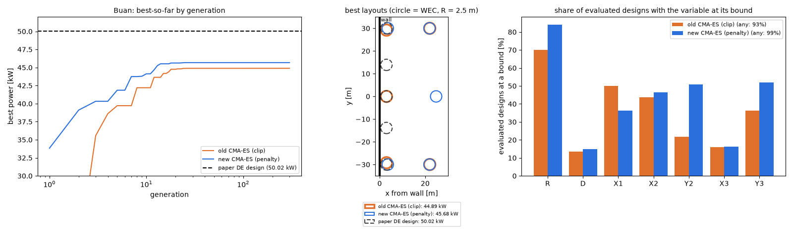

# 업데이트 보고서: 새 CMA-ES(경계 벌점)로 부안 재계산 결과

- 날짜: 2026-10-24
- 범위: 결과 분석만 (코드 변경 없음). 계산용 PC 작업 `20261024_170039_cmaes_buan_penalty`(커밋 9590a48, `results/`에 가져옴, gitignore). 비교 대상은 이전 작업 `20261023_190757_cmaes_sites2`의 부안 실행이다.
- 그림: `docs/reports/images/2026-10-24_04_cmaes_buan_rerun.png`. 데이터는 두 작업의 `logs/Buan_cmaes_*_generation_history.csv`, `*_trial_history.csv`. 그림은 분석용 스크립트로 따로 그렸다(저장소에 넣지 않음).

## 1. 개요

[보고서 03](2026-10-24_03_cmaes-bound-penalty.md)에서 CMA-ES의 경계 처리를 표준 벌점 방식(`BoundPenalty`)으로 바꿨다. 벤치마크로는 일부만 확인되었으므로, 실제 WEC 문제에서 [보고서 02](2026-10-24_02_cmaes-sites-result.md)의 조기 정체가 풀리는지 부안에서 다시 계산했다.

- 설정은 이전과 같다: 5기, 동시최적화(OptMode 3), 개체 72, 세대 300, σ0 = 0.3, ITTC 스펙트럼, 메쉬 120, 최소 간격 `MinSpacing` 4(WEC 중심 사이 4R, R = 2.5 m이면 10 m).
- 걸린 시간: 5.19 h (이전 4.6 h).

## 2. 변경 내용

코드 변경은 없다. 결과와 분석만 기록한다.

| | 이전 CMA-ES (잘라내기) | 새 CMA-ES (벌점) | 논문 DE 설계(현재 프로세스) |
| --- | --- | --- | --- |
| 출력 [kW] | 44.89 | **45.68** | 50.02 |
| 논문 설계 대비 | −10.3% | **−8.7%** | — |
| 최적 벡터 [R, D, X1, X2, Y2, X3, Y3] | [2.5, 4.6, 3.0, 3.0, 29.2, 22.0, 30.0] | [2.5, 4.8, 24.8, 3.6, 30.0, 21.9, 30.0] | [2.5, 3.8, 3, 3, 13.9, 3, 30] |
| WEC별 출력 [kW] (1, 2·3, 4·5) | 11.11, 9.85, 7.04 | 13.02, 6.35, 9.98 | — |
| 마지막 개선 세대 | 35 | 35 | — |
| WAMIT 계산 / 간격 위반 / 캐시 적중 | 2129 / 268 / 19203 (89%) | 2385 / 63 / 19152 (89%) | — |
| 경계에 붙은 변수가 있는 평가 설계 | 93% | 99% | — |

*그림 1. 왼쪽: 세대별 최고값(로그 축)과 논문 DE 설계 값(점선). 가운데: 최적 배치(세로 굵은 선이 벽, 원이 WEC). 오른쪽: 평가한 설계 중 각 변수가 경계에 붙은 비율.*

## 3. 호환성 영향

없음.

## 4. 검증 (분석)

**개선은 작다.** 새 방식이 1.8% 높지만(44.89 → 45.68 kW), 논문 DE 설계와의 차이는 여전히 8.7%다. 시드 하나씩의 비교이므로 이 1.8%가 경계 처리 덕분인지 우연인지는 가릴 수 없다.

**정체는 그대로다.**
- 두 실행 모두 35세대에서 마지막으로 개선되었고, 이후 265세대 동안 같은 값이었다.
- 캐시 적중이 89%로 같다. 개체들이 격자 위 같은 몇 점으로 모였다는 뜻이다.
- 따라서 보고서 02의 "경계 잘라내기가 정체의 원인"이라는 추정은 이 문제에서는 맞지 않았다. 경계 처리를 바꿔도 정체 시점이 같다.

**배치는 다른 골짜기다.**
- 새 최적해는 WEC1(가운데)을 벽에서 24.8 m 떨어뜨리고, 나머지 네 기를 y = ±30 m(상한)에 두었다.
- 이전 해는 WEC1을 벽 옆(x = 3)에 두었다. 바깥 네 기의 위치는 두 해가 거의 같다.
- 논문 DE 설계는 다섯 기가 모두 벽 옆(x = 3)에 한 줄로 선다.
- 새 실행은 이 "벽 옆 한 줄" 영역을 거의 보지 않았다. 평가한 설계 2448개 중 X1·X2·X3이 모두 3.5 m 이하인 것은 0개다(이전 실행 3개). 정규화 공간에서 논문 설계와 가장 가까운 평가 설계도 0.76 떨어져 있다(이전 0.30).

**경계 쪽으로 더 몰렸다.**
- 경계에 붙은 변수가 하나라도 있는 평가 설계가 93% → 99%로 늘었다. 특히 R(70 → 84%)과 Y2·Y3(22·36 → 51·52%)이 늘었다.
- 벌점 방식은 평균이 상자 밖으로 나가는 것을 허용하므로, 샘플의 대부분이 고쳐진(경계로 옮겨진) 점이 된다. 그만큼 경계 안쪽은 덜 본다.
- 간격 위반은 268 → 63으로 줄었다. 바깥 기들이 y 상한에 붙어 서로 멀어졌기 때문이다.

**결론**: 경계 벌점은 부안에서 출력을 조금 올렸지만, 조기 정체와 DE와의 차이(8.7%)는 풀지 못했다. CMA-ES는 이 문제에서 초기 몇십 세대 안에 한 골짜기를 골라 그 안에서 σ가 격자 간격까지 줄어드는 것으로 보인다.

## 5. 남은 이슈 / 후속 작업

- **σ가 격자에서 멈추는 문제**: 격자 한 칸(0.1 m)보다 σ가 작아지면 같은 점만 다시 뽑는다. `min_std_factor`(지금 0)로 σ 하한을 두거나, 캐시 적중이 일정 비율을 넘으면 σ를 키우는 방안을 검토한다. 단, 재시작·조기 종료는 쓰지 않는다는 원칙과 맞는지 먼저 확인해야 한다.
- **다른 시드**: 시드 하나로는 1.8% 차이를 판단할 수 없다. 시드를 바꿔 몇 번 더 돌리면 골짜기 선택이 시드에 달린 것인지 알 수 있다.
- **σ0**: σ0 = 0.3이면 첫 세대가 벽 옆 한 줄 영역을 고르게 덮지 못할 수 있다. 더 큰 σ0나 더 큰 개체 수와의 비교도 후보다.
- 칠발도·영일만항은 다시 계산하지 않았다. 부안 결과로 보아 경계 처리만으로는 차이가 크지 않을 것으로 본다.
- DE가 이 프로젝트의 주 알고리즘이므로, CMA-ES는 비교용으로만 둔다.
