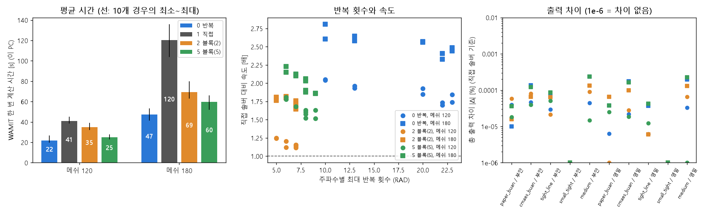

# 업데이트 보고서: WAMIT 선형 솔버(Solver 0, 1, 2, 5) 시간·결과 비교

- 날짜: 2026-10-25
- 범위: 비교 스크립트 추가와 측정 결과. 최적화 코드와 WAMIT 입력 생성은 바꾸지 않았다.
- 측정 PC: Intel Core i5-13500(14코어 20스레드), 32 GB, WAMIT v7 `NCPU` 8, `RAMGBMAX` 16. 계산용 PC가 아니라 이 PC에서 측정했다.
- 그림: `docs/reports/images/2026-10-25_01_wamit_solver_timing.png`. 데이터는 `solver_timing.py --repeats 1`의 출력 `solver_timing.csv`(80행, 저장소에 넣지 않음). 그림은 분석용 스크립트로 따로 그렸다(저장소에 넣지 않음).

## 1. 개요

현재 기본값은 반복 솔버(`Solver` 0, `ISOLVE=0`)이고, 논문 당시 코드는 직접 솔버(`ISOLVE=1`)를 썼다. 블록 반복 솔버(`Solver` N ≥ 2)는 반복 횟수가 적어 더 빠를 수도 있다. 그래서 실제 5기 설계에서 네 가지 솔버의 계산 시간과 결과 차이를 쟀다.

- 설계 5개 × 해역 2곳(부안 50 m, 영일만항 13 m) × 메쉬 2개(WEC당 1/4 모델 120, 180패널) × 솔버 4개 = 80회.
- 그 밖의 조건은 최적화와 같다: 수직벽, 51개 주파수(0.5~3.0 rad/s, 0.05 간격), ITTC 스펙트럼, 형상 1(원통 + 반구).
- 각 조합을 한 번씩 계산했다. 같은 반복 안에서 솔버 순서를 바꿔 가며 계산하므로, PC 부하의 변화가 네 솔버에 비슷하게 들어간다.

| 설계 | [R, D, X1, X2, Y2, X3, Y3] | 특징 |
| --- | --- | --- |
| `paper_buan` | [2.5, 3.8, 3, 3, 13.9, 3, 30] | 논문 DE 설계(부안), 벽 옆 한 줄 |
| `cmaes_buan` | [2.5, 4.8, 24.8, 3.6, 30, 21.9, 30] | CMA-ES(경계 벌점) 최적해, 부안 |
| `tight_line` | [2.5, 5, 3, 3, 10, 3, 20] | 큰 WEC 다섯 기가 벽 옆에 4R 간격 |
| `small_tight` | [0.5, 0.5, 3, 3, 2, 3, 4] | 작고 얕은 WEC가 4R 간격 |
| `medium` | [1.5, 2.5, 10, 6, 8, 15, 20] | 중간 크기, 흩어진 배치 |

## 2. 변경 내용

- `scripts/experiments/solver_timing.py`(새 파일): 위 조합을 `evaluate_joint`로 계산한다. 계산 시간, 총·WEC별 출력, `wec.out`의 주파수별 최대 반복 횟수(RAD/DIFF)를 CSV에 쓴다. 조합마다 가장 짧은 시간과 직접 솔버 대비 속도·출력 차이를 표로 낸다. 모든 설계가 4R 간격을 지키는지 계산 전에 확인한다.
- `tests/test_solver_timing.py`(새 파일, 3건): 반복 횟수 읽기, 설계의 간격·양수 조건, 가짜 평가 함수로 실행 순서와 비교값 계산. WAMIT 없이 실행된다.
- `docs/manual_ko.md`: `Solver` 설명에 측정 결과를 한 줄 넣고, 부가 도구 표에 스크립트를 추가했다.

### 측정 결과

시간은 WAMIT 실행과 앞뒤 처리(메쉬 생성, 출력 읽기, 출력 계산)를 포함한 평가 1회 시간이다. 10개 경우(설계 5 × 해역 2)의 평균이고, 괄호 안은 최소~최대다.

| 메쉬 | Solver 0 반복 | Solver 1 직접 | Solver 2 블록 | Solver 5 블록 |
| --- | --- | --- | --- | --- |
| 120 시간 [s] | **21.8** (20.1~26.3) | 40.8 (38.9~44.7) | 35.0 (32.3~38.6) | 24.9 (23.2~27.4) |
| 120 직접 대비 | **1.88배** (1.70~2.05) | 1.00 | 1.17배 (1.11~1.25) | 1.64배 (1.52~1.81) |
| 180 시간 [s] | **47.4** (41.7~52.8) | 120.3 (103.9~135.7) | 69.2 (63.1~79.5) | 59.7 (52.2~65.8) |
| 180 직접 대비 | **2.54배** (2.33~2.81) | 1.00 | 1.74배 (1.65~1.82) | 2.02배 (1.86~2.23) |
| 120 → 180 시간 비 | 2.17 | 2.94 | 1.97 | 2.40 |
| 최대 반복 횟수 (RAD/DIFF) | 10~23 / 10~24 | — | 5~7 / 5~8 | 6~9 / 6~10 |
| 총 출력 차이 최대 (직접 기준) | 0.00024% | 0 | 0.00013% | 0.00024% |

*그림 1. 왼쪽: 솔버·메쉬별 평균 평가 시간(검은 선은 10개 경우의 최소~최대). 가운데: 최대 반복 횟수와 직접 솔버 대비 속도(원 메쉬 120, 네모 180). 오른쪽: 설계·해역별 총 출력 차이(로그 축, 아래 끝 1e-6은 차이가 0인 경우).*

## 3. 호환성 영향

없음. 기본값 `Solver` 0을 그대로 둔다. 설정 파일, 로그 형식, WAMIT 입력 파일 생성은 바뀌지 않았다. 새 스크립트는 `workspace/solver_timing`(gitignore)에서 WAMIT을 실행하고, 결과를 `--out`(기본 `logs`)에 쓴다.

## 4. 검증

**결과는 사실상 같다.** 80회 모두 총 출력이 직접 솔버와 0.00024% 안쪽으로 같았고, WEC별 출력도 0.001% 안쪽이었다. 반복 솔버가 수렴 한계(`MAXITT` 100)에 닿은 주파수는 없었다(최대 24회). 메쉬 120 → 180의 출력 변화(0.04~0.61%)가 솔버 차이보다 1,000배 이상 크다. 따라서 정확도 면에서는 솔버를 고를 이유가 없다.

**반복 솔버(0)가 가장 빠르다.** 메쉬 120에서 직접 솔버보다 1.88배, 180에서 2.54배 빠르다.
- 직접 솔버는 패널 수 N에 대해 약 N³으로 늘어난다. 패널 1.5배에 시간 2.94배로 이론값 3.38에 가깝다.
- 반복 솔버는 반복 한 번에 약 N²이다. 시간 2.17배로 이론값 2.25에 가깝다.
- 그래서 메쉬가 커질수록 반복 솔버가 더 유리해진다.

**블록 반복 솔버는 반복 횟수가 적지만 더 느렸다.**
- 반복 횟수는 Solver 0의 1/3~1/2이다(5~10회).
- 하지만 블록마다 직접 분해를 하므로, 반복 한 번이 더 비싸다. Solver 2는 블록 하나가 문제의 절반 크기라 분해 비용이 크고, 메쉬 120에서는 직접 솔버와 거의 같은 속도였다(1.17배).
- 블록 수를 5로 늘리면 분해 비용이 줄어 Solver 0에 가까워진다. 그래도 20개 경우(설계 × 해역 × 메쉬) 모두에서 Solver 0보다 느렸다(메쉬 120에서 평균 14%, 180에서 26%).

**반복 횟수는 설계에 따라 다르다.**
- 큰 WEC가 촘촘한 `tight_line`, `paper_buan`, `cmaes_buan`은 Solver 0에서 20~23회, 작은 `small_tight`는 10회였다.
- 반복이 많은 설계일수록 Solver 0의 이점이 줄었다(메쉬 120에서 1.70~1.85배, `small_tight`는 2.05배). 그래도 직접 솔버보다 항상 빨랐다.
- 반복 횟수는 해역(수심 50 m, 13 m)과 메쉬에 거의 영향을 받지 않았다.

**이 PC와 계산용 PC, 논문 값.**
- 이 PC의 메쉬 120, Solver 0 평가는 약 22 s다. 계산용 PC는 같은 설정의 최적화(CMA-ES 부안)에서 평가당 약 7.8 s였다. 이 PC가 약 2.8배 느리다.
- 논문 Table 5(Ryzen 7 9700X, 직접 솔버, 1/4 모델 약 130패널)의 평가당 시간은 10~13 s다. 같은 조건을 이 PC에서 돌리면 약 41~45 s(메쉬 120 직접 솔버)가 걸린다.
- 평가당 50~60 s라는 기억은 이 PC 정도의 속도에서 직접 솔버를 쓴 경우와 비슷하다. 논문 계산 PC의 값은 아니다.
- 계산용 PC에서 논문 코드보다 빨라진 이유(약 16 s → 7.8 s)도 이 결과로 설명된다: 직접 → 반복 솔버(이 PC에서 1.9배) × 패널 수 130 → 120.

**코드 검사**: `ruff check .`, `ruff format --check .` 통과. `python -m unittest discover -s tests` 전체 통과(새 테스트 3건 포함).

**측정의 한계**: 조합마다 한 번만 쟀다. 처음 시험 계산과 본 측정의 같은 조합(`paper_buan`, 부안, 메쉬 120)은 Solver 0에서 25.0 s와 26.3 s, Solver 1에서 42.7 s와 44.7 s로 약 5% 차이가 났다. 솔버 사이의 차이(14% 이상)는 이보다 크다.

## 5. 남은 이슈 / 후속 작업

- 기본값 `Solver` 0을 유지한다. 블록 반복 솔버로 바꿀 이유는 없다.
- 계산용 PC(코어 수가 다름)에서는 비율이 다를 수 있다. 필요하면 같은 스크립트를 `scripts\remote.ps1`로 보내 확인한다.
- 다른 `NCPU` 값에서는 비교하지 않았다. 직접 솔버의 분해는 병렬화가 잘 되므로, 코어가 많을수록 차이가 줄 수 있다.
- 칠발도와 메쉬 160 이상의 작은 WEC 배열은 재지 않았다. 반복 횟수가 해역에 거의 무관하므로 결론이 바뀔 가능성은 낮다.
