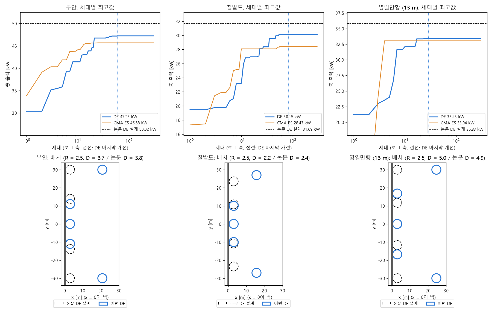

# 업데이트 보고서: DE 세 해역 동시최적화 결과(72 × 300, ITTC)

- 날짜: 2026-10-26
- 범위: 결과 분석만(코드 변경 없음). 계산용 PC 작업 `20261024_234654_de_sites`(`results/`에 가져옴, gitignore).
- 비교 대상:
  - CMA-ES: 부안은 경계 벌점 재계산 `20261024_170039_cmaes_buan_penalty`([보고서 2026-10-24_04](2026-10-24_04_cmaes-buan-rerun.md)), 칠발도·영일만항은 `20261023_190757_cmaes_sites2`([보고서 2026-10-24_02](2026-10-24_02_cmaes-sites-result.md)).
  - 논문 DE 설계: 논문 Table 4의 동시최적화 설계를 현재 프로세스로 다시 계산한 값.
- 그림: `docs/reports/images/2026-10-26_01_de_sites.png`. 데이터는 위 작업들의 `logs/*_generation_history.csv`, `*_trial_history.csv`. 그림과 추가 계산(4절 "바깥 쌍만 벽 옆으로")은 분석용 스크립트로 했다(저장소에 넣지 않음).

## 1. 개요

CMA-ES가 세 해역 모두 논문 DE 설계보다 8~10% 낮게 일찍 멈췄으므로, 같은 조건에서 이 프로젝트의 주 알고리즘인 DE로 계산했다. 목적은 두 가지다.
- 지금 프로세스의 DE가 논문 DE 설계 수준에 도달하는지 확인한다.
- 영일만항(수심 13 m)의 DE 기준값을 얻는다. 논문 설계는 수심 33 m에서 최적화된 것이다.

설정:
- 5기, 동시최적화(`OptMode` 3), 형상 1(원통 + 반구), 수직벽.
- DE: 개체 72, 세대 300, F 0.5, CR 0.9, `DEUpdate` 0(즉시 교체, 논문 방식).
- ITTC 스펙트럼, 메쉬 120, `Solver` 0, 51개 주파수.
- 최소 간격 `MinSpacing` 4(WEC 중심 사이 4R).
- 탐색 범위: R 0.5~2.5, D 0.5~5, X 3~25, Y 0.1~30 m, 간격 0.1.
- 논문 DE는 개체 100 × 300세대였다. 이번 계산은 CMA-ES와 맞추려고 72를 썼다.

## 2. 변경 내용

코드 변경은 없다. 결과와 분석만 기록한다.

| | 부안 | 칠발도 | 영일만항 (13 m) |
| --- | --- | --- | --- |
| **DE 출력 [kW]** | **47.23** | **30.15** | **33.43** |
| 최적 벡터 [R, D, X1, X2, Y2, X3, Y3] | [2.5, 3.7, 3, 3, 11.0, 20.8, 30.0] | [2.5, 2.2, 3, 3, 10.0, 15.6, 27.0] | [2.5, 5.0, 3, 3, 16.8, 24.6, 30.0] |
| WEC별 출력 [kW] (1, 2·3, 4·5) | 11.30, 8.48, 9.48 | 8.41, 5.27, 5.60 | 8.52, 6.62, 5.83 |
| 논문 DE 설계 [kW] | 50.02 | 31.69 | 35.83* |
| 논문 DE 설계 대비 | −5.6% | −4.9% | −6.7% |
| CMA-ES [kW] (대비) | 45.68 (+3.4%) | 28.43 (+6.0%) | 33.04 (+1.2%) |
| 최종값의 99%에 도달한 세대 / 마지막 개선 세대 | 36 / 59 | 47 / 83 | 17 / 29 |
| WAMIT 계산 / 간격 위반 / 캐시 적중 | 4058 / 344 / 17270 (80%) | 4639 / 669 / 16364 (76%) | 2083 / 182 / 19407 (90%) |
| 걸린 시간 (WAMIT 1회당) | 8.94 h (7.9 s) | 10.78 h (8.4 s) | 4.52 h (7.8 s) |
| 논문 Table 5 (개체 100): 시간 / 평가 수 | 19.3 h / 6756 | 31.4 h / 11579 | 15.0 h / 4137 |

\* 영일만항 논문 설계는 수심 33 m에서 최적화된 것을 13 m로 다시 계산한 값이다.

논문 DE 설계(이 저장소의 벡터 순서)는 다음과 같다. 다섯 기가 모두 벽 옆(x = 3 m)에 한 줄로 선다.
- 부안 [2.5, 3.8, 3, 3, 13.9, 3, 30]
- 칠발도 [2.5, 2.4, 3, 3, 10.8, 3, 23.5]
- 영일만항 [2.5, 4.9, 3, 3, 11.7, 3, 30]

*그림 1. 위: 세대별 최고값(로그 축). 파란 선 DE, 주황 선 CMA-ES, 검은 점선 논문 DE 설계, 파란 점선 DE의 마지막 개선 세대. 아래: DE 최적 배치(파란 실선)와 논문 DE 설계(검은 점선). 세로 굵은 선이 벽(x = 0)이다.*

## 3. 호환성 영향

없음.

## 4. 검증 (분석)

**DE가 CMA-ES보다 높지만 논문 설계에는 못 미친다.**
- 세 해역 모두 CMA-ES보다 1.2~6.0% 높다.
- 그러나 논문 DE 설계보다 4.9~6.7% 낮다.
- 영일만항은 다른 수심(33 m)에서 최적화된 논문 설계(35.83 kW)보다도 낮다. 13 m의 진짜 최적값은 35.83 kW 이상이므로, 이번 DE는 영일만항에서 적어도 6.7% 모자란다.

**배치: 가운데 세 기는 맞고, 바깥 쌍은 벽에서 멀다.**
- 세 해역 모두 R = 2.5 m(상한)이고, WEC 1·2·3이 벽 옆(x = 3 m)에 섰다. D와 Y2도 논문 설계와 비슷하다(부안 D 3.7 대 3.8, 칠발도 Y2 10.0 대 10.8).
- 바깥 쌍(WEC 4·5)만 벽에서 15.6~24.6 m 떨어진 곳에 있다. 논문 설계는 이 쌍도 x = 3 m다.
- CMA-ES는 가운데 세 기도 벽 옆 한 줄을 잘 찾지 못했으므로, 이 점에서는 DE가 논문 설계에 더 가깝다.

**바깥 쌍이 벽 옆인 설계를 거의 평가하지 않았다.**

| | 부안 | 칠발도 | 영일만항 |
| --- | --- | --- | --- |
| 평가한 설계 중 X3 ≤ 3.5 m | 2개 (최고 4.47 kW) | 1개 (0.19 kW) | 1개 (2.47 kW) |
| 상위 200개 설계의 X3 범위 [m] | 19.7~21.3 | 14.8~16.4 | 23.8~25.0 |

- 바깥 쌍이 벽 옆에 있는 설계는 해역마다 1~2개뿐이었다. 그마저 다른 변수가 나쁜 초기 설계였다.
- 상위 설계들의 X3는 폭 1.6 m 안에 모였다. 초기 몇십 세대에 개체군이 한 골짜기로 모였고, 그 뒤에는 X3를 크게 바꾸는 시도가 나오지 않았다는 뜻이다.

**바깥 쌍만 벽 옆으로 옮겨 보기(이 PC의 WAMIT으로 추가 계산).**
- DE 최적해에서 X3만 3 m로 바꾸고, 나머지 변수는 그대로 두었다.
- 먼저 DE 최적해 자체를 다시 계산해 계산용 PC 값과 같음(소수 셋째 자리까지)을 확인했다.

| | DE 최적해 [kW] | X3 = 3 m로만 바꿈 [kW] | 변화 |
| --- | --- | --- | --- |
| 부안 | 47.23 | **48.96** | +3.7% |
| 칠발도 | 30.15 | 29.86 | −0.9% |
| 영일만항 | 33.43 | **35.37** | +5.8% |

- 부안과 영일만항은 변수 하나만 바꿔도 출력이 오른다. 즉 DE 최적해는 국소 최적점이 아니다. DE는 이 방향을 탐색하지 못했을 뿐이다.
- 칠발도는 X3만 바꾸면 조금 떨어진다. 논문 설계처럼 Y3(27 → 23.5)와 D도 함께 맞아야 높아지는 것으로 보인다.
- 따라서 남은 차이는 정확도 문제가 아니라 탐색의 문제다. 개체군이 일찍 한 골짜기로 모이면서 X3가 작은 영역을 다시 보지 못했다.

**탐색량 비교.** 이번 DE의 WAMIT 계산 수는 논문 DE 평가 수의 50~60%다(부안 4058 대 6756, 칠발도 4639 대 11579, 영일만항 2083 대 4137). 개체 수(72 대 100)가 작아 초기 다양성이 적었고, 그만큼 일찍 수렴했을 가능성이 있다. 시드 하나씩의 결과이므로 시드 영향과는 아직 구분할 수 없다.

**시간.** WAMIT 1회당 7.8~8.4 s로, [보고서 2026-10-25_01](2026-10-25_01_wamit-solver-timing.md)의 예상과 맞는다. 세 해역 합계 24.2 h로, 논문 Table 5의 동시최적화 합계 65.7 h의 37%다. 1회당 계산이 빨라진 것과 평가 수가 적은 것이 함께 작용했다.

## 5. 남은 이슈 / 후속 작업

- **개체 100으로 다시 계산**: 논문과 같은 100 × 300으로 돌려, 남은 5~7% 차이가 개체 수 때문인지 확인한다. 시간은 이번의 약 1.4배(세 해역 약 35 h)로 예상한다.
- **시드 비교**: 같은 설정으로 시드를 바꿔 한두 번 더 돌리면, 바깥 쌍의 골짜기 선택이 우연인지 알 수 있다.
- 조기 종료·재시작은 쓰지 않는다는 원칙은 그대로 둔다. 초기 개체군 크기나 시드처럼 원칙 안에서 바꿀 수 있는 것부터 확인한다.
- 영일만항 13 m의 기준값은 아직 없다. X3 = 3으로 바꾼 설계(35.37 kW)도 13 m에서 최적화된 값은 아니다.
