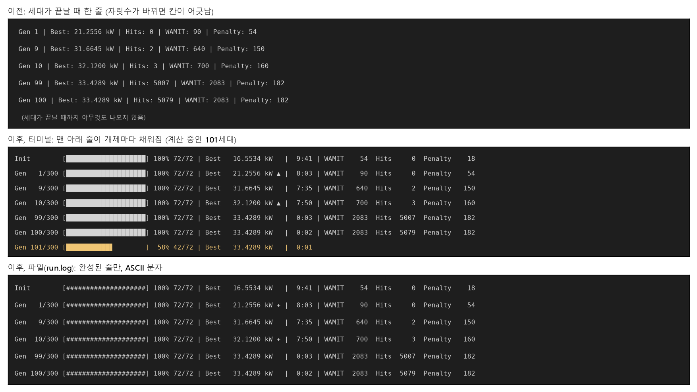

# 업데이트 보고서: 세대 진행 막대(개체마다 갱신, 세대마다 한 줄)

- 날짜: 2026-10-26
- 범위: `src/algorithms/progress.py`(신규), `src/algorithms/common.py`(`evaluate_batch(on_result=)`, `progress_text` 삭제), `src/algorithms/{de,pso,depso,ga,cma_es}.py`, `tests/test_progress.py`(신규), `docs/manual_ko.md`, `docs/architecture.md`
- 그림: `docs/reports/images/2026-10-26_02_progress_bar.png`. 분석용 스크립트로 `GenerationProgress`의 실제 출력 줄을 그렸다(저장소에 넣지 않음). 수치는 DE 영일만항 실행(`20261024_234654_de_sites`)의 로그에서 가져왔다.

## 1. 개요

지금까지는 세대가 끝날 때만 한 줄을 출력했다. 개체 72개를 평가하는 세대 하나가 약 10분 걸리므로, 그동안 진행 상황을 알 수 없었다. 또한 세대 번호와 개수의 자릿수가 바뀌면(9 → 10, 99 → 100) 줄의 칸이 어긋났다.

이번 변경으로 두 가지를 바꿨다.
- 개체 하나의 평가가 끝날 때마다 진행 막대를 갱신한다.
- 세대가 끝나면 결과 한 줄을 남기고, 모든 칸을 최대 자릿수에 맞춰 정렬한다.

## 2. 변경 내용

**출력 형식** (`src/algorithms/progress.py`, `GenerationProgress`)

```
최적화 시작: 초기 개체군 72개 평가 중...
Init        [████████████████████] 100% 72/72 | Best   16.5534 kW   |  9:41 | WAMIT    54  Hits     0  Penalty    18
Gen   1/300 [████████████████████] 100% 72/72 | Best   21.2556 kW ▲ |  8:03 | WAMIT    90  Hits     0  Penalty    54
Gen   2/300 [███████████▋        ]  58% 42/72 | Best   21.2556 kW   |  3:10
```

| 칸 | 내용 | 정렬 |
| --- | --- | --- |
| `Gen   1/300` | 세대 / 최대 세대. 초기 개체군은 `Init` | 세대 번호를 `MaxIter`의 자릿수로 오른쪽 정렬 |
| 막대 (20칸) | 이번 세대에서 평가를 마친 비율. 터미널에서는 1/8칸 단위(`▏`~`▉`)로 채움 | 고정 폭 |
| `58% 42/72` | 내림한 백분율, 마친 수 / 세대당 평가 수 | 개수를 `PopSize`의 자릿수로 정렬 |
| `Best` | 지금까지의 최고 출력 [kW], 소수 넷째 자리 | 9칸 오른쪽 정렬 |
| `▲` | 이번 세대에 최고값이 좋아짐(파일에서는 `+`) | 없으면 빈칸 |
| 시간 | 세대 소요 시간 `m:ss`(1시간 이상이면 `h:mm:ss`). 계산 중에는 경과 시간 | 고정 폭 |
| `WAMIT`, `Hits`, `Penalty` | 누적 횟수(이전과 같은 값). 세대가 끝난 줄에만 씀 | `PopSize × (MaxIter + 1)`의 자릿수로 정렬 |

세대당 평가 수는 DE·PSO·DEPSO가 `PopSize`, CMA-ES가 λ(`PopSize`)다. GA는 0번 엘리트를 다시 평가하지 않으므로 `PopSize − 1`이다. CMA-ES는 초기 개체군이 없어 `Init` 줄이 없다.

**출력 장치에 따른 동작**
- **터미널**(`isatty()` 참): 평가가 하나 끝날 때마다 `\r`로 같은 줄을 다시 그린다. 빠른 평가 함수에서도 출력이 밀리지 않게 0.1 s보다 자주 그리지 않는다. 터미널 폭을 넘는 부분은 잘라서, 줄바꿈 때문에 `\r`이 윗줄로 돌아가지 못하는 일을 막는다.
- **파일·파이프**(계산용 PC의 `run.log`, `> out.txt`): 다시 그리지 않고 세대가 끝날 때 완성된 한 줄만 쓴다. 그래서 `remote.ps1 tail`의 줄 수가 이전과 같다(세대당 한 줄).
- **문자**: 파일에는 ASCII(`#`, `-`, `+`)만 쓴다. 계산용 PC의 `run.log`는 UTF-8로 쓰이지만 PowerShell 5.1의 `Get-Content`는 BOM 없는 파일을 시스템 코드 페이지로 읽는다. 지금 `tail`에서 한국어 줄이 깨지는 것도 이 때문으로 보이며, 블록 문자도 같은 이유로 깨질 수 있다. 터미널이라도 출력 인코딩이 블록 문자를 담지 못하면(예: cp949 콘솔) ASCII로 바꾼다.

**묶음 평가의 진행 알림** (`CachedEvaluator.evaluate_batch(vectors, on_result=None)`)
- GA, CMA-ES, `DEUpdate=1`인 DE, 모든 알고리즘의 초기 개체군은 한 세대를 한꺼번에 평가한다. 이 경우에도 막대가 개체마다 움직이도록, 벡터 하나의 값이 정해질 때마다 `on_result(score)`를 부른다.
- 부르는 순서: 이미 캐시에 있던 설계 → 새로 계산한 설계(끝난 순서) → 같은 묶음 안에서 겹친 설계. 모두 `len(vectors)`번 불린다.
- `Workers > 1`이면 `pool.map` 대신 `submit` + `as_completed`로 끝난 순서대로 알린다. 결과 배열과 trial 로그의 순서는 이전과 같다.
- `CachedEvaluator.progress_text()`는 쓰는 곳이 없어져 지웠다.



*그림 1. 위: 이전 출력. 가운데: 터미널 출력(노란 줄이 계산 중인 세대). 아래: 파일 출력.*

## 3. 호환성 영향

- **화면·`run.log` 형식이 바뀐다.** `Gen 12 | Best: ... | Hits: ... | WAMIT: ... | Penalty: ...` 형식을 읽는 스크립트는 이 저장소에 없다. 직접 만든 스크립트가 이 줄을 읽는다면 새 형식에 맞춰야 한다. 정보는 같고, 숫자 형식은 `Best`의 천 단위 쉼표만 빠졌다.
- "초기 세대 최적 발전량: ..." 줄은 `Init` 줄로 바뀌었다.
- CSV·JSON 로그(`*_trial_history.csv`, `*_generation_history.csv`, `*_summary.json`)와 최적화 결과는 바뀌지 않는다. 난수 사용 순서도 그대로다.
- 설정 파일 변경은 없다. WAMIT 입력 파일과 무관하다.

## 4. 검증

- `tests/test_progress.py`(8건)
  - 1·9·10·99·100·300세대와 `Init` 줄의 길이와 칸 위치가 모두 같다.
  - 파일 출력은 세대당 한 줄, ASCII만 쓴다.
  - 터미널에서는 개체마다 `\r`로 다시 그리고, 37/72에서 `51%`와 부분 막대를 보인다.
  - cp949 터미널에서는 ASCII로 바뀐다.
  - 71/72는 `98%`다(100%로 반올림하지 않음).
  - 시간 형식을 확인한다.
  - `evaluate_batch`의 `on_result`가 캐시 적중과 묶음 안 중복을 포함해 벡터 수만큼 불린다(`Workers` 1, 2).
  - 다섯 알고리즘이 모두 세대마다 한 줄(CMA-ES는 `Init` 없음)을 쓴다.
- 기존 테스트(`test_parallel_eval.py`의 묶음 평가·로그 순서 포함)는 모두 그대로 통과했다.
- 실제 터미널(Windows PowerShell)에서 DE(개체 72, 12세대, 평가당 0.04 s 가짜 함수)를 돌려, 막대가 같은 줄에서 채워지고 세대마다 한 줄이 남는 것을 확인했다.
- `ruff check .`, `ruff format --check .` 통과. `python -m unittest discover -s tests` 전체 통과(새 테스트 8건 포함).

## 5. 남은 이슈 / 후속 작업

- 계산용 PC의 `run.log`는 여전히 세대가 끝날 때만 줄이 늘어난다. 세대 중간 진행을 원격으로 보려면 별도의 진행 파일이 필요하다.
- `remote.ps1 tail`에서 한국어가 깨지는 문제(PowerShell 5.1 `Get-Content`의 기본 인코딩)는 고치지 않았다. `job_ctl.ps1`의 `Get-Content`에 `-Encoding UTF8`을 주면 해결될 것으로 보인다.
- 전체 남은 시간(ETA)은 넣지 않았다. 세대가 지날수록 캐시 적중이 늘어 세대 시간이 크게 줄어들므로(8분 → 수 초), 평균으로 어림하면 크게 틀리기 때문이다.
- 한국어 Windows의 옛 콘솔 글꼴에서는 블록 문자가 두 칸 폭으로 보일 수 있다. 이때는 인코딩이 cp949이므로 ASCII로 바뀐다.
