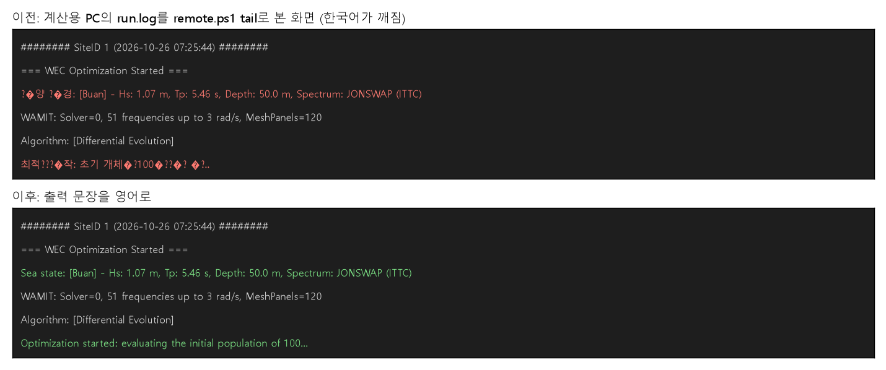

# 업데이트 보고서: 화면 출력·오류 메시지를 영어로

- 날짜: 2026-10-26
- 범위: `main.py`, `src/algorithms/{de,pso,depso,ga,cma_es}.py`, `src/utils/config_parser.py`, `src/utils/validation.py`, `scripts/summarize_results.py`, `tests/test_english_output.py`(신규), `docs/conventions.md`, `docs/manual_ko.md`
- 그림: `docs/reports/images/2026-10-26_03_english_output.png`. 위쪽은 작업 `20261026_072542_de100_sites`의 `remote.ps1 tail` 화면을 옮겼고, 아래쪽은 같은 줄을 새 문장으로 바꿔 그렸다(계산용 PC에서 새 코드로 찍은 화면은 아님). 그림은 분석용 스크립트로 그렸다(저장소에 넣지 않음).

## 1. 개요

계산용 PC의 `run.log`를 `remote.ps1 tail`로 보면 한국어 줄이 `?�양 ?�경`처럼 깨졌다. `run.log`는 UTF-8(`PYTHONIOENCODING=utf-8`)로 쓰이지만 PowerShell 5.1의 `Get-Content`는 BOM 없는 파일을 시스템 코드 페이지로 읽기 때문인 것으로 보인다. 사용자 요청에 따라, 실행 중인 DE 100 × 300 작업 이후부터는 프로그램이 출력하는 문장을 모두 영어로 쓴다. 주석과 docstring은 그대로 둔다.

## 2. 변경 내용

| 파일 | 이전 | 이후 |
| --- | --- | --- |
| `main.py` | `해양 환경: [Buan] - Hs: ...` | `Sea state: [Buan] - Hs: ...` |
| `main.py` | `유효한 해를 찾지 못했습니다.` | `No valid solution was found.` |
| `de.py`, `ga.py` | `최적화 시작: 초기 개체군 72개 평가 중...` | `Optimization started: evaluating the initial population of 72...` |
| `pso.py`, `depso.py` | `최적화 시작: 초기 개체군(군집) 72개 평가 중...` | `Optimization started: evaluating the initial swarm of 72...` |
| `cma_es.py` | `최적화 시작: 세대당 72개 샘플, 최대 300세대` | `Optimization started: 72 samples per generation, up to 300 generations` |
| `config_parser.py` | 섹션 밖 값, `'값 변수명'` 형식, 중복 키 오류 3개 | `value defined outside a [section]`, `expected 'value name'`, `'X' is defined twice in [S]` |
| `validation.py` | 숫자 아님, 유한하지 않음, 양수 아님, 범위 오류, 간격 오류, 간격 경고 등 10개 | 같은 내용의 영어 문장 (예: `'StepSize' must be positive (> 0), got -0.1`) |
| `summarize_results.py` | `11개 실행을 요약했습니다: ...` | `Summarized 11 runs: ...` |

- `tests/test_english_output.py`(신규, 1건): `main.py`, `src/`, `scripts/`의 문자열 상수 중 docstring이 아닌 것에 한글이 있으면 실패한다. f-string의 고정 부분도 검사한다. 이후 한국어 출력이 다시 들어오는 것을 막는다.
- `docs/conventions.md`: "4. Console Output Language" 절을 추가했다(출력은 영어, 주석·docstring은 한국어 가능).
- `docs/manual_ko.md`: 6장 출력 예시를 영어 문장으로 바꾸고, 출력이 영어인 이유를 한 줄 적었다.

*그림 1. 위: 이전 `run.log`를 `tail`로 본 화면(빨간 줄이 깨진 한국어). 아래: 같은 줄의 새 문장.*

## 3. 호환성 영향

- 화면·`run.log`의 문장과 오류 메시지가 바뀐다. 이 문장을 찾는 스크립트나 테스트는 저장소에 없다(검사: 전체 테스트 통과).
- CSV·JSON 로그, 설정 파일, WAMIT 입력 파일, 최적화 결과는 바뀌지 않는다.
- 지금 계산용 PC에서 돌고 있는 `20261026_072542_de100_sites`는 제출할 때의 코드(`ec71cd6`)로 돌므로 한국어 출력이 그대로 나온다. 다음 제출부터 영어가 된다.
- `scripts/remote.ps1`, `scripts/remote/job_ctl.ps1`의 PowerShell 메시지(`작업 ID: ...` 등)는 이번 범위에 넣지 않았다. 이 메시지는 개인용 PC 콘솔에 바로 나오므로 깨지지 않는다.

## 4. 검증

- 변경 전에 docstring이 아닌 문자열 상수를 모두 훑어 한글이 있는 23곳을 찾았고, 모두 바꿨다. 바꾼 뒤 새 테스트로 0곳임을 확인했다.
- `ruff check .`, `ruff format --check .` 통과. `python -m unittest discover -s tests` 전체 통과(새 테스트 1건 포함).

## 5. 남은 이슈 / 후속 작업

- `remote.ps1 tail`이 UTF-8을 잘못 읽는 근본 문제는 그대로다. 출력이 영어이므로 이제는 문제가 드러나지 않지만, `job_ctl.ps1`의 `Get-Content`에 `-Encoding UTF8`을 주면 확실히 해결된다.
- 원하면 PowerShell 스크립트의 메시지도 같은 규칙으로 영어로 바꿀 수 있다.
