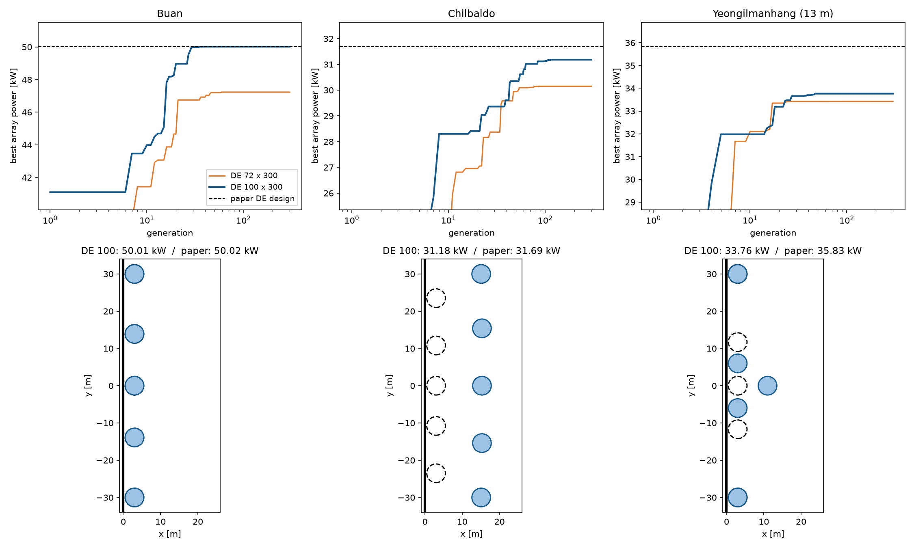

# 업데이트 보고서: DE 세 해역 동시최적화 결과(100 × 300)와 direct solver 확인

- 날짜: 2026-10-27
- 범위: 결과 분석만 했고 코드는 바꾸지 않았다.
- 계산용 PC 작업:
  - 부안: `20261026_072542_de100_sites`
  - 칠발도·영일만항: `20261026_143020_de100_sites23`(커밋 33f6ad4, `--sites 2 3`)
  - 두 작업 모두 `results/`에 가져왔다(gitignore).
- 비교 대상:
  - DE 72 × 300: `20261024_234654_de_sites`([보고서 2026-10-26_01](2026-10-26_01_de-sites-result.md))
  - 논문 DE 설계: 논문 Table 4의 동시최적화 설계를 현재 프로세스로 다시 계산한 값
- 그림 `docs/reports/images/2026-10-27_01_de100_sites.png`:
  - 데이터는 위 작업들의 `logs/*_generation_history.csv`, `*_trial_history.csv`, `*_summary.json`이다.
  - 그림·통계·direct solver 재계산(4절)은 분석용 스크립트로 했고, 스크립트는 저장소에 넣지 않았다.
  - direct solver 재계산은 `scripts/experiments/solver_timing.py`의 `build_config`를 썼다.

## 1. 개요

[보고서 2026-10-26_01](2026-10-26_01_de-sites-result.md)에서 DE 72 × 300은 논문 DE 설계보다 4.9~6.7% 낮았다. 원인은 탐색 부족으로 보였다. 이번에는 논문과 같은 개체 100 × 300세대로 다시 계산했다. 확인할 것은 두 가지다.
- 개체 수를 늘리면 논문 설계와의 차이가 줄어드는가.
- 로그에 가끔 나오는 반복 솔버의 `MAXITT` 경고가 최적 설계의 출력에 영향을 주는가. 세 최적 설계를 `Solver` 0(반복)과 1(direct)으로 다시 계산해 비교했다.

설정은 개체 수만 72에서 100으로 바꾸고 나머지는 2026-10-26_01과 같다.
- 5기, 동시최적화(`OptMode` 3), 형상 1(원통 + 반구), 수직벽.
- DE: F 0.5, CR 0.9, `DEUpdate` 0.
- 스펙트럼과 해석: ITTC 스펙트럼, 메쉬 120, `Solver` 0, 51개 주파수.
- 제약: 최소 간격 `MinSpacing` 4(WEC 중심 사이 4R).
- 탐색 범위: R 0.5~2.5, D 0.5~5, X 3~25, Y 0.1~30 m, 간격 0.1.

## 2. 변경 내용

코드 변경은 없다. 결과와 분석만 기록한다.

| | 부안 | 칠발도 | 영일만항 (13 m) |
| --- | --- | --- | --- |
| **DE 100 출력 [kW]** | **50.01** | **31.18** | **33.76** |
| 최적 벡터 [R, D, X1, X2, Y2, X3, Y3] | [2.5, 3.8, 3.0, 3.0, 13.9, 3.0, 30.0] | [2.5, 2.0, 15.3, 15.1, 30.0, 15.3, 15.4] | [2.5, 4.8, 11.0, 3.0, 6.0, 3.0, 30.0] |
| WEC별 출력 [kW] (1, 2·3, 4·5) | 10.03, 10.56, 9.43 | 5.98, 5.93, 6.67 | **0.41**, 8.14, 8.54 |
| 논문 DE 설계 [kW] (대비) | 50.02 (−0.01%) | 31.69 (−1.6%) | 35.83* (−5.8%) |
| DE 72 [kW] (대비) | 47.23 (+5.9%) | 30.15 (+3.4%) | 33.43 (+1.0%) |
| 최종값의 99%에 도달한 세대 / 마지막 개선 세대 | 27 / 39 | 63 / 117 | 23 / 47 |
| WAMIT 계산 / 간격 위반 / 캐시 적중 | 3183 / 872 / 26045 (87%) | 8425 / 3195 / 18480 (61%) | 3785 / 728 / 25587 (85%) |
| 걸린 시간 (WAMIT 1회당) | 7.00 h (7.9 s) | 18.97 h (8.1 s) | 8.13 h (7.7 s) |
| 논문 Table 5: 시간 / 평가 수 | 19.3 h / 6756 | 31.4 h / 11579 | 15.0 h / 4137 |

\* 영일만항 논문 설계는 수심 33 m에서 최적화된 것이다. 이 값은 그 설계를 13 m에서 다시 계산한 것이다.

캐시 적중률은 전체 평가 30100회(초기 100 + 100 × 300) 가운데 비율이다.

*그림 1. 위: 세대별 최고값(로그 축). 파란 선은 DE 100, 주황 선은 DE 72, 검은 점선은 논문 DE 설계다. 아래: DE 100 최적 배치(파란 원)와 논문 DE 설계(검은 점선 원). 굵은 세로선이 벽(x = 0)이다.*

## 3. 호환성 영향

없음.

## 4. 검증 (분석)

### 4.1 개체 100: 세 해역 모두 DE 72보다 높다

**부안: 논문 설계를 그대로 찾았다.**
- 최적 벡터가 논문 DE 설계 [2.5, 3.8, 3, 3, 13.9, 3, 30]과 같다. 출력 차이는 0.01%다.
- 다섯 기가 모두 벽 옆(x = 3 m)에 한 줄로 선다.
- 27세대에 최종값의 99%에 도달했고, 39세대 이후로는 개선이 없었다.
- DE 72(47.23 kW)보다 5.9% 높다. DE 72는 바깥 쌍이 벽에서 20.8 m 떨어진 골짜기에 머물렀었다.

**칠발도: 논문 설계와 다른 배치로 1.6% 낮다.**
- 논문 설계에서는 다섯 기가 모두 벽 옆에 선다.
- DE 100에서는 다섯 기가 모두 벽에서 약 15 m 떨어진 곳에 한 줄로 섰다. 출력은 31.18 kW다.
- WEC 2·3 쌍은 y = ±30 m 경계에 닿았고, 4·5 쌍은 y = ±15.4 m에 있다. 즉 쌍의 순서가 논문과 반대다.
- 세 해역 중 가장 오래 개선이 이어졌다. 117세대까지 개선됐고, WAMIT 계산도 8425회로 가장 많았다.
- 그래도 다섯 기가 모두 벽 옆(X1, X2, X3 ≤ 3.5 m)인 설계는 한 번도 평가하지 않았다(아래 표).

**영일만항: DE 72보다 1.0%만 높고, 바깥 쌍만 옮긴 DE 72 설계보다 낮다.**
- WEC 2·3과 4·5는 벽 옆에 섰다. WEC 1은 x = 11 m로 밀려나 0.41 kW밖에 내지 못한다.
- WEC 2·3 쌍이 y = ±6 m로 가운데에 붙어 있다. 이 때문에 WEC 1과 WEC 2 사이 거리가 √(8² + 6²) = 10.0 m = 4R로, 최소 간격 제약에 딱 걸린다.
- 즉 WEC 1이 벽 옆으로 갈 수 없는 배치에 갇혔다. 논문 설계는 Y2 = 11.7 m여서 WEC 1도 벽 옆에 선다.
- 33.76 kW는 [보고서 2026-10-26_01](2026-10-26_01_de-sites-result.md)에서 DE 72 최적해의 X3만 3 m로 바꾼 설계(35.37 kW)보다 낮다.

**벽 옆 배치를 얼마나 평가했나** (간격 위반이 아닌 설계만 셌다)

| | 부안 | 칠발도 | 영일만항 |
| --- | --- | --- | --- |
| 평가한 설계 | 3183 | 8425 | 3785 |
| 다섯 기 모두 벽 옆 (X1, X2, X3 ≤ 3.5 m): 개수 / 최고값 | 822 / 50.01 kW | **0** / — | **4** / 29.38 kW |
| WEC 1이 벽 옆 (X1 ≤ 3.5 m): 개수 / 최고값 | 1636 / 50.01 kW | 1597 / 29.80 kW | 43 / 31.70 kW |
| 상위 200개 설계의 X1 범위 [m] | 3.0~3.4 | 14.9~15.7 | 10.6~11.8 |

- 부안은 다섯 기가 모두 벽 옆인 영역을 충분히 평가했고, 그 영역에서 최적값을 찾았다.
- 칠발도와 영일만항은 이 영역을 거의 평가하지 않았다. 논문 설계는 이 영역에 있다.
- 상위 200개 설계의 X1은 폭 1.2 m 안에 모였다. 초기 수십 세대에 개체군이 한 골짜기로 모였다는 뜻이다. DE 72와 같은 양상이다.

**정리**
- 개체 100은 개체 72보다 세 해역 모두 높았다. 부안에서는 논문 설계에 도달했다.
- 칠발도와 영일만항에서는 논문 설계와 다른 골짜기에 수렴했다. 남은 차이(1.6%, 5.8%)는 정확도 문제가 아니라 탐색의 문제다.
- 해역마다 시드 하나씩만 돌렸으므로, 개체 수의 효과와 시드의 효과는 아직 구분할 수 없다.

### 4.2 반복 솔버 경고와 direct solver 비교

로그에는 `WAMIT iterative solver reached MAXITT at 1 frequencies (first: 2.95 rad/s)`와 같은 경고가 가끔 나왔다.
- 경고가 난 주파수는 모두 2.1~3.0 rad/s다. 파랑 스펙트럼의 에너지가 아주 작은 고주파 영역이다.
- Python 경고는 같은 문장이면 한 번만 출력된다. 따라서 로그의 경고 개수는 실제로 한도에 닿은 횟수보다 적다.

세 최적 설계를 이 PC의 WAMIT으로 `Solver` 0과 1로 각각 다시 계산했다. 메쉬 120, 작업의 `config.cfg`를 그대로 썼다.

| | 부안 | 칠발도 | 영일만항 |
| --- | --- | --- | --- |
| Solver 0 (반복) [kW] | 50.014964 | 31.180733 | 33.764256 |
| Solver 1 (direct) [kW] | 50.014948 | 31.180748 | 33.764257 |
| 차이 (1 − 0) | −0.00003% | +0.00005% | +0.000003% |
| WEC별 최대 차이 [W] | 0.006 | 0.013 | 0.002 |
| 반복 횟수 최댓값 radiation / diffraction (한도 100) | 22 / 23 | **100** / 22 | 22 / 23 |
| 한도에 닿은 주파수 | 없음 | 3.0 rad/s | 없음 |
| 계산 시간 Solver 0 / 1 [s] | 12.1 / 24.6 | 15.9 / 32.6 | 15.4 / 27.8 |

- 칠발도 최적 설계는 3.0 rad/s의 radiation 문제에서 반복 한도 100에 닿았다. 그래도 출력은 direct solver와 0.00005%밖에 다르지 않다.
- 이 주파수는 칠발도 스펙트럼에서 에너지가 거의 없는 곳이다. 수렴하지 못한 오차가 출력에 반영되지 않는다.
- 이 PC에서 Solver 0으로 계산한 값은 계산용 PC 로그의 값(50.014960, 31.180707, 33.764252 kW)과 소수 다섯째 자리까지 같다.
- 결론: 세 최적 설계에서 반복 솔버와 direct solver의 차이는 0.0001% 미만이다. `MAXITT` 경고는 최적화 결과에 영향이 없다.
- direct solver는 1.8~2.1배 느리므로 `Solver` 0을 그대로 쓴다.

### 4.3 시간

- WAMIT 1회당 7.7~8.1 s다. [보고서 2026-10-25_01](2026-10-25_01_wamit-solver-timing.md)의 예상과 맞는다.
- 세 해역 합계 34.1 h다. 논문 Table 5의 동시최적화 합계 65.7 h의 52%다.
- 새로 평가한 설계 수(간격 위반 포함)는 부안 4055, 칠발도 11620, 영일만항 4513이다.
  - 칠발도와 영일만항은 논문 평가 수(11579, 4137)와 비슷하다.
  - 부안은 27세대에 수렴하는 바람에 캐시 적중이 많았고, 논문의 60%다.

## 5. 남은 이슈 / 후속 작업

- **시드 비교**: 칠발도와 영일만항을 같은 설정에서 시드만 바꿔 다시 돌린다. 벽 옆 골짜기를 찾는지가 시드에 달렸는지 확인한다.
- **영일만항 13 m 기준값**: 지금까지 13 m에서 얻은 값 가운데 가장 높은 것은 논문 설계(33 m에서 최적화)를 13 m에서 다시 계산한 35.83 kW다. 13 m에서 직접 최적화해 이 값을 넘는 설계는 아직 찾지 못했다.
- 조기 종료·재시작은 쓰지 않는다는 원칙은 그대로 둔다. 초기 개체군 크기와 시드처럼 이 원칙 안에서 바꿀 수 있는 것부터 확인한다.
- `MAXITT` 경고는 고주파에서만 나고 결과에 영향이 없음을 확인했으므로, 경고 처리는 그대로 둔다.
