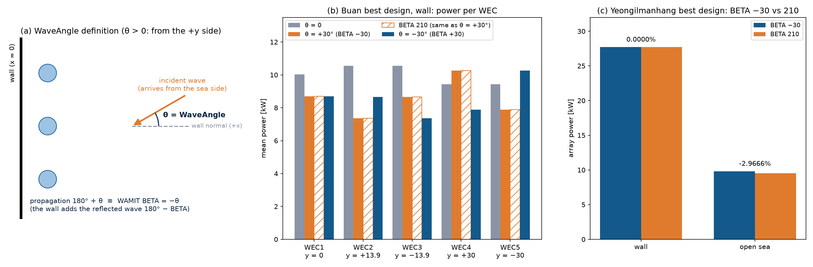

# 업데이트 보고서: 입사파 방향 `WaveAngle` 추가와 벽이 있을 때의 WAMIT BETA 부호 확인

- 날짜: 2026-11-01
- 범위: 새 설정 `WaveAngle`, WAMIT `.pot`의 `BETA` 줄.
- 기본값(0)에서는 WAMIT 입력 파일이 수정 전과 같다.
- 그림 `docs/reports/images/2026-11-01_01_wave_angle.png`:
  - 이 PC의 WAMIT v7로 계산했다.
  - 설정은 `results/20261026_143020_de100_sites23/config.cfg`(ITTC, 메쉬 120, `Solver` 0)를 썼다.
  - DE 100 최적 설계(부안·칠발도·영일만항)에 `BETA`를 바꿔 넣은 분석용 스크립트로 만들었다. 스크립트는 저장소에 넣지 않았다.

## 1. 개요

지금까지 입사파 방향은 `BETA = 0`으로 고정되어 있었다. 이번에 설정에서 입사파 방향을 바꿀 수 있게 했다.

사용자가 "벽이 있을 때는 각도에 −를 붙인다"고 알고 있어서, 아래 두 가지를 확인했다.
- WAMIT 매뉴얼에서 벽이 있을 때 `BETA`를 어떻게 정의하는지.
- 실제 WAMIT 계산에서 그 정의가 맞는지.

결론: 각도를 "파도가 바다 쪽에서 벽으로 다가오는 방향과 벽의 법선 사이 각도 θ"로 정의하면, 벽이 있을 때 `BETA = −θ`가 맞다.
- 실제 진행 방향은 180° + θ다.
- WAMIT이 반사파를 함께 넣기 때문에 180° + θ와 −θ는 같은 파동장이 된다.
- 벽이 없으면 두 값은 다른 파동장이다. 그래서 이 부호 규칙은 벽이 있을 때만 성립한다.

## 2. 변경 내용

**WAMIT 매뉴얼 근거 (WAMIT v7 매뉴얼 12.4절 "Bodies and wavemakers with vertical walls")**
- `IWALLX0=1`이면 x = 0 평면이 반사벽이고, 물체 좌표(`XBODY`)와 `BETA`는 벽 좌표계 기준이다. `BETA`는 +X 축에서 잰 입사파의 **진행 방향**이다.
- 입사파는 "벽에서 반사되기 전의 성분"으로 정의된다(진폭 A). 벽이 하나면 물체가 없을 때의 파동장은 최대 높이 2A인 비스듬한 정상파다.
- 즉 WAMIT은 `BETA`로 준 파도와 그 반사파를 함께 넣는다. x = 0 벽에서 진행 방향 (cos β, sin β)의 반사는 (−cos β, sin β), 곧 180° − β다.
  - 따라서 β와 180° − β는 같은 파동장이다.
  - 입사파와 반사파를 합한 속도 포텐셜은 cos(kX cos β)·e^{ikY sin β}에 비례한다. 이 식은 β ↔ 180° − β에 대해 바뀌지 않는다.
- 매뉴얼에는 "β = 0이면 파도가 벽과 나란하게 진행한다"는 문장이 있다. 이것은 y = 0 벽(`IWALLY0`, TEST04)의 예다. 이 프로젝트의 x = 0 벽에서는 β = 0이 벽에 수직이다.

**설정 `WaveAngle` [도] (`config.cfg` `[WEC Parameters]`, 선택, 기본 0)**
- 정의: 파도가 바다 쪽(x > 0)에서 벽으로 다가오는 방향과 벽 법선(+x 축) 사이 각도.
  - 0: 벽에 수직으로 다가오는 파도.
  - 양수: +y 쪽에서 비스듬히 다가오는 파도.
- 진행 방향은 180° + θ이고, WAMIT에는 같은 파동장인 `BETA = −θ`를 쓴다. θ = 0일 때 `BETA 0`이 그대로 나와 기존 입력과 같아지므로 −θ를 택했다.
- 범위: −90 < θ < 90.
  - |θ| = 90은 벽과 나란한 파도다. 이때는 반사파가 따로 없는데, WAMIT은 이 경우에도 진폭을 2A로 정의해서(매뉴얼 12.4절) 다른 각도와 맞지 않는다. 그래서 받지 않는다.
- 벽이 없는 배치(`VerticalWall` 0, `OptMode` 2·3)는 θ = 0만 받는다.
  - 벽이 없으면 −θ와 180° + θ가 다른 파동장이라(4절) 같은 정의를 쓸 수 없다.
  - 기존 개방 해역 입력(`BETA 0`)도 바꾸지 않는다.
- `OptMode` 1(축대칭 1기, 개방 해역)은 방향이 결과와 무관하다. 그래서 값을 검사만 하고 `BETA 0`을 쓰며, 0이 아니면 안내문을 출력한다.

**코드**

| 파일 | 내용 |
| --- | --- |
| `src/physics/wamit_handler.py` | `DEFAULT_WAVE_ANGLE`, `MAX_WAVE_ANGLE`, `check_wave_angle(angle, wall, opt_mode)`, `wamit_beta(config)`. `write_pot_file`이 `BETA`에 `wamit_beta`를 쓴다. `wall_enabled`를 `solvers.py`에서 이곳으로 옮겼다(`solvers.wall_enabled`로도 계속 쓸 수 있다). |
| `src/physics/solvers.py` | Capytaine(개방 해역만)도 `WaveAngle`이 0이 아니면 오류를 낸다. |
| `src/problems/{shape,layout,joint}_opt.py` | 문제 설정에 `wave_angle` 추가(`*_config.json` 로그에도 남는다). |
| `main.py` | `WaveAngle`을 읽고 검증한다. 화면에 `Hydrodynamics: WAMIT, vertical wall at x = 0, waves arriving at 30 deg from the wall normal`처럼 출력한다. |
| `src/utils/run_summary.py` | `summary.csv`에 `wave_angle` 칸 추가. |
| `config.cfg`, `README.md`, `docs/manual_ko.md` | 설정 설명. |
| `tests/test_wave_angle.py` | 새 테스트 15건(범위, 부호, `-0` 방지, 기본 `.pot` 줄, 개방 해역 거부, 설정 전달). |

## 3. 호환성 영향

- `WaveAngle`이 없거나 0이면 결과가 이전과 같다.
  - WAMIT 입력 파일(`wec.pot`, `.frc`, `.cfg`, `.gdf`, `fnames.wam`, `config.wam`)을 수정 전 코드와 바이트 단위로 비교했다.
  - 비교한 경우는 기본, `FreqGrid` 1, 개방 해역(`VerticalWall` 0) 세 가지이고, 모두 같았다.
- `summary.csv`에 `wave_angle` 칸이 하나 늘었다(`freq_grid` 다음).
- 사용자가 할 일은 없다. 비스듬한 파도를 쓰려면 `config.cfg`의 `WaveAngle`에 각도(도)를 적는다.

## 4. 검증

- `ruff check .`, `ruff format --check .` 통과.
- `python -m unittest discover -s tests`: 277건 통과(3건 건너뜀).

**WAMIT 계산으로 부호 확인.** 이 PC의 WAMIT으로 DE 100 최적 설계 세 개를 계산했다. 수치는 배열 평균 출력 [kW]다.

| 설계 | 벽 | BETA 0 | BETA 180 | BETA −30 | BETA 210 | BETA 30 | BETA 150 |
| --- | --- | --- | --- | --- | --- | --- | --- |
| 부안 [2.5, 3.8, 3, 3, 13.9, 3, 30] | 있음 | 50.014967 | 50.014954 | 42.859858 | 42.859868 | 42.859882 | 42.859874 |
| 칠발도 [2.5, 2.0, 15.3, 15.1, 30, 15.3, 15.4] | 있음 | 31.180734 | 31.180736 | 23.381027 | 23.381036 | 23.381034 | 23.381018 |
| 영일만항 [2.5, 4.8, 11, 3, 6, 3, 30] | 있음 | — | — | 27.699364 | 27.699364 | — | — |
| 영일만항 | 없음 | — | — | 9.802147 | 9.511358 (−2.97%) | — | — |
| 칠발도 | 없음 | — | — | 8.216030 | 8.213841 (−0.03%) | — | — |

- **벽이 있으면 β와 180° − β가 같다.** 모든 쌍에서 차이가 0.0001% 미만이다. WEC별 출력도 소수 다섯째 자리까지 같다. 이 정도 차이는 반복 솔버의 수렴 오차 수준이다([보고서 2026-10-27_01](2026-10-27_01_de100-sites-result.md) 4.2절).
  - 따라서 실제 진행 방향 180° + θ 대신 `BETA = −θ`를 써도 결과가 같다.
- **벽이 없으면 같지 않다.** 영일만항 설계는 총 파워가 3% 다르고, WEC 1은 1.67 kW 대 2.63 kW로 크게 다르다.
  - 이 등가성은 벽의 반사파 덕분이다. 벽이 없을 때 같은 부호 규칙을 쓰면 안 된다.
  - 부안 설계는 벽이 없어도 같았는데(13.532578 대 13.532585), 다섯 기가 모두 x = 3 m 한 줄이어서 x 방향으로 대칭이기 때문이다.
- **`WaveAngle`이 의도한 `BETA`로 들어간다.** `WaveAngle` 30은 `BETA −30`과, −30은 `BETA 30`과 같은 값이 나왔다(부안 42.859858, 42.859882).
- **+θ와 −θ는 거울상이다.** 배치가 y = 0에 대칭이어서 총 파워는 같고, 쌍을 이룬 WEC의 파워만 서로 바뀐다(그림 1(b)).
- **부호가 물리적으로 맞는지.** `WaveAngle` +30(+y 쪽에서 다가옴)에서는 +y 쪽 바깥 WEC 4(y = +30 m)가 10.27 kW로 가장 많이 냈다. 반대쪽 WEC 5는 7.89 kW다. 파도를 먼저 받는 쪽이 더 많이 내므로, 정의한 방향과 맞다.

*그림 1.*
- *(a) `WaveAngle` 정의.*
- *(b) 부안 최적 설계(벽 있음)의 WEC별 출력. 회색 θ = 0, 주황 θ = +30°(`BETA −30`), 빗금 `BETA 210`(θ = +30°와 같음), 파랑 θ = −30°.*
- *(c) 영일만항 최적 설계에서 `BETA −30`과 `BETA 210`의 총 출력. 벽이 있으면 같고, 없으면 3% 다르다.*

**참고: 비스듬한 파도의 영향.** 같은 설계에서 θ = 30°이면 총 파워가 부안 −14.3%(50.01 → 42.86 kW), 칠발도 −25.0%(31.18 → 23.38 kW) 줄었다. 두 설계 모두 θ = 0에서 최적화된 것이므로, 30°에 맞춰 다시 최적화하면 차이는 줄어들 수 있다.

## 5. 남은 이슈 / 후속 작업

- **대칭 배치의 한계.** 설계 벡터는 y = 0에 대칭인 배치만 표현한다(`decode_symmetric_positions`). θ ≠ 0이면 최적 배치가 비대칭일 수 있으므로, 비스듬한 파도의 최적화 결과는 "대칭 배치 중 최적"이다. 비대칭 배치 변수가 필요한지는 따로 검토한다.
- **단방향 파랑만 다룬다.** 방향 분산(directional spreading)은 없다. 여러 방향을 쓰려면 `NBETA`와 방향 가중 평균이 필요하다.
- **개방 해역의 비스듬한 파도.** 개방 해역에서는 기존 입력(`BETA 0`, 파도가 −x 쪽에서 옴)을 유지하려고 θ = 0만 받는다. 개방 해역 배치를 비스듬한 파도로 계산하려면 그쪽의 각도 정의를 따로 정해야 한다.
- θ ≠ 0으로 최적화를 실제로 돌린 결과는 아직 없다.
