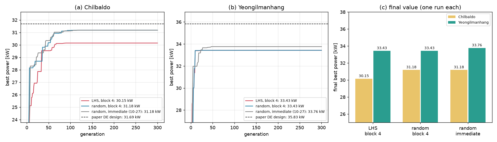

# 업데이트 보고서: 칠발도·영일만항에서 초기 개체군(`InitPop` 0 / 1) 비교

- 날짜: 2026-11-03
- 계산: 계산용 PC 작업 `20261101_223606_initpop_cmp`(커밋 0c775fc)
  - `run_sites.py --sites 2 3 --variants InitPop=1 InitPop=0`
  - DE 개체 100 × 300세대, F 0.5, CR 0.9, ITTC, 메쉬 120, 형상 1(원통 + 반구), 5기 동시최적화
  - `DEUpdate` 2(묶음 4), `Workers` 4, `NCPU` 4, 시드 고정 없음
- 비교 기준: 같은 해역의 DE 100(`InitPop` 0, `DEUpdate` 0, `Workers` 1) `20261026_143020_de100_sites23`([보고서 2026-10-27_01](2026-10-27_01_de100-sites-result.md))
- 코드 변경은 없다. 결과와 분석만 기록한다.
- 그림 `docs/reports/images/2026-11-03_01_initpop_sites.png`
  - 각 실행의 `logs/*_generation_history.csv`, `*_summary.json`, `*_trial_history.csv`(`results/`에 가져옴)로 그렸다.
  - 그림을 만든 분석용 스크립트는 저장소에 넣지 않았다.

## 1. 개요

[보고서 2026-11-01_03](2026-11-01_03_lhs-initial-population.md)에서 라틴 하이퍼큐브 초기 개체군(`InitPop` 1)을 추가했다. 벤치마크 함수에서는 차이가 없었으므로, 실제 WEC 문제에서 확인하려고 칠발도·영일만항을 `InitPop` 1과 0으로 한 번씩 돌렸다.
- 두 조건의 다른 설정(`DEUpdate` 2 등)은 같다.
- 두 해역은 DE 100이 논문 설계(다섯 기 모두 벽 옆)와 다른 골짜기에 수렴한 곳이다.

## 2. 결과

(a) 칠발도와 (b) 영일만항의 세대별 최고 출력, (c) 최종값이다. 점선은 논문 DE 설계를 현재 프로세스로 다시 계산한 값이다(영일만항은 수심 33 m 설계를 13 m에서 계산한 값).

| 해역 | 조건 | 출력 [kW] | 최적 벡터 [R, D, X1, X2, Y2, X3, Y3] | 99% 도달 / 마지막 개선 세대 | WAMIT / 간격 위반 / 캐시 적중 | 걸린 시간 (WAMIT 1회당) |
| --- | --- | --- | --- | --- | --- | --- |
| 칠발도 | **LHS**, 묶음 4 | **30.15** | [2.5, 2.2, 3.0, 3.0, 10.0, 15.6, 27.0] | 63 / 90 | 6899 / 1140 / 22061 | 13.47 h (7.0 s) |
| 칠발도 | 난수, 묶음 4 | **31.18** | [2.5, 2.0, 15.3, 15.1, 30.0, 15.3, 15.4] | 62 / 119 | 7070 / 4738 / 18292 | 14.77 h (7.5 s) |
| 칠발도 | 난수, 즉시 교체 (10-27) | 31.18 | [2.5, 2.0, 15.3, 15.1, 30.0, 15.3, 15.4] | 63 / 117 | 8425 / 3195 / 18480 | 18.97 h (8.1 s) |
| 영일만항 | **LHS**, 묶음 4 | **33.43** | [2.5, 5.0, 3.0, 3.0, 16.8, 24.6, 30.0] | 10 / 27 | 2610 / 266 / 27224 | 4.77 h (6.6 s) |
| 영일만항 | 난수, 묶음 4 | **33.43** | [2.5, 5.0, 3.0, 3.0, 16.8, 24.6, 30.0] | 10 / 30 | 2640 / 288 / 27172 | 4.84 h (6.6 s) |
| 영일만항 | 난수, 즉시 교체 (10-27) | 33.76 | [2.5, 4.8, 11.0, 3.0, 6.0, 3.0, 30.0] | 23 / 47 | 3785 / 728 / 25587 | 8.13 h (7.7 s) |

논문 DE 설계: 칠발도 31.69 kW, 영일만항 35.83 kW(13 m 재계산).

**LHS는 결과를 좋게 하지 않았다.**
- 칠발도는 LHS가 1.03 kW(3.3%) 낮고, 영일만항은 두 조건이 같은 설계에 도착했다.
- 실행이 하나씩이라 칠발도의 차이가 LHS 때문인지 운인지는 구분할 수 없다. 다만 좋아지는 쪽의 근거는 없다.

**서로 다른 실행이 격자 위의 같은 점에 정확히 도착한다.** 시드를 고정하지 않았는데도 그렇다.

| 해역 | 골짜기(최적 벡터) | 출력 [kW] | 도착한 실행 |
| --- | --- | --- | --- |
| 칠발도 | 앞 두 줄 벽 옆, 바깥 쌍 X3 15.6 | 30.15 | DE 72 (10-26), **LHS 묶음 4** |
| 칠발도 | 다섯 기 모두 x ≈ 15 m | 31.18 | DE 100 즉시 교체 (10-27), **난수 묶음 4** |
| 영일만항 | 앞 두 줄 벽 옆, 바깥 쌍 X3 24.6 | 33.43 | DE 72 (10-26), **LHS 묶음 4**, **난수 묶음 4** |
| 영일만항 | 가운데 쌍과 바깥 쌍 벽 옆, WEC1 x 11.0 | 33.76 | DE 100 즉시 교체 (10-27) |

- 해역마다 DE가 끌려가는 골짜기가 두 개쯤 있고, 실행마다 그중 하나에 수렴한다. 어느 쪽으로 갈지는 초기 개체군 방식으로 정해지지 않는다.
- 논문 설계가 있는 "다섯 기 모두 벽 옆" 골짜기에는 이번 네 실행 모두 가지 못했다. 이 영역(X1, X2, X3 모두 ≤ 3.5 m)의 설계를 이번 네 실행은 하나도 평가하지 않았다(10-27 영일만항 즉시 교체는 4개, 최고 29.38 kW).
- 영일만항은 10세대 만에 최종값의 99%에 도달하고, 30세대 이후는 새 설계가 거의 없다(캐시 적중 90%). 개체군이 매우 일찍 한 점으로 모인다.

**묶음 즉시 교체(`DEUpdate` 2)의 실제 문제 확인**
- 같은 난수 초기화에서 칠발도는 즉시 교체와 같은 설계(31.18 kW)에 도착했다.
- 영일만항은 다른 골짜기로 갔다(33.43 대 33.76 kW). 이것은 위 표의 골짜기 선택과 같은 현상으로, 묶음 방식 때문이라고 볼 근거는 없다. LHS와 DE 72도 같은 골짜기로 갔다.
- 시간은 칠발도 18.97 → 14.77 h, 영일만항 8.13 → 4.84 h로 줄었다.
  - WAMIT 1회당 시간이 7.5~8.1 s → 6.6~7.5 s로 줄었다(동시 실행, [보고서 2026-11-01_02](2026-11-01_02_de-block-update.md)의 1.19배와 비슷).
  - 영일만항은 일찍 수렴해서 WAMIT 계산 수도 줄었다(3785 → 2640).

## 3. 호환성 영향

없다. 코드와 설정 파일을 바꾸지 않았다. `results/summary.csv`에 이번 네 실행이 추가됐다(`init_pop`, `de_update`, `workers` 칸으로 구분).

## 4. 검증

- 각 실행의 `summary.json` 최고값과 벡터가 `run.log`의 `Best fitness`, `Best vector`와 같다.
- 평가 수의 합(WAMIT + 간격 위반 + 캐시 적중)이 모두 30,100(초기 100 + 100 × 300)이다.
- `config.json`에서 `init_pop`(1, 0)과 `workers` 4를 확인했다.
- 참고: `trial_history.csv`의 벡터는 대칭 쌍을 정렬한(canonicalize) 뒤의 값이다. 그래서 X2, X3 열 하나만 보면 LHS의 층화가 보이지 않는다. "다섯 기 모두 벽 옆"은 X1, X2, X3 모두 ≤ 3.5 m로 세어서 정렬의 영향을 받지 않는다.

## 5. 남은 이슈 / 후속 작업

- **결론: 초기 개체군은 골짜기 선택 문제의 원인이 아니다.** 기본값은 그대로 `InitPop` 0(논문)으로 둔다. `InitPop` 1은 옵션으로 남긴다.
- 문제는 탐색 과정이다. 개체군이 10~60세대 안에 한 골짜기로 모이고, 그 뒤로 다른 골짜기를 보지 못한다. 검토할 후보는 다음과 같다.
  - 변이 전략: DE/rand/1/bin은 CR 0.9에서 대부분의 변수를 변이 벡터에서 가져오므로, 다른 개체의 좋은 부분(예: X3 = 3)을 합치기 어렵다. CR을 낮추거나 다른 전략(current-to-pbest 등)을 검토한다.
  - 다양성 유지: 수렴 뒤 일부 개체를 다시 뽑거나(재시작), 독립 실행 여러 번 중 가장 좋은 것을 고른다.
  - 지역 탐색: 최종 해에서 변수 하나씩 바꿔 보는 후처리. 10-26 분석에서 영일만항 DE 72 설계의 X3만 3 m로 바꾸자 35.37 kW로 올랐다.
- 해역마다 실행 하나의 결과는 "어느 골짜기에 갔는가"에 크게 좌우된다. 결과를 논문과 비교할 때는 여러 실행을 보고해야 한다.
