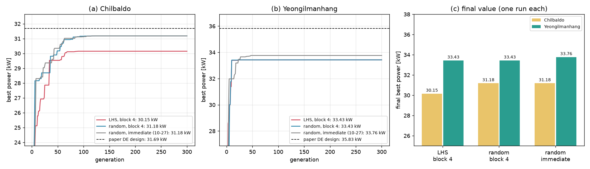

# 업데이트 보고서: 라틴 하이퍼큐브 초기 개체군(`InitPop`) 제거

- 날짜: 2026-11-04
- 범위:
  - 코드: `src/algorithms/common.py`, `src/algorithms/{de,pso,ga,depso}.py`, `main.py`
  - 설정: `config.cfg`(`InitPop` 줄 삭제)
  - 실험 스크립트: `scripts/experiments/algorithm_benchmark.py`(`de_lhs`, `depso_lhs` 삭제), `scripts/experiments/run_sites.py`(예시만 변경)
  - 문서: `README.md`, `docs/manual_ko.md`, `docs/algorithms_and_problems.md`
  - 테스트: `tests/test_init_population.py` 삭제, `tests/test_run_sites.py` 수정
- WAMIT 입력 파일은 바뀌지 않는다.
- 그림 `docs/reports/images/2026-11-03_01_initpop_sites.png`(제거 근거, [보고서 2026-11-03_01](2026-11-03_01_initpop-sites-result.md)의 그림을 다시 씀)

## 1. 개요

[보고서 2026-11-01_03](2026-11-01_03_lhs-initial-population.md)에서 라틴 하이퍼큐브 초기 개체군(`InitPop` 1)을 추가했다. 두 번의 시험에서 효과가 없었다.
- 벤치마크 함수(DE 100, 7차원, 시드 30, 세 조건): 최종값 차이 없음(p ≥ 0.12).
- 실제 WEC 문제([보고서 2026-11-03_01](2026-11-03_01_initpop-sites-result.md)): 칠발도 LHS 30.15 kW 대 난수 31.18 kW, 영일만항은 둘 다 33.43 kW(같은 설계).

결과는 초기화 방식이 아니라 DE가 어느 골짜기로 수렴하느냐로 정해졌다. 사용자가 이 프로젝트에서 LHS를 쓰지 않기로 결정해서(2026-11-04), 코드와 설정에서 제거했다.

## 2. 변경 내용

**코드**
- `common.py`: `lhs_grid_population`, `initial_population`, `check_init_pop`, `INIT_POPULATIONS`, `DEFAULT_INIT_POP`를 삭제했다.
- DE, PSO, GA, DEPSO는 LHS를 넣기 전처럼 `random_grid_population`을 직접 부른다.
- `main.py`: `InitPop` 읽기·검증과 `Initial population: ...` 출력을 삭제했다.

**설정**: `config.cfg`에서 `InitPop` 줄과 설명 주석 두 줄을 삭제했다.

**실험 스크립트**
- `algorithm_benchmark.py`: `de_lhs`, `depso_lhs`와 `init_pop` 전달 코드를 삭제했다.
- `run_sites.py`: 기능은 그대로이고, `--variants` 예시만 `InitPop` 대신 `DEUpdate`로 바꿨다.

**요약표**: `summary.csv`의 `init_pop` 칸은 남겼다. 2026-11-03 비교 작업(`20261101_223606_initpop_cmp`)의 두 조건을 구분하는 데 쓰인다. 새 작업에서는 빈 칸이다.

**테스트**
- `tests/test_init_population.py`(10건)를 삭제했다.
- `tests/test_run_sites.py`의 `--variants` 시험은 `InitPop` 대신 `PopSize`로 값을 바꿔 같은 동작을 확인한다.

**보고서**: 2026-11-01_03과 2026-11-03_01 보고서는 당시 기록이므로 그대로 둔다.

## 3. 호환성 영향

- 기본값(`InitPop` 0)의 동작과 결과는 같다. 기본값 경로는 원래 `random_grid_population`을 그대로 불렀으므로 난수 호출 순서도 같다.
- `InitPop` 줄이 있는 예전 설정 파일도 오류 없이 실행된다. 다만 그 값은 무시되고, 항상 균등 난수로 시작한다.
  - 예: `results/20261101_223606_initpop_cmp/config_v1_site*.cfg`(`InitPop` 1)를 다시 돌리면 LHS가 아니라 난수로 시작한다.
- 사용자가 할 일은 없다.

## 4. 검증

- `ruff check .`, `ruff format --check .` 통과(`docs/research_notes/`는 커밋하지 않는 사용자 폴더라 검사에서 뺐다).
- `python -m unittest discover -s tests`: 284건 통과(3건 건너뜀). 이전 294건에서 삭제한 LHS 테스트 10건이 빠졌다.
- 저장소에서 `InitPop`, `init_pop`, `lhs`, `initial_population`을 찾아, 남은 것이 `run_summary.py`의 `init_pop` 칸뿐임을 확인했다(보고서와 CHANGELOG 제외).

## 5. 남은 이슈 / 후속 작업

- 골짜기 선택 문제는 탐색 과정에서 다룬다. 후보는 DE의 CR이나 변이 전략 변경, 수렴 뒤 재시작, 최종 해의 지역 탐색이다([보고서 2026-11-03_01](2026-11-03_01_initpop-sites-result.md) 5절).
