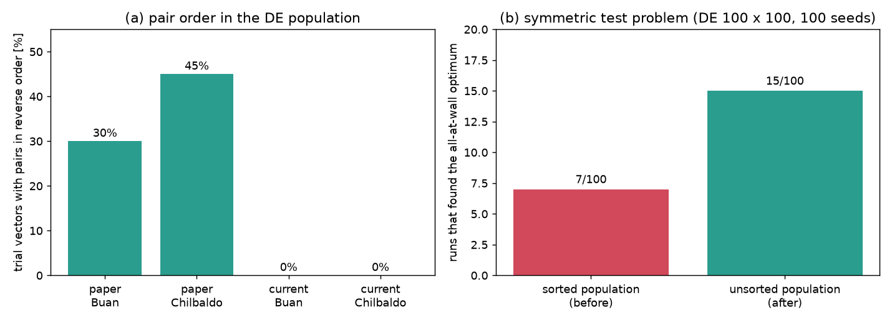

# 업데이트 보고서: DE 개체군에 대칭 쌍 정렬을 쓰지 않음 (논문 계산과 같게)

- 날짜: 2026-11-04
- 범위: `src/algorithms/de.py`, `tests/test_fixes.py`(커밋 288ca12)
- WAMIT 입력 파일은 바뀌지 않는다. 평가는 이전처럼 정렬한 벡터로 한다.
- 그림 `docs/reports/images/2026-11-04_02_de_pair_order.png`
  - (a) 논문 계산 로그(사용자 제공, `WEC Shape Layout Optimization/new_data/Sim_*_trial_history.csv`)와 현재 실행 로그에서 셌다.
  - (b) 대칭 시험 문제(아래 4.2절)를 바뀐 코드와 이전 코드로 100번씩 돌렸다.
  - 분석·시험용 스크립트는 저장소에 넣지 않았다.

## 1. 개요

현재 DE는 칠발도·영일만항에서 논문 설계보다 낮은 골짜기에 수렴한다([보고서 2026-11-03_01](2026-11-03_01_initpop-sites-result.md)). 원인을 찾으려고 논문 때 코드와 로그를 지금과 비교했다.

**발전량 계산은 같다.**
- 개편 전 마지막 커밋 `12fe7c3`(2026-07-07)을 ITTC 스펙트럼으로 돌리면 논문 Table 4 값이 소수점까지 나온다(칠발도 동시 31.911, 순차 31.327, 부안 동시 50.357, 순차 47.519 kW).
- 지금 코드는 0.5~1.0% 낮다. 메쉬, 솔버, 가진력 계산을 바꾼 영향이다. 설계 사이의 순위는 같다.

| 칠발도 설계 | 논문 때 코드 [kW] | 지금 코드 [kW] |
| --- | --- | --- |
| 논문 동시 [2.5, 2.4, 3, 3, 10.8, 3, 23.5] | 31.911 | 31.689 |
| 논문 순차 [2.5, 2.0, 15.3, 15.2, 15.3, 15.0, 30] | 31.327 | 31.006 |
| DE 100 결과 [2.5, 2.0, 15.3, 15.1, 30.0, 15.3, 15.4] | 31.308 | 31.181 |
| DE 72 결과 [2.5, 2.2, 3, 3, 10.0, 15.6, 27.0] | 30.115 | 30.149 |

**DE 코드에는 차이가 하나 있다.** 사용자가 준 논문 계산 로그(평가 수 6755, 11578 = 논문 Table 5의 6756, 11579)를 보면, 논문 때 DE는 대칭 쌍을 정렬하지 않았다.
- 시험 벡터 중 (x2, y2) > (x3, y3)인 것이 부안 30%, 칠발도 45%다. 초기 개체군에서는 42~55%로 무작위 수준이다. y나 원점 거리로 정렬한 흔적도 없다.
- 순서만 다른 같은 배치를 따로 계산한 경우가 부안 97개, 칠발도 147개다(평가의 1.3~1.4%). 캐시에서도 정렬하지 않았다.
- 저장소의 첫 커밋(2026-05-26)부터 `CachedEvaluator`가 시험 벡터를 **제자리에서** 정렬했다. 그래서 DE 개체군에 정렬된 벡터가 들어갔다. 현재 실행 로그의 벡터는 100% 정렬되어 있다(그림 (a)).

정렬한 목적은 순서만 바뀐 같은 배치를 다시 계산하지 않는 것이다(사용자 설명). 이 목적 자체는 맞다. 문제는 정렬된 벡터를 개체군에 되돌려 넣는 부분이다.

## 2. 변경 내용

**`run_de`** (`src/algorithms/de.py`)
- 초기 개체군과 시험 벡터를 `canonical_copy`(격자 스냅 + 정렬한 사본)로 평가한다. 캐시 키도 이 사본으로 만든다.
- 개체군에는 정렬하지 않은 시험 벡터를 넣는다. PSO, CMA-ES, DEPSO가 이미 쓰던 방식과 같다.
- 돌려주는 최적 설계와 로그(`trial_history`, `generation_history`)는 이전처럼 정렬된 형태다.
- 난수 호출 순서는 같다.

**왜 문제가 되는가**
- 두 쌍의 x가 비슷하면(벽 옆 배치는 둘 다 x = 3) x가 0.1만 달라져도 정렬 순서가 뒤집힌다. 그러면 y값 두 개(약 11과 약 23)가 자리를 바꾼다.
- 개체마다 "y2 자리"에 다른 쌍의 값이 들어가므로, 차분 변이 a + F(b − c)가 두 쌍을 섞는다. 두 쌍을 따로 다듬지 못하고 가운데 값으로 끌린다.
- 정렬하지 않으면 개체군이 스스로 일관된 순서(예: 한 쌍은 y ≈ 11, 다른 쌍은 y ≈ 23)로 모인다.

**테스트** (`tests/test_fixes.py`, 1건 추가)
- `test_de_population_is_not_reordered`: 대칭인 목적 함수에서 DE의 최종 결과가 정렬을 완전히 끈 DE(논문 방식)와 같은지 확인한다. 평가 함수가 받는 벡터는 모두 정렬되어 있어야 한다.
- 이전 코드로 돌리면 이 테스트가 실패한다(궤적이 달라짐). 확인했다.

GA도 정렬된 벡터를 개체군에 넣는다. 주 알고리즘이 아니어서 이번에는 바꾸지 않았다.

## 3. 호환성 영향

- 같은 시드여도 DE 결과가 이전과 달라진다(개체군 내용이 다름). 평가 함수, 캐시, 로그 형식은 같다.
- 설정 파일 변경은 없다. 사용자가 할 일은 없다.
- 이전 DE 결과(DE 72, DE 100, InitPop 비교)는 정렬된 개체군으로 계산된 것이다.

## 4. 검증

### 4.1 코드 검사
- `ruff check .`, `ruff format --check .` 통과(`docs/research_notes/`는 커밋하지 않는 사용자 폴더라 제외).
- `python -m unittest discover -s tests`: 285건 통과(3건 건너뜀).

### 4.2 대칭 시험 문제 (WAMIT 없음, 그림 (b))
- 문제 설정:
  - 5기 배치 변수 5개, 격자 0.1, 간격 제약은 실제와 같다.
  - 목적 함수는 정렬한 배치로 계산한다. 봉우리는 두 개다.
    - 높은 봉우리(32.0): 다섯 기 모두 벽 옆, [3, 3, 11, 3, 23].
    - 넓고 낮은 봉우리(31.2): 칠발도 DE 100 결과와 같은 [15.3, 15.1, 30, 15.3, 15.4].
- DE 100 × 100세대, F 0.5, CR 0.9, 시드 100개.
- 높은 봉우리를 찾은 횟수는 이전 코드 7/100, 바뀐 코드 15/100이다(Fisher p = 0.11).
- 방향은 기대와 맞지만 통계적으로 확실한 차이는 아니다. 이 시험 문제는 실제 지형을 흉내 낸 것일 뿐이므로, 실제 WEC 문제에서 확인한다(4.3절).

### 4.3 실제 해역 (진행 중)
- 계산용 PC 작업 `20261104_050221_de_nosort_sites21`(2026-11-04 05:02 시작).
- 논문과 같은 조건: DE 100 × 300, 즉시 교체(`DEUpdate` 0), `Workers` 1, `NCPU` 8, ITTC.
- 칠발도, 부안 순서로 돌린다. 예상 시간은 약 19 h + 7 h다.
- 판단 기준: 칠발도에서 벽 옆 골짜기(지금 코드로 31.69 kW)에 도달하는가.
- 결과는 다음 보고서에 적는다.

## 5. 남은 이슈 / 후속 작업

- 4.3절 결과 확인. 실행 하나라 운의 영향이 남으므로, 결과에 따라 칠발도를 한두 번 더 돌릴지 정한다.
- 결과가 좋으면 `DEUpdate` 2(계산용 PC 기본)에서도 같은지 확인하고, GA에도 같은 방식을 적용할지 검토한다.
- 영일만항(13 m)은 논문(33 m)과 문제가 다르다. 그래서 칠발도·부안으로 판단한 뒤에 다시 돌린다.
