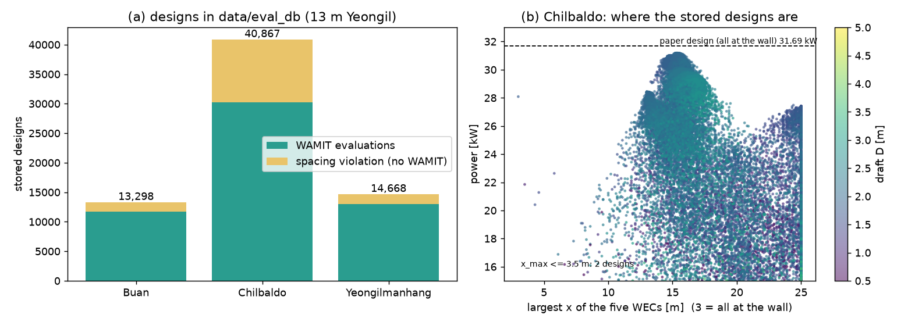

# 업데이트 보고서: 평가 기록 데이터베이스와 재사용 옵션(`EvalCache`)

- 날짜: 2026-11-04
- 범위:
  - 새 모듈: `src/utils/eval_db.py`(설정 지문, 읽기·쓰기·병합)
  - 새 스크립트: `scripts/build_eval_db.py`(`results/`, `logs/` → `data/eval_db/`)
  - 수정: `src/algorithms/common.py`(`CachedEvaluator` 미리 불러오기, `stored_hits`), `src/algorithms/progress.py`(`Stored` 표시)
  - 수정: `main.py`, `config.cfg`(`[WAMIT Settings] EvalCache`), `scripts/remote.ps1`(fetch 뒤 자동 갱신), `.gitignore`(`data/eval_db/`)
  - 문서: `README.md`, `docs/manual_ko.md`, `CLAUDE.md`(구조도)
  - 테스트: `tests/test_eval_db.py`(7건)
- WAMIT 입력 파일은 바뀌지 않는다. 기본값(`EvalCache` 0)에서는 동작도 같다.
- 그림 `docs/reports/images/2026-11-04_03_eval_db.png`: `data/eval_db/*.csv`로 그렸다(그림 스크립트는 저장소에 넣지 않음).

## 1. 개요

사용자 요청:
- 지금까지 계산한 설계와 발전량을 한 곳에 모은다.
- 테스트할 때 계산용 PC로 다시 돌리지 않고 그 값을 바로 쓴다.
- 나중에 대리모델 학습 데이터로도 쓴다.

평가할 때마다 `trial_history.csv`에 설계 변수, 총 발전량, WEC별 발전량, 간격 위반 여부가 남아 있었다. 이것을 평가 설정별로 모으고, 같은 설정의 실행이 미리 불러오게 했다.

## 2. 변경 내용

**설정 지문** (`eval_db.fingerprint`)
- 발전량을 정하는 값만 모은다: 해역 이름, `OptMode`, `NumWECs`, 스펙트럼, Hs, Tp, γ, 수심, 메쉬, 솔버, `OmegaMax`, `FreqGrid`, 형상, 벽, 입사각, 유체 솔버(WAMIT/Capytaine), 최소 간격(벌점 값에 영향).
  - `OptMode` 2이면 고정 반지름과 흘수도 넣는다.
  - `Workers`, `NCPU`, 알고리즘은 결과를 바꾸지 않으므로 넣지 않는다.
- 평가 코드의 판 `EVAL_VERSION`(현재 1)을 함께 넣는다. 평가 코드를 바꿔 같은 설정에서도 값이 달라지면 이 값을 올린다. 그러면 옛 기록은 불러오지 않는다.
- 예전 설정에 없던 키는 기본값으로 채운다(형상 1, 벽 1, 입사각 0, 유체 솔버 1). `FreqGrid`가 없는 2026-10-23 이전 실행은 메쉬·주파수 방식이 지금과 달라서 넣지 않는다.
- 파일 이름: `data/eval_db/<해역>_mode<OptMode>_n<NumWECs>_<지문 해시 10자리>.csv`, 지문은 같은 이름의 `.json`.

**데이터베이스 만들기** (`scripts/build_eval_db.py`)
- `*_trial_history.csv`와 `*_config.json`을 찾아 지문별로 합친다.
- 같은 설계(정렬된 벡터)는 처음 기록을 남긴다. 값이 상대 1e-4 넘게 다르면 충돌로 세고 알린다.
- `remote.ps1 fetch`가 결과를 가져온 뒤 그 작업 폴더로 자동 실행한다.
- 열: `v1..v7`, `fitness`, `p1..p5`, `penalized`, `source`(처음 기록한 실행).

**미리 불러오기** (`EvalCache 1`)
- `CachedEvaluator`가 시작할 때 지문이 같은 파일을 읽어 둔다. `Stored evaluations: N designs from <파일>`처럼 출력한다.
- 저장된 설계는 WAMIT 없이 그 값을 쓴다.
  - 처음 쓸 때 trial 기록에 남겨, 실행이 방문한 설계 목록은 빠지지 않는다.
  - `stored_hits`로 따로 세고(진행 줄 `Stored`, `summary.json`), WAMIT 수와 캐시 적중 수에는 넣지 않는다.
- 지금 문제의 격자에 없는 기록(다른 `StepSize`나 범위)은 건너뛴다.
- 기본값은 0이다. WAMIT 계산 수와 시간을 논문과 비교하는 실험에 영향을 주지 않기 위해서다.

## 3. 호환성 영향

- `EvalCache` 0(기본)에서는 이전과 같다. `summary.json`에 `stored_hits` 칸이 늘었다(0).
- `data/eval_db/`는 gitignore한다(결과에서 만들어지고, 약 11 MB). 다만 `data/`는 `remote.ps1 submit`의 스냅샷에 들어가므로 계산용 PC에서도 쓸 수 있다.
- 사용자가 할 일:
  - 처음 한 번 `python scripts/build_eval_db.py`를 실행한다. 이번에는 실행해 두었다.
  - 기록을 쓰고 싶은 실행에서 `EvalCache 1`로 설정한다.

## 4. 검증

**만든 데이터베이스** (2026-11-04, 14개 실행, 1.5초)

| 해역 | 설계 | WAMIT | 간격 위반 | 최고값 |
| --- | --- | --- | --- | --- |
| 부안 | 13,298 | 11,751 | 1,547 | 50.015 kW |
| 칠발도 | 40,867 | 30,260 | 10,607 | 31.181 kW |
| 영일만항 (13 m) | 14,668 | 12,966 | 1,702 | 33.764 kW |

- 조건은 모두 ITTC, 메쉬 120, 반복 솔버, 0.05 rad/s × 51, 원통 + 반구, 벽, 입사각 0, 5기 동시최적화다.
- WAMIT 54,977회는 설계당 약 7초로 보면 약 107시간에 해당한다.
- 여러 실행에서 같은 설계를 다시 계산한 값의 최대 상대 차이는 6.2e-7이었다(반복 솔버 수렴 오차). 충돌로 센 것은 없다.
- 오늘 지금 코드로 다시 계산한 칠발도 DE 100 설계 31.181 kW([보고서 2026-11-04_02](2026-11-04_02_de-unsorted-population.md))는 데이터베이스 값과 같다.
- 현재 `config.cfg`로 만든 문제 설정(해역 1~3)이 이 세 파일을 찾는 것을 확인했다.
- 2026-10-23 이전 실행 3개는 설정이 기록되지 않아 넣지 않았다.

**테스트** (`tests/test_eval_db.py`, 7건)
- 지문: 결과에 영향이 없는 값(`Workers`, `NCPU`)은 같은 파일이고, 수심·메쉬·스펙트럼·입사각·Hs가 다르면 다른 파일이다. 예전 설정의 기본값 처리와 필수 키가 없을 때 거부하는지도 확인한다.
- 미리 불러오기: 저장된 설계는 평가 함수를 부르지 않고 trial 기록에 남는다. 묶음 평가에서도 같은 설계는 한 번만 기록을 쓴다. 집계(`stored_hits`, 캐시 적중)를 확인하고, 격자 밖 기록은 건너뛴다.
- 같은 시드의 DE를 두 번 돌리되, 첫 실행 기록으로 데이터베이스를 만든다. 두 번째 실행은 평가 함수를 한 번도 부르지 않고 같은 답을 낸다.
- 만들기 스크립트: 여러 실행 병합, 값 충돌 시 처음 값 유지, 설정이 없는 실행 건너뛰기, 간격 위반 기록 저장.
- 전체: `ruff check .`, `ruff format --check .` 통과(`docs/research_notes/` 제외). `python -m unittest discover -s tests` 292건 통과(3건 건너뜀).

## 5. 남은 이슈 / 후속 작업

**대리모델 데이터로 쓸 때 주의할 점**
- 기록은 최적화 경로를 따라 모인 것이라 수렴한 골짜기 근처에 몰려 있다.
- 칠발도에서는 다섯 기가 모두 벽 옆인 영역(x_max ≤ 3.5 m)의 설계가 2개뿐이다(그림 (b)). 논문 설계가 있는 곳의 데이터가 거의 없다.
- 대리모델을 만들려면 이런 영역을 따로 채우는 계산(공간 채움 표본 등)이 필요하다.

**논문 때 기록**
- 논문 때 기록(동시 부안 6,755, 칠발도 11,578, 영일만항 33 m, 순차 결과)은 평가 방식이 달라 값이 0.5~1% 높다.
- 그래서 같은 데이터베이스에 넣지 않았다. 대리모델에 쓰려면 별도 파일로 바꾸는 스크립트가 필요하다(낮은 정밀도 데이터로 쓰거나 보정해서 사용).

**저장하지 않는 것**
- WAMIT 유체력 계수는 저장하지 않는다. 그래서 Hs나 Tp가 바뀐 해역 조건에는 기록을 쓸 수 없다.
- 유체력 계수(`.1`, `.3`)를 저장하면 같은 형상·배치에서 스펙트럼만 바꿔 다시 계산할 수 있다. 다만 파일이 훨씬 커진다.

**검증 계산**
- 진행 중인 검증 계산(`20261104_050221_de_nosort_sites21`)은 fetch할 때 자동으로 데이터베이스에 더해진다.
