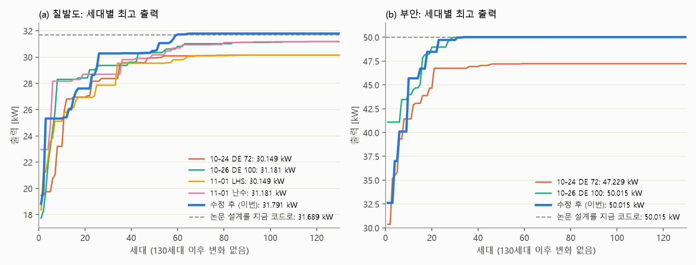
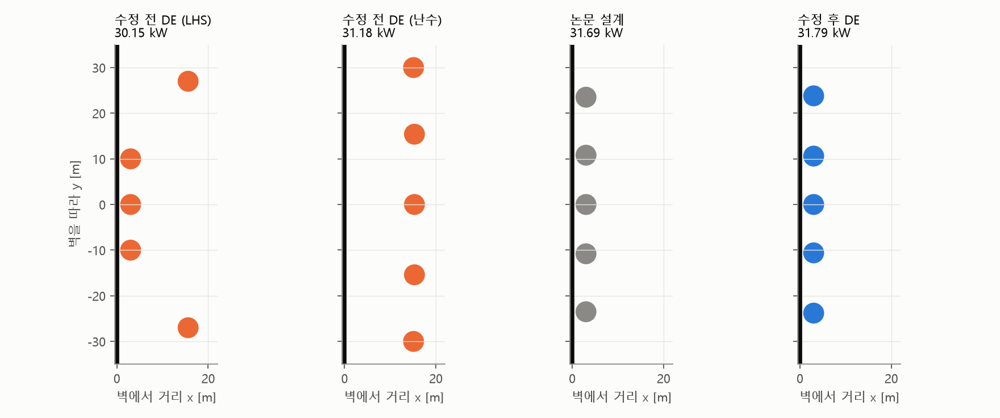
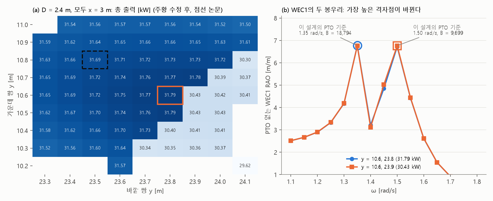

# 업데이트 보고서: 정렬 수정 후 DE의 최적해 (칠발도·부안)와 PTO 감쇠 계단

- 날짜: 2026-11-05
- 계산: 계산용 PC 작업 `20261104_050221_de_nosort_sites21`(커밋 288ca12)
  - `run_sites.py --sites 2 1`, DE 개체 100 × 300세대, F 0.5, CR 0.9, 시드 고정 없음
  - ITTC, 메쉬 120, 반복 솔버, 0.05 rad/s × 51, 형상 1(원통 + 반구), 벽, 5기 동시최적화
  - `DEUpdate` 0, `Workers` 1, `NCPU` 8. `EvalCache` 기능이 생기기 전에 시작한 작업이라 저장 기록을 쓰지 않았다.
- 코드 변경은 없다. 결과와 분석만 기록한다. WAMIT 입력도 바뀌지 않았다.
- **이 보고서는 최적해만 다룬다.** 계산 도중 같은 PC에 다른 계산이 끼어들어 걸린 시간은 비교할 수 없다(사용자 확인). 그래서 시간 비교는 넣지 않았다.
- 그림 3개 (`docs/reports/images/`)
  - `2026-11-05_01_convergence.png`, `2026-11-05_01_layouts.png`: 각 실행의 `results/*/logs/*_generation_history.csv`, `*_summary.json`으로 그렸다.
  - `2026-11-05_01_pto_step.png`: (a)는 `data/eval_db/Chilbaldo_mode3_n5_e71c389f46.csv`, (b)는 아래 3절의 WAMIT 계산이다.
  - 그림과 분석 스크립트는 저장소에 넣지 않았다.

## 1. 개요

[보고서 2026-11-04_02](2026-11-04_02_de-unsorted-population.md)에서 DE가 정렬된 벡터를 개체군에 넣지 않도록 고쳤다. 판단 기준은 "칠발도에서 다섯 기 모두 벽 옆인 골짜기(논문 설계)에 도달하는가"였다.

**결과**
- 칠발도: 도달했다. 31.791 kW로, 지금 코드로 계산한 논문 설계 31.689 kW보다 0.32% 높다.
- 부안: 논문 설계와 벡터까지 같은 50.015 kW에 도달했다.
- 새로 찾은 것: 칠발도 최적점 바로 옆에 출력이 4% 끊기는 계단이 있다. 원인은 PTO 감쇠를 정하는 규칙이다. 최적점의 정확한 위치는 이 계단이 정한다.

## 2. 결과

점선은 논문 설계를 지금 코드로 계산한 값이다. 130세대 이후로는 어느 실행도 바뀌지 않아 잘랐다.

**칠발도** ("벽 옆"은 x1, x2, x3가 모두 3.5 m 이하이고 간격 위반이 없는 설계)

| 실행 | 개체군 | 출력 [kW] | 최적 벡터 [R, D, X1, X2, Y2, X3, Y3] | 벽 옆 설계 수 | 99% 도달 / 마지막 개선 세대 | WAMIT |
| --- | --- | --- | --- | --- | --- | --- |
| 10-24 DE 72 | 정렬 | 30.149 | [2.5, 2.2, 3, 3, 10.0, 15.6, 27.0] | 0 | 47 / 83 | 4,639 |
| 10-26 DE 100 | 정렬 | 31.181 | [2.5, 2.0, 15.3, 15.1, 30.0, 15.3, 15.4] | 0 | 63 / 117 | 8,425 |
| 11-01 LHS, 묶음 4 | 정렬 | 30.149 | [2.5, 2.2, 3, 3, 10.0, 15.6, 27.0] | 0 | 63 / 90 | 6,899 |
| 11-01 난수, 묶음 4 | 정렬 | 31.181 | [2.5, 2.0, 15.3, 15.1, 30.0, 15.3, 15.4] | 0 | 62 / 119 | 7,070 |
| **11-04 DE 100** | **정렬 안 함** | **31.791** | **[2.5, 2.4, 3, 3, 10.6, 3, 23.8]** | **1,615** | 59 / 65 | 5,455 |
| (논문 설계, 지금 코드) | | 31.689 | [2.5, 2.4, 3, 3, 10.8, 3, 23.5] | | | |
| (논문 설계, 논문 때 코드) | | 31.911 | 위와 같음 | | | |

**부안**

| 실행 | 개체군 | 출력 [kW] | 최적 벡터 | 벽 옆 설계 수 | 99% 도달 / 마지막 개선 세대 | WAMIT |
| --- | --- | --- | --- | --- | --- | --- |
| 10-24 DE 72 | 정렬 | 47.229 | [2.5, 3.7, 3, 3, 11.0, 20.8, 30] | 0 | 36 / 59 | 4,058 |
| 10-26 DE 100 | 정렬 | 50.015 | [2.5, 3.8, 3, 3, 13.9, 3, 30] | 822 | 27 / 39 | 3,183 |
| **11-04 DE 100** | **정렬 안 함** | **50.015** | **[2.5, 3.8, 3, 3, 13.9, 3, 30]** | 844 | 23 / 40 | 3,219 |

부안 벡터는 논문 설계와 같다. 지금 코드 값이 논문 값 50.357 kW보다 낮은 것은 평가 코드 차이다(메쉬, 솔버, 가진력 계산).

**칠발도 새 설계와 논문 설계** (둘 다 지금 코드, 단위 kW)

| 설계 | 합계 | WEC1 | WEC2, 3 (각각) | WEC4, 5 (각각) |
| --- | --- | --- | --- | --- |
| 논문 Y2 10.8, Y3 23.5 | 31.689 | 6.233 | 7.015 | 5.713 |
| 새 설계 Y2 10.6, Y3 23.8 | 31.791 | 6.190 | 7.123 | 5.678 |

R, D와 x는 같고 y만 조금 다르다. 같은 골짜기 안에서 위치가 조금 옮겨간 것이다.

**수렴**
- 칠발도는 74세대, 부안은 47세대 이후 새 WAMIT 계산이 없다. 개체군 전체가 한 설계로 모였다는 뜻이다.
- 그래서 나머지 세대는 탐색을 하지 않았다. 이 답이 전역 최적이라는 보장은 없다.

## 3. PTO 감쇠 계단

**현상** (그림 (a))
- D = 2.4 m이고 모두 x = 3 m인 면에서, 출력이 약 31.7 kW와 약 30.4 kW의 두 층으로 나뉜다.
- 경계는 Y3 − Y2 ≈ 13.2~13.3 m인 대각선이다. 저장된 값에서 Y3 0.1 m 차이로 1% 넘게 변하는 곳은 Y2 = 10.3~10.9 m의 7곳이고, 모두 이 선 위에 있다.
- 새 설계는 위층의 끝에 있다. 바로 옆 (10.6, 23.9)는 30.429 kW로 4.29% 낮다.
- 위층 안에서는 Y3를 늘릴수록 대체로 출력이 오른다. 그래서 최적점은 봉우리 꼭대기가 아니라 **계단에서 잘린 자리**다.

**원인** ([`rao_calc.py:176`](../../src/physics/rao_calc.py:176))
- PTO 감쇠는 "PTO 없는 RAO가 가장 큰 격자점의 방사감쇠 B_kk"로 정한다.
- 이 배치의 WEC1 RAO에는 봉우리가 두 개 있다(1.35, 1.50 rad/s). 높이가 거의 같아서, 배치가 0.1 m 바뀌면 어느 쪽이 더 높은지 뒤집힌다.
- 뒤집히면 PTO 감쇠가 약 절반이 된다.

| 설계 (Y2, Y3) | WEC1 봉우리 RAO (1.35 / 1.50 rad/s) | 고른 주파수 | WEC1 PTO 감쇠 [N s/m] | WEC1 출력 | 합계 |
| --- | --- | --- | --- | --- | --- |
| (10.6, 23.8) | **6.767** / 6.716 | 1.35 | 18,794 | 6.190 kW | 31.79 kW |
| (10.6, 23.9) | 6.753 / **6.761** | 1.50 | 9,699 | 5.040 kW | 30.43 kW |

**PTO 감쇠만의 영향인지 확인** (이 PC의 WAMIT로 두 설계를 계산하고, 수력 계수와 PTO 감쇠를 맞바꿈)

| 수력 계수 | PTO 감쇠 | 합계 [kW] |
| --- | --- | --- |
| (10.6, 23.8) | 자기 것 | 31.792 |
| (10.6, 23.8) | 옆 설계 것 | 30.423 |
| (10.6, 23.9) | 옆 설계 것 | **31.815** |
| (10.6, 23.9) | 자기 것 | 30.429 |

- 수력 계수는 거의 그대로이고, 출력 차이는 PTO 감쇠에서 온다. 계단은 감쇠 선택 규칙 때문이다.
- PTO 감쇠를 유지하면 (10.6, 23.9)가 오히려 더 높다. 계단이 없다면 최적점은 조금 더 간 곳에 있을 것이다.

**해석할 때 주의할 점**
- 같은 규칙은 논문 때 코드(`12fe7c3`의 `rao_calc.py:147`)에도 있다. 이번에 코드 오류를 찾은 것이 아니라, 논문 때부터 있던 모델의 성질을 확인한 것이다.
- 1.35 rad/s 봉우리는 폭이 좁다(1.30에서 4.18, 1.35에서 6.77, 1.40에서 3.21). 0.05 rad/s 격자로는 높이를 정확히 재기 어렵고, 격자가 바뀌면 경계도 옮겨갈 수 있다. 이 봉우리의 물리적 원인과 격자 의존성은 확인하지 않았다.
- 원인을 직접 확인한 것은 이 두 설계뿐이다. 대각선의 나머지 곳은 같은 양상으로 보이지만 따로 계산하지 않았다.
- 논문 설계 31.689 kW와 새 설계 31.791 kW의 차이(0.32%)는 계단 크기(4%)보다 훨씬 작다. "논문보다 좋아졌다"보다는 "같은 골짜기를 찾았다"로 읽는 것이 맞다.
- 부안 최적점 근처에는 이런 계단이 보이지 않는다. 벽 옆 설계의 Y2, Y3 한 칸 차이는 95%가 0.16% 이내이고(최대 1.28%), 최적점은 Y3 = 30 m 상한에 닿아 있다.

## 4. 검증

**결과 확인**
- `summary.json`의 값과 벡터가 `run.log`의 `Best fitness`, `Best vector`와 같다.
- 칠발도 평가 수의 합(WAMIT + 간격 위반 + 캐시 적중)이 5,455 + 1,305 + 23,340 = 30,100이다.
- WEC2와 3, WEC4와 5의 출력이 대칭으로 같다(칠발도 벽 옆 설계 전체에서 상대 차이 최대 1.3e-4).
- 칠발도 최적 설계를 찾은 65세대 줄 근처에는 반복 솔버 MAXITT 경고가 없다(실행 전체에서 경고 9건).
- 데이터베이스 갱신: 부안 17,587개, 칠발도 47,590개. 칠발도의 벽 옆 설계는 2개에서 1,617개로 늘었다. 값 충돌은 없었다.

**이 PC에서 다시 계산**
- 칠발도 (10.6, 23.8)을 `NCPU` 4로 다시 계산해 31.792 kW를 얻었다. 계산용 PC 값은 31.7915 kW다.
- (10.6, 23.9)는 30.429 kW로 저장값과 같다.

**코드 검사**
- 코드 변경은 없다. `ruff check .`, `ruff format --check .` 통과(`docs/research_notes/` 제외), `python -m unittest discover -s tests` 통과.

**정렬 수정의 효과를 어디까지 말할 수 있는가**
- 칠발도: 정렬 실행 4번 중 벽 옆 골짜기에 간 것은 0번(벽 옆 설계 평가도 0개)이고, 수정 후 1번 중 1번이다. 실행이 적어서 Fisher p = 0.2로, 통계적으로 확실하지 않다.
- 부안: 수정 전 DE 100도 같은 설계를 찾았다. 수정 효과의 증거가 되지 않는다.
- 정렬 실행들은 개체 수(72, 100), 묶음 방식, 초기화가 서로 달라 정렬만의 영향으로 분리되지 않는다.

## 5. 호환성 영향

없다. 코드와 설정 파일을 바꾸지 않았다. `results/summary.csv`와 `data/eval_db/`(둘 다 gitignore)에 이번 결과가 더해졌다.

## 6. 남은 이슈 / 후속 작업

1. **칠발도 반복 실행.** 다른 시드로 몇 번 더 돌려 벽 옆 골짜기에 다시 가는지 확인한다. 시간을 재는 실험이 아니므로 `EvalCache` 1로 돌린다.
2. **영일만항(13 m) 재계산.** 수정 후 아직 돌리지 않았다.
3. **PTO 감쇠 규칙 검토(사용자 결정 필요).** 지금 규칙을 유지하면 논문과 비교할 수 있지만, 최적점이 계단 끝에 놓이고 격자에 좌우될 수 있다. 규칙이나 격자를 바꾸면 발전량 값 자체가 달라지므로 `EVAL_VERSION`도 올려야 한다. 먼저 `FreqGrid` 1(봉우리 근처 촘촘한 격자)로 이 설계들을 다시 계산하면, 규칙을 바꾸지 않고 격자 의존성을 볼 수 있다.
4. **`DEUpdate` 2와 GA.** 결과가 재현되면 `DEUpdate` 2에서도 같은지 보고, GA에도 같은 방식을 적용할지 검토한다.
5. **논문 때 코드와 새 설계.** 새 설계를 논문 때 코드로 계산해 본 적은 없다. 그 코드에서도 논문 설계보다 높은지는 모른다.
