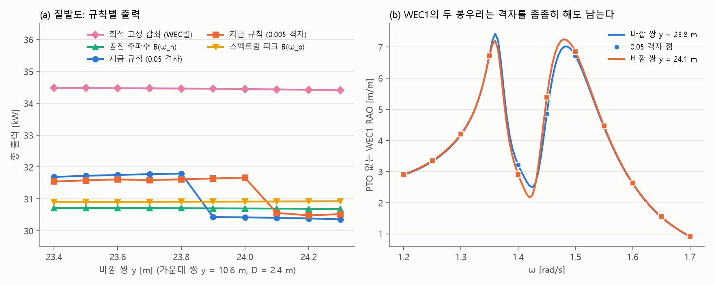

# 업데이트 보고서: PTO 감쇠 규칙 검토

- 날짜: 2026-11-05
- 코드 변경은 없다. 검토 결과와 선택지만 기록한다. WAMIT 입력도 바뀌지 않았다.
- 계산: 이 PC의 WAMIT로 설계 19개를 계산했다(칠발도 16, 부안 3). `EvalCache`는 쓰지 않았다(저장 기록에는 수력 계수가 없다).
  - 주파수: 기존 0.05 rad/s 격자 + 칠발도 1.20~1.70, 부안 1.00~1.60 구간의 0.005 rad/s 격자
  - 나머지 조건은 [보고서 2026-11-05_01](2026-11-05_01_de-nosort-optimum.md)과 같다.
- 그림 `docs/reports/images/2026-11-05_02_pto_rules.png`: 위 계산의 수력 계수로 그렸다. 스크립트와 수력 계수는 저장소에 넣지 않았다.

## 1. 개요

[보고서 2026-11-05_01](2026-11-05_01_de-nosort-optimum.md)에서 칠발도 최적점 옆의 4% 계단이 PTO 감쇠 규칙 때문임을 확인했다. 사용자 요청으로 이 규칙을 검토했다.

**결론**
- 계단은 격자가 성겨서 생긴 것이 아니다. 격자를 촘촘히 해도 위치만 옮겨 남는다.
- 지금 규칙이 고르는 RAO 봉우리는 heave 공진이 아니다. 칠발도 WEC1의 공진은 두 봉우리 사이에 있다.
- 다른 연속 규칙은 계단이 없지만, 설계 순위가 바뀌므로 최적해도 달라질 수 있다.
- 지금 감쇠는 같은 모델(WEC별 고정 선형 감쇠) 안에서 최선이 아니다. 최적값을 쓰면 칠발도 +8.4%, 부안 +24.8%다.

**권장**
- 논문 재현과 비교에는 지금 규칙을 그대로 쓴다(기본값 유지).
- 새 연구에는 "최적 고정 감쇠"를 옵션으로 추가한다.

어떤 규칙을 쓸지는 모델 정의를 바꾸는 일이라 사용자가 정한다.

## 2. 지금 규칙

[`rao_calc.py:176`](../../src/physics/rao_calc.py:176): WEC k마다 PTO 없는 RAO가 가장 큰 **격자점**을 찾아, 그 점의 방사감쇠 B_kk를 PTO 감쇠로 쓴다. 첫 커밋부터 같고, 논문 때 코드(`12fe7c3`)에도 있다. README와 매뉴얼은 이것을 "heave 공진의 방사감쇠"로 설명한다.

## 3. 검토 결과

### 3.1 계단은 촘촘한 격자에서도 남는다 (그림 (a), (b))

칠발도 Y2 = 10.6 m, D = 2.4 m에서 Y3를 바꾸며 계산했다.

| 격자 | 계단 위치 (Y3) | WEC1 PTO 감쇠 변화 | 출력 변화 |
| --- | --- | --- | --- |
| 0.05 | 23.8 → 23.9 | 18,794 → 9,699 | 31.79 → 30.43 kW |
| 0.005 | 24.0 → 24.1 | 18,037 → 10,611 | 31.66 → 30.56 kW |

- 촘촘한 격자에서 WEC1 봉우리는 1.36, 1.48~1.485 rad/s에 있다. 0.05 격자는 1.36의 꼭대기를 지나쳐서(7.43 대신 6.77) 왼쪽 봉우리를 낮게 잰다. 그래서 계단이 약 0.2 m 일찍 나타난다.
- 원인은 "더 높은 봉우리 하나만 고르는" 규칙 자체다. 두 봉우리 높이가 같아지는 곳에서는 격자와 상관없이 값이 끊긴다.
- [앞 보고서](2026-11-05_01_de-nosort-optimum.md) 3절에서 격자가 바뀌면 경계도 옮겨갈 수 있다고 적었다. 이번에 확인했다.

### 3.2 봉우리는 공진이 아니다

ω²(M + A_kk(ω)) = C_kk의 해를 공진 주파수 ω_n으로 계산했다. 19개 설계 모두 WEC마다 해가 하나였다.

| 칠발도 (10.6, 23.8) | 값 [rad/s] |
| --- | --- |
| WEC1 공진 ω_n | 1.436 |
| WEC1 RAO 봉우리 | 1.36, 1.485 |
| WEC1 RAO 골 | 약 1.42 |
| 스펙트럼 피크 ω_p | 1.402 |

- 공진 근처가 오히려 골이고, 양옆에 봉우리가 있다. WEC끼리와 벽의 상호작용으로 응답이 갈라진 것으로 보이지만 원인은 확인하지 않았다(WEC 1기 비교 계산이 필요하다).
- 그래서 지금 규칙은 문서의 설명("공진의 방사감쇠")과 다르게 동작한다. 이 값은 1.35에서 18,794, 공진 근처에서 13,141, 1.50에서 9,699로 크게 다르다.

### 3.3 후보 규칙 비교

수력 계수는 그대로 두고 PTO 감쇠만 바꿔 계산했다. 적분은 모두 0.05 격자다.

| 규칙 | 뜻 | 계단 | 추가 WAMIT |
| --- | --- | --- | --- |
| 지금 (0.05) | RAO 최대 격자점의 B_kk | 있음 | 없음 |
| 지금 (0.005) | 같은 규칙, 촘촘한 격자 | 있음(위치 이동) | 점 수만큼 늘어남 |
| B(ω_n) | 공진 주파수의 B_kk(보간) | 없음 | 없음 |
| B(ω_p) | 스펙트럼 피크의 B_kk(보간) | 없음 | 없음 |
| 최적 고정 감쇠 | 총 출력이 최대인 WEC별 고정값 (대칭 쌍은 같은 값, Nelder-Mead) | 없음 | 없음, 평가당 약 0.05 s 추가 |

"계단 없음"은 위 Y3 10개 설계에서 확인한 것이다. 그림 (a)에서 B(ω_p), B(ω_n), 최적 고정 감쇠는 Y3를 따라 매끄럽다.

**설계별 출력 [kW]** (각 열의 굵은 값이 그 규칙에서 가장 높은 값)

| 설계 | 지금 (0.05) | 지금 (0.005) | B(ω_n) | B(ω_p) | 최적 고정 감쇠 |
| --- | --- | --- | --- | --- | --- |
| 칠발도 새 설계 D 2.4, (10.6, 23.8) | **31.791** | 31.615 | 30.706 | 30.909 | 34.461 |
| 칠발도 논문 D 2.4, (10.8, 23.5) | 31.689 | 31.633 | 30.836 | 31.053 | 34.534 |
| 칠발도 D 2.4, (10.6, 24.0) | 30.421 | **31.663** | 30.700 | 30.914 | 34.444 |
| 칠발도 D 2.2, (10.6, 23.8) | 30.999 | 30.465 | **31.277** | **31.477** | 34.830 |
| 칠발도 다섯 기 x ≈ 15 m, D 2.0 | 31.181 | 31.010 | 30.844 | 29.582 | **34.891** |
| 부안 논문 설계 | 50.015 | 49.991 | 49.760 | 52.231 | 62.409 |

**이 표에서 읽을 것**
- **설계 순위는 규칙에 따라 바뀐다.** 새 설계는 지금 규칙에서만 가장 높다. 0.005 격자에서는 논문 설계가 새 설계보다 높다.
- **최적 고정 감쇠에서는 x ≈ 15 m 설계가 벽 옆 설계보다 높다.** 다만 이 표는 5개 설계만 비교한 것이다. 각 규칙의 실제 최적해는 DE를 다시 돌려야 알 수 있다.
- **지금 감쇠는 최적값보다 작다.** 칠발도 새 설계의 최적값은 31,420 / 26,156 / 22,555로 지금(18,794 / 13,856 / 11,725)의 1.7~1.9배다. 지금 값을 모두 2배로 해도 34.397 kW가 된다. 그래서 감쇠가 절반으로 떨어지면 출력도 크게 떨어진다.

### 3.4 적분 격자의 영향

같은 감쇠로 적분만 촘촘한 격자로 바꾸면 칠발도 새 설계는 31.791 → 31.754 kW(−0.12%), 부안 논문 설계는 50.015 → 49.364 kW(−1.30%)다. 부안은 좁은 봉우리(1.205 rad/s, RAO 13.1) 때문에 0.05 격자의 오차가 더 크다. 기존 [격자 설계안](../frequency_grid_design.md)의 결과와 같은 방향이다. 이 오차는 PTO 규칙과는 별개다.

## 4. 호환성 영향

없다. 코드와 설정 파일을 바꾸지 않았다.

규칙을 바꾸게 되면 다음 영향이 있다.
- 발전량 값이 달라져 논문, 기존 결과와 직접 비교할 수 없다.
- 데이터베이스(`data/eval_db/`)에는 총 출력만 있고 수력 계수가 없다. 그래서 새 규칙의 값을 다시 계산할 수 없고, 지문에 규칙을 넣어 파일을 나눠야 한다. 새 규칙의 탐색은 WAMIT을 처음부터 돌려야 한다.

## 5. 검증

- 19개 설계의 0.05 격자 부분집합으로 다시 계산한 지금 규칙의 값이 저장값과 같다(칠발도 31.791, 31.689, 31.181, 30.429 kW, 부안 50.015 kW).
- 최적 고정 감쇠를 확인하려고 지금 감쇠에 같은 배수를 곱해 봤다. 0.5, 1, 1.5, 2, 2.5, 3배에서 24.41, 31.79, 34.11, 34.40, 33.77, 32.74 kW로, 2배 근처에 봉우리가 하나 있고 최적값 34.461 kW와 맞다.
- `ruff check .`, `ruff format --check .` 통과(`docs/research_notes/` 제외), `python -m unittest discover -s tests` 통과.

**확인하지 않은 것**
- 비교는 설계 19개뿐이고, 다른 규칙으로 DE를 돌리지 않았다.
- 최적 고정 감쇠는 시작점 하나로 찾았다. 운동 진폭이나 PTO 힘의 한계는 넣지 않았다.
- 봉우리가 갈라지는 물리적 원인은 확인하지 않았다.
- 다른 설계 영역이나 영일만항에서 같은 현상이 얼마나 자주 나타나는지는 모른다.

## 6. 남은 이슈 / 선택지

| 선택지 | 장점 | 단점 |
| --- | --- | --- |
| A. 지금 규칙 유지 | 논문과 비교 가능, 변경 없음 | 계단 위에 최적점이 놓일 수 있고, 문서 설명과 다름 |
| B. `B(ω_n)` 옵션 | "공진의 방사감쇠"라는 정의를 그대로 지킴, 연속 | 출력은 지금과 비슷하거나 낮음, 최적 감쇠보다 작음 |
| C. 최적 고정 감쇠 옵션 | 같은 모델에서 출력 최대, 연속, 추가 WAMIT 없음 | PTO 정의가 바뀜, 값이 크게 달라져 논문과 직접 비교 불가 |

**권장: A를 기본으로 두고 C를 옵션으로 추가한다.**
- 설정 예: `PTORule` {0: 지금, 1: 최적 고정 감쇠}, 기본 0. 평가 지문에도 넣는다.
- 그다음 칠발도, 부안을 옵션 1로 DE를 돌려 최적해가 어떻게 바뀌는지 본다.
- 어느 쪽이든 README와 매뉴얼의 "공진의 방사감쇠" 설명은 실제 동작(비제어 RAO 최대점)에 맞게 고쳐야 한다.
- 칠발도 반복 실행([앞 보고서](2026-11-05_01_de-nosort-optimum.md) 6절)은 규칙을 정한 뒤에 진행하는 것이 낫다. 다만 논문 재현 확인이 목적이면 지금 규칙으로 바로 돌릴 수 있다.
