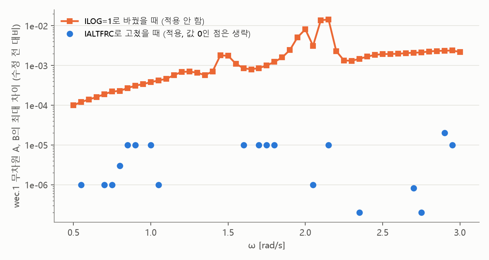

# 업데이트 보고서: wec.cfg의 IALTFRC 철자 수정, ILOC 발견

- 날짜: 2026-11-05
- WAMIT 입력 변경: `wec.cfg`의 한 줄(`IALTERC=1` → `IALTFRC=1`). 다른 입력 파일은 같고, 해석 결과도 같다.
- 계산: 이 PC의 WAMIT, 칠발도 논문 설계 1개. R 2.5, D 2.4, WEC 위치 (3, 0), (3, ±10.8), (3, ±23.5), 수심 33 m, 벽 있음, 120패널(실제 125), NCPU 8. `EvalCache`는 쓰지 않았다(WAMIT 실행 자체를 비교해야 한다).
- 그림 `docs/reports/images/2026-11-05_03_cfg_keywords.png`: 위 계산의 `wec.1`로 그렸다. 스크립트와 출력 파일은 저장소에 넣지 않았다.

## 1. 개요

동료에게 줄 5기 입력 샘플을 만들다가 `wec.cfg`의 `IALTERC=1`이 오타로 보였다. 사용자 요청으로 WAMIT v7 매뉴얼에서 확인하고 고쳤다.

확인하는 중에 같은 파일의 `ILOC=1`도 매뉴얼에 없는 이름임을 알았다. `ILOG=1`을 의도한 것으로 보이지만, 이것은 고치면 결과가 달라지므로 **고치지 않고 사용자 결정으로 남겼다.**

## 2. 변경 내용

- [`wamit_handler.py:325`](../../src/physics/wamit_handler.py:325): `IALTERC=1` → `IALTFRC=1`
- [`tests/test_solvers.py`](../../tests/test_solvers.py): `wec.cfg`에 올바른 철자가 쓰이는지 확인하는 테스트 추가
- 저장소 밖 파일: 동료용 샘플 `workspace/wamit_sample_5wec.zip`(gitignore)의 `wec.cfg`도 같은 내용으로 교체

`.cfg`의 두 줄은 첫 커밋(`8dc4914`)부터 있었고, 논문 때 코드(`12fe7c3`)에도 있다.

## 3. 호환성 영향

- 설정 파일, 로그 형식, API는 그대로다.
- 사용자가 할 일은 없다.
- `EVAL_VERSION`은 올리지 않았다. 해석 결과가 같으므로 `data/eval_db/`의 기록을 그대로 쓸 수 있다.

## 4. 검증

**매뉴얼(`V70_Manual.pdf`) 확인**

| `wec.cfg`의 이름 | 매뉴얼 언급 수 | 내용 |
| --- | --- | --- |
| `IALTERC` | 0 | 없는 이름. 올바른 이름은 `IALTFRC`(기본값 1, `.frc` 형식 1) |
| `ILOC` | 0 | 없는 이름. 비슷한 이름은 `ILOG`(기본값 0) |

나머지 `IPLTDAT`, `NUMHDR`, `IPERIN`, `IPEROUT`, `IWALLX0`, `ISOR`, `ISOLVE`, `MAXITT`, `ISCATT`는 매뉴얼에 있다.

WAMIT은 모르는 이름을 오류 없이 넘어간다. `wec.out`에 `ILOG = 0`으로 찍혀서, **지금까지의 계산은 `ILOG=0`이었음**을 확인했다.

**실행 비교** (설정마다 2회)

| `wec.cfg` | 총 출력 [kW] | `wec.1`의 최대 차이 (수정 전 1회차 대비) |
| --- | --- | --- |
| 수정 전 (`IALTERC`, `ILOC`) | 31.6894, 31.6894 | 0, 2e-5 |
| `IALTFRC=1`, `ILOC` 그대로 (**적용**) | 31.6894, 31.6894 | 2e-5, 2e-5 |
| `IALTFRC=1`, `ILOC` 삭제 | 31.6894, 31.6894 | 1e-5, 2e-5 |
| `IALTFRC=1`, `ILOG=1` (적용 안 함) | 31.6887, 31.6887 | 0.0144, 0.0144 |

- 2e-5는 같은 설정을 다시 돌려도 나는 차이이고, `wec.1`의 출력 자릿수와 같은 크기다.
- 입력 비교: 수정 전후 `fnames.wam`, `config.wam`, `wec.pot`, `wec.frc`, `wec.gdf`는 바이트까지 같고, `wec.cfg`는 해당 한 줄만 다르다.
- 압축한 샘플을 풀어 실행해도 정상 종료하고 31.6894 kW가 나온다.
- `ruff check .`, `ruff format --check .` 통과(`docs/research_notes/` 제외), `python -m unittest discover -s tests` 통과.

그림에서 `IALTFRC` 수정의 차이는 다시 돌릴 때의 차이 수준이다. `ILOG=1`의 차이는 주파수에 따라 약 1e-4~1e-2로 더 크고, ω = 2.15 rad/s에서 가장 크다.

## 5. 남은 이슈 / 후속 작업

**`ILOC=1` 처리 (사용자 결정 대기)**

| 선택지 | 결과 | 영향 |
| --- | --- | --- |
| A. 그대로 둠 | 계속 `ILOG=0` | 없음. 의미 없는 줄이 남음 |
| B. 줄 삭제 또는 `ILOG=0`으로 명시 | 계속 `ILOG=0` | 삭제해도 결과가 같음을 확인했다. 혼란만 줄어듦 |
| C. `ILOG=1`로 수정 | 매뉴얼은 "더 정확"하다고 설명 | 이 설계에서 총 출력 −0.002%. 값이 달라지므로 `EVAL_VERSION`을 올려야 하고, 기존 기록을 다시 쓸 수 없음. 논문 조건과도 달라짐 |

- 권장은 B다. 이 설계에서는 차이가 작아서, 기존 기록과 논문 비교를 버릴 근거가 없다.
- 다만 `ILOG`의 영향은 설계 1개로만 봤다. C를 고려한다면 다른 형상과 해역도 확인해야 한다.
- 수행 시간은 비교하지 않았다. 실행마다 15~23초로 흔들려서 이 비교로는 판단할 수 없다.
