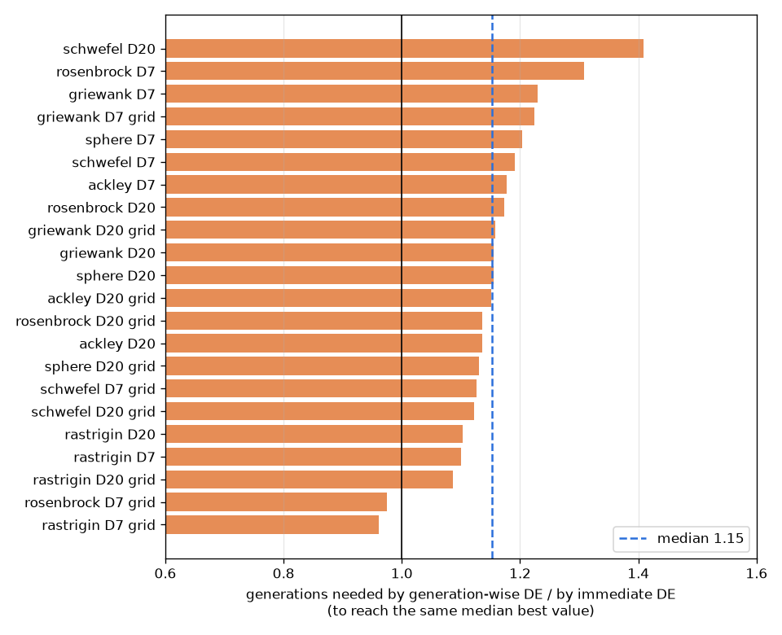

# DE에서 "바로 바꾸기"와 "한꺼번에 바꾸기" 비교

- 날짜: 2026-10-23

## 1. 무엇이 궁금했나요?

DE는 후보 100개를 한 줄로 세워 놓고 한 명씩 더 좋은 후보가 나오면 자리를 바꿔요. 지금 프로그램은 더 좋은 후보가 나오면 **바로** 바꾸고, 다음 후보를 만들 때 바뀐 친구를 바로 써요.

다른 방법은 100개를 **한꺼번에** 만들어서 모두 시험한 다음, 마지막에 한꺼번에 바꾸는 거예요. 이렇게 하면 WAMIT을 여러 개 동시에 돌릴 수 있어서 빨라져요. 그런데 결과가 나빠지지 않을까요?

## 2. 어떻게 비교했나요?

수학자들이 최적화 방법을 시험할 때 쓰는 **연습 문제 6개**로 비교했어요. 어떤 건 매끈한 그릇 모양이고, 어떤 건 울퉁불퉁한 계란판 모양이에요. 문제마다 30번씩, 두 방법이 **같은 출발점**에서 시작했어요. 총 1,440번 돌렸고, 컴퓨터 코어 20개로 나눠서 4분 만에 끝났어요.

## 3. 결과

파란 선(바로 바꾸기)이 주황 선(한꺼번에 바꾸기)보다 **조금 더 빨리** 내려가요(아래로 갈수록 좋아요).

| 결과 | 경우 수 (24개 중) |
| --- | --- |
| 바로 바꾸기가 확실히 좋음 | 11 |
| 차이 없음 | 13 |
| 한꺼번에 바꾸기가 확실히 좋음 | 0 |

한꺼번에 바꾸기는 같은 결과에 가려면 **약 15% 더 많은 세대**가 필요했어요(많으면 40%).

## 4. 그래서 어떻게 하면 좋을까요?

- 한꺼번에 바꾸기는 조금 느리게 좋아지지만, 대신 **WAMIT을 여러 개 동시에** 돌릴 수 있어요.
- 동시에 돌려서 **1.4배보다 빨라지면** 한꺼번에 바꾸기가 같은 시간에 더 좋은 답을 찾아요.
- 그래서 다음에는 계산용 컴퓨터에서 WAMIT을 동시에 몇 개 돌리면 얼마나 빨라지는지 재 볼 거예요.

## 5. 조심할 점

- 연습 문제는 진짜 부표 문제와 달라요.
- 한꺼번에 바꾸기로 바꾸면 논문에 쓴 방법과 조금 달라져요. 이건 결정이 필요해요.
