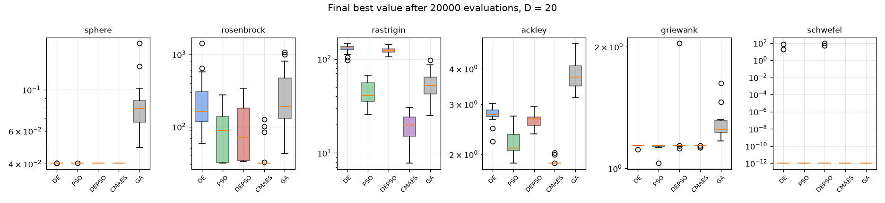

# 얽힌 문제로 다시 비교하기

- 날짜: 2026-10-23

## 1. 왜 다시 했나요?

지난번 연습 문제 중 몇 개는 변수끼리 **서로 상관없는** 문제였어요. 이런 문제는 변수를 하나씩 바꿔 보는 GA한테 유리해요. 그런데 진짜 부표 문제는 반지름, 깊이, 위치가 **서로 얽혀** 있어요. 그래서 연습 문제를 빙글 돌려서 변수끼리 얽히게 만든 뒤 다시 비교했어요.

## 2. 결과

| 방법 | 평균 순위 (1등이 가장 좋음) |
| --- | --- |
| CMA-ES | 2.4 |
| PSO | 2.5 |
| DE | 2.6 |
| DEPSO | 3.0 |
| GA | 4.5 |

- **GA**는 얽힌 문제에서 크게 나빠졌어요. 지난번에 좋았던 건 문제 모양 덕분이었어요.
- **CMA-ES**는 변수가 많고 울퉁불퉁한 문제에서 가장 좋았어요. 변수끼리 어떻게 얽혀 있는지 스스로 배우기 때문이에요.
- 부표 문제와 같은 7개 변수에서는 **DE**도 아주 좋았어요.

## 3. 조심할 점

연습 문제 하나(Schwefel)는 돌리면 정답이 바뀌어 버려서 순위에서 뺐어요. 진짜 부표 문제의 결과는 계산용 컴퓨터에서 돌고 있는 CMA-ES 계산이 끝나면 비교할 거예요.
