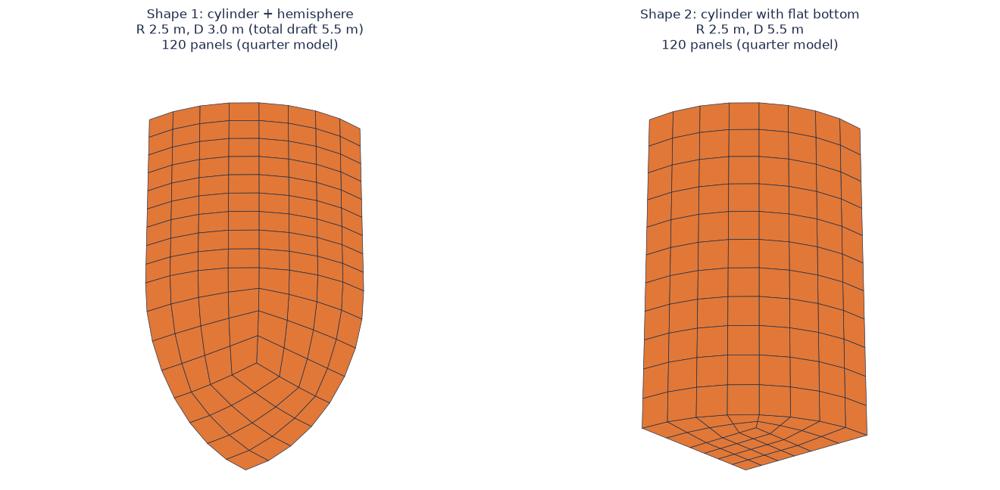

# 평평한 바닥 원통 부표 추가

- 날짜: 2026-10-23

## 1. 무엇이 바뀌었나요?

지금까지는 부표 모양이 **원통 아래에 반구(공의 반쪽)가 붙은 모양** 하나뿐이었어요. 이제 **바닥이 평평한 원통**도 고를 수 있어요. `config.cfg`의 `Shape`를 2로 하면 돼요.

| `Shape` | 모양 | D의 뜻 |
| --- | --- | --- |
| 1 (기본) | 원통 + 반구 | 원통 부분의 길이 (물에 잠긴 깊이는 D + R) |
| 2 (새로 추가) | 평평한 바닥 원통 | 물에 잠긴 깊이 |

두 모양 모두 **반지름 R과 깊이 D** 두 숫자로 정해져요.

## 2. 어떻게 만들었나요?

WAMIT은 부표 표면을 작은 조각(패널)으로 나눠서 계산해요. 평평한 바닥은 동그란 판이라서 **가운데는 네모, 바깥쪽은 둥근 띠**로 나눴어요. 바닥 둘레의 점이 옆면 조각과 딱 맞물리게 했어요.

조각으로 계산한 넓이와 부피가 진짜 원통과 **99% 이상** 같은 것을 확인했어요.

## 3. 아직 안 한 것

- 진짜 WAMIT으로 계산해서 조각 수가 충분한지(정확한지)는 아직 확인하지 않았어요. 계산용 컴퓨터가 지금 다른 계산 중이라, 끝나면 확인할 거예요.
- 평평한 바닥은 모서리에서 물이 소용돌이치는 효과가 있는데, 이 프로그램은 그 효과를 계산하지 않아요.
