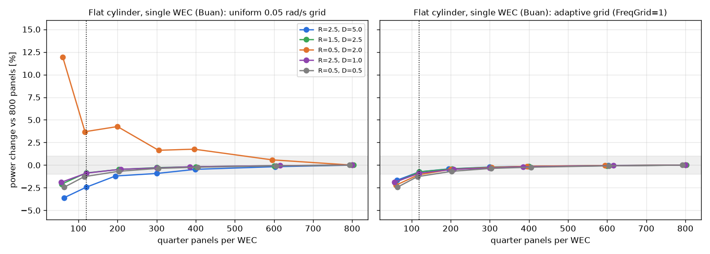

# 원통 부표 조각 수 시험

- 날짜: 2026-10-23
- 이번에는 **이 컴퓨터의 WAMIT**으로 직접 계산했어요(요청하신 대로).

## 1. 무엇을 시험했나요?

새로 넣은 **평평한 바닥 원통** 부표를 WAMIT으로 처음 계산했어요. 부표 표면을 몇 조각으로 나눠야 충분히 정확한지 알아보려고, 조각 수를 60개부터 800개까지 바꿔 가며 부표 하나의 전기량을 계산했어요.

## 2. 결과

- 오른쪽 그림(촘촘한 주파수 눈금)을 보면, **120조각이면 1% 안쪽**, 200조각이면 0.5% 안쪽으로 정확해요. 기존 부표(원통 + 반구)와 비슷한 수준이에요.
- 왼쪽 그림(보통 눈금)에서 주황색 선이 들쭉날쭉한 건 **조각 때문이 아니라 눈금 때문**이에요. 가늘고 긴 부표는 공진 산이 좁아서, 눈금이 성기면 산꼭대기를 놓쳐요.
- 부피와 물이 떠받치는 힘도 진짜 값과 99% 이상 맞았어요.

## 3. 고친 것

- 바닥 **모서리 근처 조각을 더 촘촘하게** 했어요. 모서리에서 물의 흐름이 많이 바뀌기 때문이에요. 조금 더 정확해졌어요.
- 바닥이 얕은 원통은 아주 빠른 파도에서 공진해요. 그 공진이 계산하는 범위(3 rad/s)보다 위에 있으면, 시작할 때 **경고**를 띄우게 했어요.

## 4. 덤으로 알게 된 것

물에 잠긴 깊이가 같으면, **평평한 바닥 원통이 반구 바닥보다 전기를 11~14% 더** 만들었어요. 부피가 커서 흔들리는 박자가 파도 박자에 더 가까워지기 때문이에요. (모서리에서 생기는 소용돌이 효과는 계산에 없어요.)
