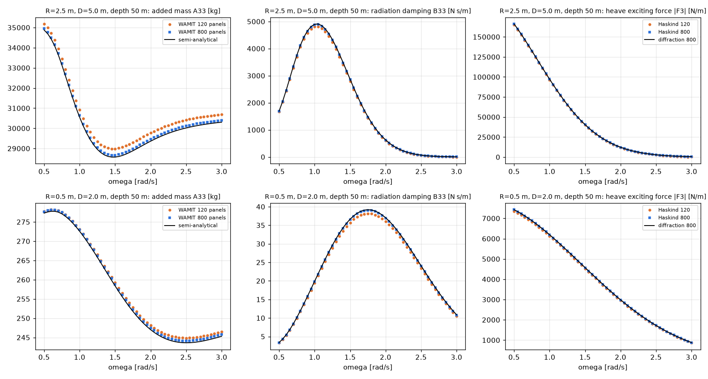

# 원통 부표 답 맞추기

- 날짜: 2026-10-23
- 이 컴퓨터의 WAMIT으로 계산했어요.

## 1. 무엇을 했나요?

앞에서는 "조각을 늘려도 답이 크게 안 변한다(안정적이다)"는 것만 확인했어요. 이번에는 **답이 정말 맞는지** 세 가지 방법으로 채점했어요.

| 채점 방법 | 비유 |
| --- | --- |
| ① 손으로 푼 답과 비교 | 계산기 답을 수학 공식으로 직접 푼 답과 맞춰 보기 |
| ② 두 가지 방법의 답 비교 | 같은 문제를 다른 풀이로 풀어서 같은지 보기 |
| ③ 에너지 규칙 확인 | 들어온 에너지보다 더 많이 꺼내지 않는지 보기 |

## 2. 결과

- **① 손으로 푼 답(검은 선)과 WAMIT(점)이 거의 겹쳐요.** 조각 800개일 때 차이가 0.7% 안쪽이에요. 기본값 120개일 때는 약 2% 차이가 나요.
- **② 두 가지 풀이의 답이 0.1% 안쪽으로 같아요.**
- **③ 부표가 파도에서 꺼내는 에너지는 이론 한계를 넘지 않았어요.**

그래서 새로 만든 원통 부표의 계산이 **맞다**고 말할 수 있어요.

## 3. 솔직하게 말할 점

처음에 "손으로 푼 답"을 만들 때 계산 항을 너무 적게 써서, 가늘고 긴 부표에서 22%나 틀린 답이 나왔어요. WAMIT이 틀린 게 아니라 **제 손 계산이 틀렸던 거예요.** 항을 충분히 늘리니 맞았어요.

## 4. 아직 남은 것

- 부표 5개와 벽이 있을 때는 아직 확인하지 않았어요.
- 바닥 모서리에서 생기는 소용돌이 효과는 이 프로그램으로 확인할 수 없어요.
