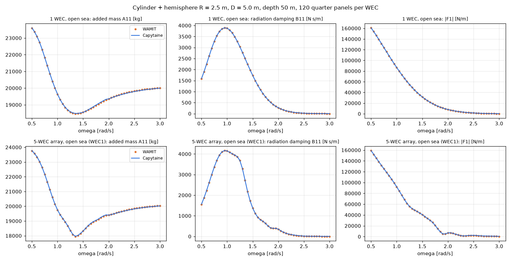

# 무료 계산기 Capytaine 추가

- 날짜: 2026-10-23

## 1. 무엇이 바뀌었나요?

지금까지는 파도와 부표의 힘을 계산할 때 **WAMIT**이라는 유료 프로그램만 쓸 수 있었어요. 이제 **Capytaine**이라는 **무료(오픈소스) 프로그램**으로도 계산할 수 있어요. 그래서 WAMIT 라이선스가 없는 사람도 이 프로그램을 쓸 수 있게 됐어요.

`config.cfg`에서 이렇게 고르면 돼요.

| 설정 | 뜻 |
| --- | --- |
| `HydroSolver 1` (기본) | WAMIT |
| `HydroSolver 2` | Capytaine (먼저 `pip install capytaine`) |
| `VerticalWall 0` | 벽 없는 바다 (Capytaine은 이것만 돼요) |

## 2. 어떻게 바꿨나요?

먼저 프로그램을 **두 부분으로 나눴어요.**
1. 힘을 계산하는 부분(WAMIT 또는 Capytaine)
2. 그 힘으로 부표가 얼마나 흔들리고 전기를 얼마나 만드는지 계산하는 부분

2번은 계산기가 바뀌어도 그대로예요. 그래서 계산기만 갈아 끼우면 돼요. 나눈 뒤에도 WAMIT 결과가 **예전과 완전히 똑같은지** 확인했어요.

## 3. 두 계산기의 답이 같나요?

점(WAMIT)과 선(Capytaine)이 거의 겹쳐요. 전기량 차이는 **0.5% 안쪽**이에요. 부표 5개가 서로 영향을 주는 경우에도 맞았어요.

## 4. 아쉬운 점

- Capytaine은 **느려요.** 부표 5개 계산이 WAMIT은 8초, Capytaine은 약 100초 걸려요.
- 아직 **벽이 있는 바다**는 Capytaine으로 계산할 수 없어요. 거울에 비친 부표를 더 놓는 방법(이미지법)으로 나중에 만들 거예요.
