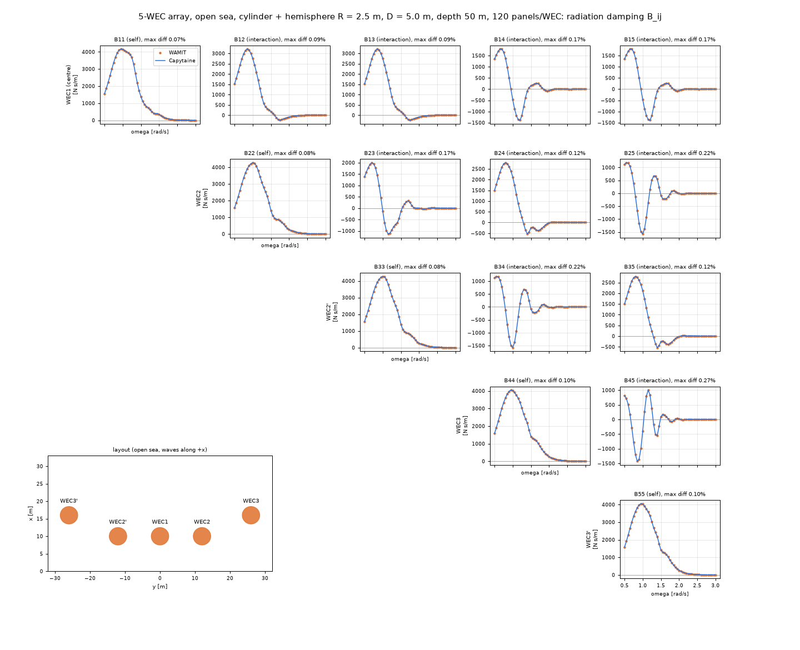

# 부표끼리 주고받는 힘 비교

- 날짜: 2026-10-24

## 1. 무엇을 했나요?

부표 5개를 바다에 띄우면, 한 부표가 움직일 때 생긴 물결이 **옆 부표를 밀어요.** 이것을 "상호작용"이라고 해요. 마치 수영장에서 한 친구가 첨벙대면 옆 친구도 흔들리는 것과 같아요.

지난번에는 WAMIT(유료 계산기)과 Capytaine(무료 계산기)의 답을 **가운데 부표 하나만** 비교했어요. 이번에는 **부표끼리 주고받는 힘까지 전부** 비교했어요.

## 2. 무엇을 비교했나요?

| 이름 | 쉬운 뜻 |
| --- | --- |
| 부가질량 A | 부표가 움직일 때 함께 끌려가는 물의 무게 |
| 방사감쇠 B | 부표가 물결을 만들어 에너지를 내보내는 정도 |
| 가진력 F | 파도가 부표를 미는 힘 |

A와 B는 "1번이 움직이면 2번이 받는 힘"처럼 **두 부표 사이마다** 값이 있어요. 부표가 5개라서 짝이 많아요.

## 3. 결과

- 칸 하나가 부표 한 쌍이에요. 점은 WAMIT, 선은 Capytaine이에요.
- 물결 모양으로 오르락내리락하는 곳까지 **거의 완전히 겹쳐요.**

| 비교한 것 | 차이 |
| --- | --- |
| 자기 자신 힘 (A, B) | 0.2% 안쪽 |
| 서로 주고받는 B | 0.3% 안쪽 |
| 서로 주고받는 A | 1~2% (원래 값이 작아서 커 보여요) |
| 파도가 미는 힘 F | 0.2% 안쪽 |

서로 주고받는 A는 자기 자신 힘의 10분의 1 정도로 작아요. 그래서 1~2% 차이라도 실제로는 아주 작은 차이예요. 100원짜리의 2%와 1000원짜리의 2%가 다른 것과 같아요.

## 4. 이상해 보이는 곳

파도가 짧은(빠른) 쪽 끝에서, 맨 끝 부표 2개의 **힘의 방향(위상)** 이 두 계산기에서 다르게 나왔어요. 그런데 그때 파도가 미는 힘은 **거의 0**이에요. 거의 0인 화살표는 방향이 조금만 흔들려도 크게 달라 보여요. 그래서 전기량에는 영향이 없어요.

## 5. 아직 남은 것

벽이 있는 바다에서는 Capytaine으로 아직 계산할 수 없어서, 그 경우의 비교는 나중에 해요.
