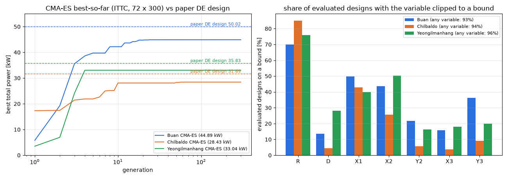

# CMA-ES 결과와 벽에 막힌 탐색

- 날짜: 2026-10-24

## 1. 무엇을 했나요?

부표 모양과 위치를 함께 찾는 계산을 **CMA-ES**라는 방법으로 세 바다(부안, 칠발도, 영일만항)에서 돌렸어요. 계산용 컴퓨터에서 하루 가까이 걸렸어요.

## 2. 결과

| 바다 | CMA-ES가 찾은 전기량 | 논문(DE 방법)의 답 | 차이 |
| --- | --- | --- | --- |
| 부안 | 44.9 kW | 50.0 kW | 10% 모자람 |
| 칠발도 | 28.4 kW | 31.7 kW | 10% 모자람 |
| 영일만항 | 33.0 kW | 35.8 kW | 8% 모자람 |

CMA-ES가 세 곳 모두 **논문 답보다 못한 답**에서 멈췄어요.

왼쪽 그림을 보면 선이 금방 올라가다가 **아주 일찍(4~66번째 세대) 평평해져요.** 그 뒤 200번 넘게 더 찾았는데 나아지지 않았어요.

## 3. 왜 그랬을까요?

보물찾기에 비유해 볼게요.

- 운동장에 울타리(탐색 범위)가 있어요. 좋은 보물은 **울타리 바로 옆**에 많아요. 부표는 크게(반지름 최대), 벽 가까이(x 최소) 두는 게 좋거든요.
- CMA-ES는 "좋았던 친구들이 서 있던 곳"을 보고 다음에 찾을 범위를 정해요.
- 그런데 울타리 밖으로 나간 친구를 **울타리에 딱 붙여 세워요.** 그러면 친구들이 울타리를 따라 한 줄로 서게 돼요. CMA-ES는 "이쪽으로는 더 볼 곳이 없네" 하고 찾는 범위를 점점 줄여요.
- 결국 처음 찾은 골짜기 근처만 맴돌다 멈춰요.

오른쪽 그림이 그 증거예요. 평가한 설계의 **93~96%가 울타리에 붙어** 있었어요.

## 4. 앞으로

울타리 밖으로 나간 친구를 붙여 세우되, **"원래 어디까지 갔었는지"는 기억하게** 하는 방법이 있어요. CMA-ES를 만든 사람이 권하는 방법이에요. 이렇게 고친 뒤 다시 계산해 볼 예정이에요(먼저 확인받고 진행).
