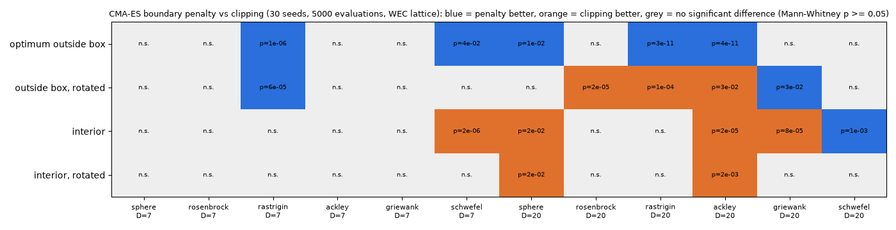

# CMA-ES 울타리 처리 바꾸기

- 날짜: 2026-10-24

## 1. 무엇을 바꿨나요?

지난번에 CMA-ES가 답을 찾다가 일찍 멈춘다는 것을 봤어요. 의심 가는 곳은 **울타리(탐색 범위) 처리**였어요.

| | 울타리 밖으로 나간 친구 | 다음에 어디를 찾을지 정할 때 |
| --- | --- | --- |
| 전 (잘라내기) | 울타리에 붙여 세움 | 붙여 세운 자리를 기억 |
| 후 (벌점) | 울타리에 붙여 세움 | **원래 갔던 자리**를 기억하고, 나간 만큼 **벌점** |

"벌점" 방식은 CMA-ES를 만든 사람이 권하는 표준 방법이에요. 너무 멀리 나가면 점수를 깎아서 안쪽으로 돌아오게 해요.

## 2. 처음엔 실패했어요

처음 만든 벌점은 **너무 셌어요.** 친구들이 울타리 근처에도 못 가서, 울타리 바로 옆에 있는 보물을 오히려 더 못 찾았어요. 그래서 널리 쓰이는 프로그램(pycma)과 똑같이 고쳤어요. 이제는 벌점이 상황에 맞게 커지기도 하고 작아지기도 해요.

## 3. 시험 결과

시험용 문제 48개(함수 6종 × 크기 2종 × 4가지 경우)를 30번씩 풀어 봤어요.

- 파란 칸: 새 방법이 더 잘함. 주황 칸: 옛 방법이 더 잘함. 회색: 차이 없음.
- 부표 문제와 크기가 같은 **7개 변수** 문제에서는 새 방법이 같거나 더 잘했어요. 딱 하나(내부 schwefel)만 옛 방법이 나았어요.
- 변수가 **20개**인 문제에서는 옛 방법이 더 잘한 경우도 있었어요.

그래서 "울타리 처리 때문에 멈췄다"는 지난번 생각은 **반만 맞았어요.** 새 방법이 대체로 낫지만 모든 경우에 그런 건 아니에요.

## 4. 아직 남은 것

진짜 부표 문제에서 나아지는지는 WAMIT으로 다시 계산해야 알 수 있어요. 계산용 컴퓨터에서 하루 정도 걸려요.
