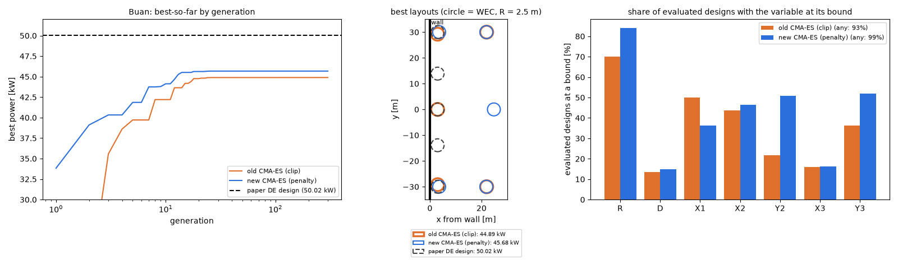

# 새 CMA-ES로 부안 다시 계산

- 날짜: 2026-10-24

## 1. 무엇을 했나요?

지난번에 CMA-ES의 **울타리(탐색 범위) 처리**를 바꿨어요. 울타리 밖으로 나간 친구를 원래 자리로 기억하고, 나간 만큼 벌점을 주는 방법이에요.

이번에는 그 새 방법으로 **부안 바다**의 부표 5개를 진짜로 다시 계산했어요. 계산용 컴퓨터가 약 5시간 동안 WAMIT으로 계산했어요.

## 2. 결과

| | 전기 [kW] | 논문 답과 비교 |
| --- | --- | --- |
| 옛 CMA-ES | 44.89 | 10.3% 모자람 |
| **새 CMA-ES** | **45.68** | **8.7% 모자람** |
| 논문 답(DE) | 50.02 | — |

조금 좋아졌어요. 100원을 벌던 것이 102원쯤 된 셈이에요. 하지만 논문 답에는 아직 못 미쳐요.

- 왼쪽 그림: 세대(차례)마다 지금까지 찾은 가장 좋은 값이에요. 파란 선(새 방법)이 주황 선(옛 방법)보다 조금 위에 있지만, **둘 다 35번째쯤에서 멈췄어요.** 점선은 논문 답이에요.
- 가운데 그림: 부표를 놓은 자리예요. 왼쪽의 굵은 선이 벽이에요.
- 오른쪽 그림: 울타리에 딱 붙은 설계가 얼마나 많았는지예요.

## 3. 무엇을 알게 됐나요?

**지난번 생각이 틀렸어요.** 지난번에는 "울타리 처리 때문에 일찍 멈춘다"고 생각했어요. 그런데 울타리 처리를 바꿔도 똑같이 35번째에 멈췄어요. 그러니 멈추는 진짜 이유는 다른 곳에 있어요.

**다른 곳을 찾아다녔어요.** 논문 답은 부표 5개를 모두 **벽 바로 옆에 한 줄로** 세워요. 새 CMA-ES는 가운데 부표를 벽에서 멀리(약 25 m) 떼어 놓았어요. 2448개의 설계를 계산하는 동안 "벽 옆에 한 줄" 같은 설계는 **한 번도** 보지 않았어요. 보물이 있는 방에는 들어가 보지도 않은 거예요.

**같은 걸 자꾸 다시 골랐어요.** 고른 설계의 89%는 이미 계산해 본 것이었어요. 친구들이 한곳에 꼭 모여서 같은 자리만 계속 보고 있었다는 뜻이에요.

## 4. 아직 남은 것

- 친구들이 너무 꼭 모이지 않게 하는 방법(퍼지는 정도에 바닥을 두기)을 생각해 봐야 해요.
- 한 번만 해 봐서는 2% 차이가 실력인지 운인지 몰라요. 여러 번 해 보면 알 수 있어요.
- 이 프로젝트의 주인공은 DE예요. CMA-ES는 비교하려고 쓰는 거예요.
