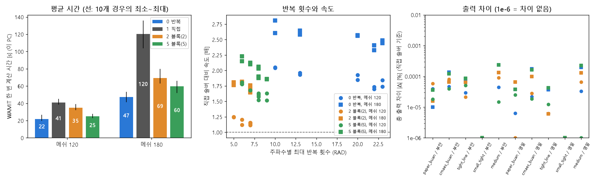

# 계산 방법 네 가지 빠르기 시합

## 무엇을 했나요?

WAMIT은 부표가 파도에 얼마나 흔들리는지 계산하는 프로그램입니다. 이 계산의 가장 큰 부분은 아주 큰 연립방정식(모르는 값이 수백 개인 문제)을 푸는 일입니다. WAMIT에는 이것을 푸는 방법(솔버)이 여러 가지 있습니다.

| 번호 | 이름 | 비유 |
| --- | --- | --- |
| 0 | 반복 솔버 (지금 쓰는 것) | 답을 대충 짐작한 뒤, 고치고 또 고쳐서 점점 정답에 다가가기 |
| 1 | 직접 솔버 (논문 때 쓴 것) | 공식대로 처음부터 끝까지 한 번에 풀기 |
| 2, 5 | 블록 반복 솔버 | 문제를 2조각, 5조각으로 나눠 조각마다 공식으로 풀고, 조각 사이는 고쳐 가며 맞추기 |

이 네 가지로 부표 5개 설계 5가지를, 바다 2곳(부안, 영일만항)과 부표 그물망(메쉬) 크기 2가지로 계산해서 빠르기와 답을 비교했습니다. 모두 80번 계산했습니다.

## 결과: 답은 똑같고, 0번이 가장 빠릅니다

**답**: 네 방법의 발전량 차이는 가장 커도 0.00024%였습니다. 50 kW 중에 0.1 W쯤 차이니까, 사실상 똑같습니다.

**빠르기** (이 PC에서 한 번 계산하는 데 걸린 평균 시간)

| 그물망 크기 | 0 반복 | 1 직접 | 2 블록 | 5 블록 |
| --- | --- | --- | --- | --- |
| 120 (지금 쓰는 크기) | **22초** | 41초 | 35초 | 25초 |
| 180 (더 촘촘함) | **47초** | 120초 | 69초 | 60초 |

*왼쪽 그림: 막대가 짧을수록 빠릅니다. 파란색(0번)이 늘 가장 짧습니다.*

- 0번은 1번(논문 때 방법)보다 그물망 120에서 약 2배, 180에서 약 2.5배 빠릅니다.
- 그물망이 촘촘해질수록 차이가 커집니다. 1번은 문제가 1.5배 커지면 일이 약 3배로 늘지만, 0번은 약 2배만 늘기 때문입니다.

## 블록 솔버가 더 좋을 줄 알았는데요?

블록 솔버는 "고치기"를 훨씬 적게 합니다. 0번이 10~23번 고칠 때 블록 솔버는 5~10번만 고칩니다.

그런데 한 번 고칠 때마다 조각마다 공식으로 푸는 일을 해야 해서, 한 번 고치는 데 시간이 많이 듭니다.

비유하면 이렇습니다.
- 0번: 계단을 20번 오르지만 한 칸이 낮다.
- 블록 솔버: 계단을 7번만 오르지만, 오르기 전에 무거운 짐을 싸야 한다.

이 문제에서는 짐 싸는 시간이 더 커서, 블록 솔버가 20가지 경우 모두 0번보다 느렸습니다. 조각을 5개로 나누면 조각이 작아져서 짐이 가벼워지고, 2개로 나눌 때보다 빨라졌습니다.

## 논문 때 "한 번에 50~60초"였던 기억은?

- 논문에 적힌 계산 PC의 시간은 한 번에 10~13초였습니다.
- 이 PC는 계산용 PC보다 약 3배 느립니다. 이 PC에서 논문 때 방법(1번)으로 계산하면 약 41~45초가 걸립니다.
- 그래서 50~60초는 이 PC처럼 느린 PC에서 1번 방법을 쓴 시간과 비슷합니다. 논문 계산 PC의 시간은 아닌 것으로 보입니다.
- 지금 계산용 PC가 논문 코드보다 2배쯤 빠른 이유도 확인했습니다. 0번 방법을 쓰기 때문입니다(그리고 그물망이 조금 작아졌습니다).

## 그래서 무엇이 바뀌나요?

바뀌는 것은 없습니다. 지금 쓰는 0번이 가장 빠르고 답도 같으니 그대로 씁니다. 다음에 또 비교할 수 있도록 비교용 프로그램(`scripts/experiments/solver_timing.py`)을 남겼습니다.

## 아직 모르는 것

- 이 PC에서만 쟀습니다. 코어가 많은 계산용 PC에서는 1번이 조금 더 따라올 수도 있습니다.
- 각 경우를 한 번씩만 쟀습니다. 같은 계산을 다시 하면 시간이 5% 정도 달라집니다. 그래도 방법 사이의 차이(14% 이상)가 더 큽니다.
