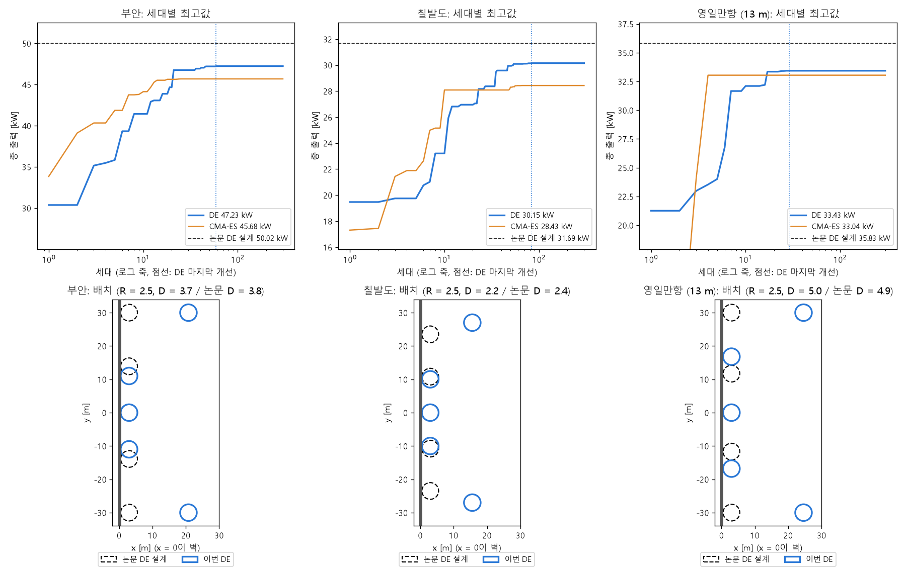

# DE로 세 바다 다시 계산

## 무엇을 했나요?

벽 앞에 부표(파도로 전기를 만드는 장치) 5개를 놓을 때, 부표 크기와 자리를 어떻게 정하면 전기를 가장 많이 만드는지 컴퓨터가 찾게 했습니다.

찾는 방법(알고리즘)은 **DE**입니다. DE는 72명의 "설계 친구들"이 서로의 좋은 점을 섞어 가며, 300번(세대) 동안 조금씩 더 좋은 설계를 찾는 방법입니다. 바다 세 곳(부안, 칠발도, 영일만항)에서 계산했고, 모두 24시간쯤 걸렸습니다.

전에 같은 일을 CMA-ES라는 다른 방법으로 해 봤는데, 논문 답보다 8~10% 낮게 일찍 멈췄습니다. 그래서 이번에는 이 프로젝트의 주 방법인 DE로 다시 했습니다.

## 결과

| 바다 | 이번 DE | 전의 CMA-ES | 논문 답 |
| --- | --- | --- | --- |
| 부안 | **47.2 kW** | 45.7 kW | 50.0 kW |
| 칠발도 | **30.1 kW** | 28.4 kW | 31.7 kW |
| 영일만항 | **33.4 kW** | 33.0 kW | 35.8 kW |

- DE가 CMA-ES보다 세 바다 모두 조금 더 좋았습니다(1~6%).
- 하지만 논문 답보다는 아직 5~7% 낮습니다.

*위 그림: 세대가 지날수록 가장 좋은 값이 어떻게 올라가는지 보여 줍니다. 파란 선(DE)이 검은 점선(논문 답)에 닿지 못하고 평평해집니다. 아래 그림: 동그라미가 부표이고, 왼쪽 굵은 선이 벽입니다. 파란 동그라미가 이번 답, 검은 점선 동그라미가 논문 답입니다.*

## 무엇이 달랐나요?

아래 그림을 보면 이유가 보입니다.

- 가운데 부표 3개는 논문 답처럼 벽 바로 옆에 섰습니다. 크기도 논문 답과 거의 같습니다.
- 그런데 맨 바깥 부표 2개는 벽에서 15~25 m 떨어져 있습니다. 논문 답은 이 2개도 벽 옆에 둡니다.

## 바깥 부표 2개만 벽 옆으로 옮겨 보면?

다른 것은 그대로 두고, 바깥 부표 2개만 벽 옆으로 옮겨서 계산해 보았습니다.

| 바다 | 이번 답 | 바깥 2개만 벽 옆으로 |
| --- | --- | --- |
| 부안 | 47.2 kW | **49.0 kW** (4% 늘어남) |
| 칠발도 | 30.1 kW | 29.9 kW (조금 줄어듦) |
| 영일만항 | 33.4 kW | **35.4 kW** (6% 늘어남) |

부안과 영일만항은 한 가지만 바꿨는데도 더 좋아졌습니다. 그러니까 DE가 찾은 답이 "더 좋아질 수 없는 꼭대기"는 아니었습니다. DE가 그쪽을 **가 보지 않았던 것**입니다.

실제로 기록을 보니, 바다마다 계산한 설계 2천~5천 개 중에 바깥 부표가 벽 옆에 있는 설계는 바다마다 1~2개뿐이었습니다.

## 왜 그쪽을 안 가 봤을까요?

비유하면, 72명이 산에서 가장 높은 봉우리를 찾는데, 처음 몇십 번 만에 모두 한 봉우리 근처로 모여 버린 것과 같습니다. 그 뒤로는 모두 그 근처만 살펴서, 옆에 더 높은 봉우리가 있어도 가 보지 못했습니다.

DE도 처음 30~80세대 안에 좋은 값이 정해졌고, 나머지 200세대 넘게는 같은 답에 머물렀습니다.

## 아직 모르는 것

- 논문에서는 친구가 100명이었는데, 이번에는 72명이었습니다. 친구가 적으면 처음에 산을 덜 넓게 둘러봅니다. 100명으로 다시 계산하면 차이가 줄어드는지 확인하려고 합니다.
- 한 번씩만 계산했기 때문에, 운(처음 친구들이 어디서 시작했는지) 때문인지도 아직 모릅니다.
- 계산 시간은 논문 때(약 66시간)의 37%인 24시간이었습니다. 계산이 빨라진 덕분도 있고, 일찍 모여서 새로 계산한 설계가 적었던 탓도 있습니다.
