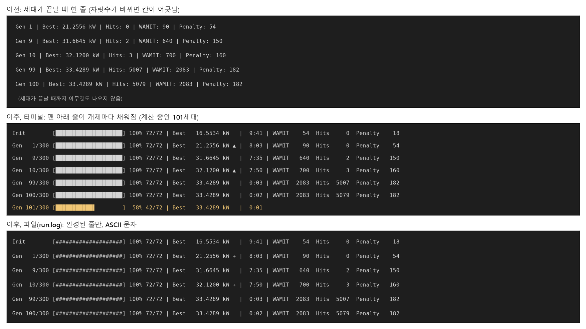

# 계산 진행 막대 만들기

## 무엇이 불편했나요?

최적화는 "세대"를 300번 반복합니다. 한 세대에서는 설계 72개를 하나씩 WAMIT으로 계산하는데, 하나에 약 8초씩 걸리니 한 세대가 10분쯤 걸립니다.

그런데 지금까지는 **세대가 다 끝나야** 화면에 한 줄이 나왔습니다. 10분 동안은 화면이 멈춘 것처럼 보여서, 잘 돌고 있는지, 얼마나 남았는지 알 수 없었습니다.

또 줄의 칸이 맞지 않았습니다. `Gen 9`와 `Gen 10`처럼 자릿수가 바뀌면 뒤의 글자들이 한 칸씩 밀렸습니다.

## 무엇이 바뀌었나요?

이제 설계 하나의 계산이 끝날 때마다 **진행 막대**가 한 칸씩 채워집니다. 휴대폰에서 파일을 내려받을 때 보이는 막대와 같습니다.

```
Init        [████████████████████] 100% 72/72 | Best   16.5534 kW   |  9:41 | WAMIT    54  Hits     0  Penalty    18
Gen   1/300 [████████████████████] 100% 72/72 | Best   21.2556 kW ▲ |  8:03 | WAMIT    90  Hits     0  Penalty    54
Gen   2/300 [███████████▋        ]  58% 42/72 | Best   21.2556 kW   |  3:10
```

맨 아래 줄은 지금 계산 중인 세대입니다. 이 줄은 새 줄로 늘어나지 않고 **같은 자리에서** 막대만 길어집니다. 세대가 끝나면 그 줄이 완성된 채로 남고, 다음 세대의 막대가 그 아래에서 시작합니다.



*위: 전의 화면. 가운데: 새 화면(노란 줄이 지금 채워지는 막대). 아래: 파일에 남는 기록.*

## 줄에 적힌 것 읽는 법

| 보이는 것 | 뜻 |
| --- | --- |
| `Gen   2/300` | 300세대 중 2번째 세대 (`Init`은 맨 처음 무작위로 만든 설계들) |
| 막대와 `58%` | 이번 세대에서 계산이 끝난 비율 |
| `42/72` | 72개 중 42개 끝남 |
| `Best` | 지금까지 찾은 가장 좋은 발전량 |
| `▲` | 이번 세대에서 더 좋은 설계를 찾았다는 표시 |
| `8:03` | 이번 세대에 걸린 시간 (8분 3초) |
| `WAMIT`, `Hits`, `Penalty` | WAMIT으로 계산한 수, 전에 계산한 답을 다시 쓴 수, 규칙을 어겨 계산 없이 버린 수 |

**칸 맞추기**: 세대 번호는 늘 세 칸(`  1`, ` 10`, `100`)을 차지하게 했습니다. 그래서 1세대든 100세대든 막대와 숫자가 위아래로 똑바로 줄을 섭니다. 받아쓰기 공책의 네모 칸에 한 글자씩 쓰는 것과 같습니다.

## 계산용 PC에서는?

계산용 PC에서는 화면 대신 파일(`run.log`)에 기록이 쌓입니다. 파일에 막대를 매번 다시 그리면, 세대마다 72줄씩 쌓여 읽기 힘듭니다. 그래서 파일에는 **세대가 끝날 때 완성된 한 줄만** 씁니다.

그리고 파일에는 `█` 대신 `#`, `▲` 대신 `+`를 씁니다. 어떤 프로그램은 특별한 문자를 깨진 글자로 보여 주는데, `#`과 `+`는 어디서나 똑같이 보이기 때문입니다.

## 바뀌지 않은 것

- 계산 결과와 저장되는 기록 파일(CSV, JSON)은 똑같습니다. 화면에 보이는 모양만 바뀌었습니다.

## 아직 남은 것

- 계산용 PC의 파일은 여전히 세대가 끝나야 한 줄이 늘어납니다. 멀리서 세대 중간의 진행을 보려면 다른 방법이 필요합니다.
- "다 끝나려면 몇 시간 남았는지"는 넣지 않았습니다. 처음 세대는 10분 걸리지만, 나중 세대는 전에 계산한 답을 다시 쓰는 일이 많아 몇 초 만에 끝납니다. 그래서 평균으로 어림하면 크게 틀립니다.
- 계산용 PC 기록을 가져와 볼 때 한국어가 깨지는 문제는 아직 고치지 않았습니다.
