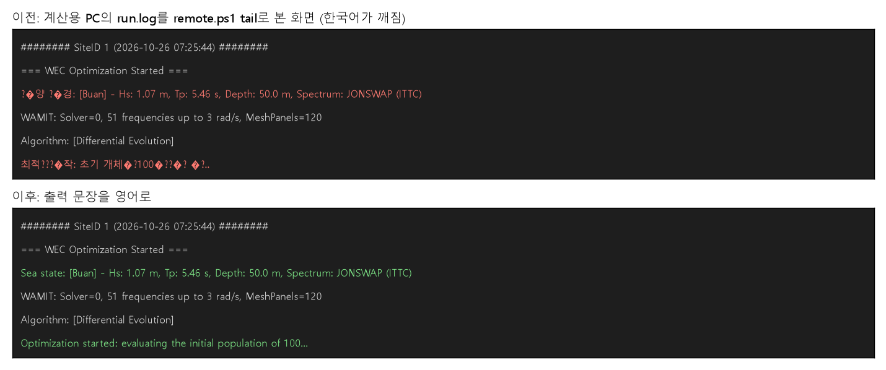

# 화면 글자를 영어로

## 무엇이 문제였나요?

계산용 PC에서 돌고 있는 계산이 어디까지 했는지 보려고 기록(`run.log`)을 열면, 한국어가 이렇게 깨져 보였습니다.

```
?�양 ?�경: [Buan] - Hs: 1.07 m, ...
최적???�작: 초기 개체�?100�??��? �?..
```

원래는 "해양 환경", "최적화 시작: 초기 개체군 100개 평가 중..."이라는 글자입니다.

## 왜 깨졌을까요?

컴퓨터는 글자를 숫자로 바꿔서 저장합니다. 그런데 글자를 숫자로 바꾸는 "암호표"가 여러 가지 있습니다.

- 계산용 PC는 기록을 **A라는 암호표**(UTF-8)로 적었습니다.
- 기록을 읽는 프로그램(PowerShell)은 **B라는 암호표**로 읽었습니다.

영어 알파벳과 숫자는 두 암호표에서 똑같이 생겨서 멀쩡하게 보입니다. 하지만 한국어는 두 암호표가 달라서 엉뚱한 글자가 나옵니다. 그래서 영어로 된 부분(`Hs: 1.07 m`)은 멀쩡하고 한국어만 깨졌습니다.

## 무엇을 바꿨나요?

프로그램이 화면에 쓰는 문장을 모두 영어로 바꿨습니다. 영어는 어느 암호표로 읽어도 똑같이 보이기 때문입니다.

| 전 | 후 |
| --- | --- |
| 해양 환경: [Buan] ... | Sea state: [Buan] ... |
| 최적화 시작: 초기 개체군 100개 평가 중... | Optimization started: evaluating the initial population of 100... |
| 유효한 해를 찾지 못했습니다. | No valid solution was found. |
| 'StepSize'는 양수(> 0)여야 합니다. | 'StepSize' must be positive (> 0) |

설정 파일을 잘못 썼을 때 나오는 오류 문장들도 모두 영어로 바꿨습니다. 모두 23곳입니다.



*위: 전에 계산용 PC 기록을 열었을 때(빨간 줄이 깨진 글자). 아래: 새 문장으로 바꾸면 이렇게 보입니다.*

## 다시 한국어가 들어가지 않게

누군가 나중에 실수로 한국어 출력 문장을 넣으면 바로 알 수 있도록, 검사 프로그램(테스트)을 하나 만들었습니다. 프로그램 안에서 화면에 나갈 수 있는 글자에 한글이 있으면 검사가 "틀렸어요"라고 알려 줍니다.

코드 안의 설명(주석)은 사람이 읽는 것이라 화면에 나오지 않으므로 한국어 그대로 둡니다.

## 언제부터 바뀌나요?

지금 계산용 PC에서 돌고 있는 계산(DE 100 × 300)은 바꾸기 전의 프로그램으로 돌고 있어서, 끝날 때까지 한국어가 깨져 보입니다. **다음 계산부터** 영어로 나옵니다.

## 아직 남은 것

- 읽는 쪽의 암호표를 고치는 방법도 있습니다. 이번에는 글자를 영어로 바꾸는 쪽을 택했고, 읽는 쪽은 아직 고치지 않았습니다.
- 원격 계산을 보내고 받는 PowerShell 프로그램의 안내 문장(예: "작업 ID")은 아직 한국어입니다. 이 문장은 내 PC 화면에 바로 나와서 깨지지 않습니다.
