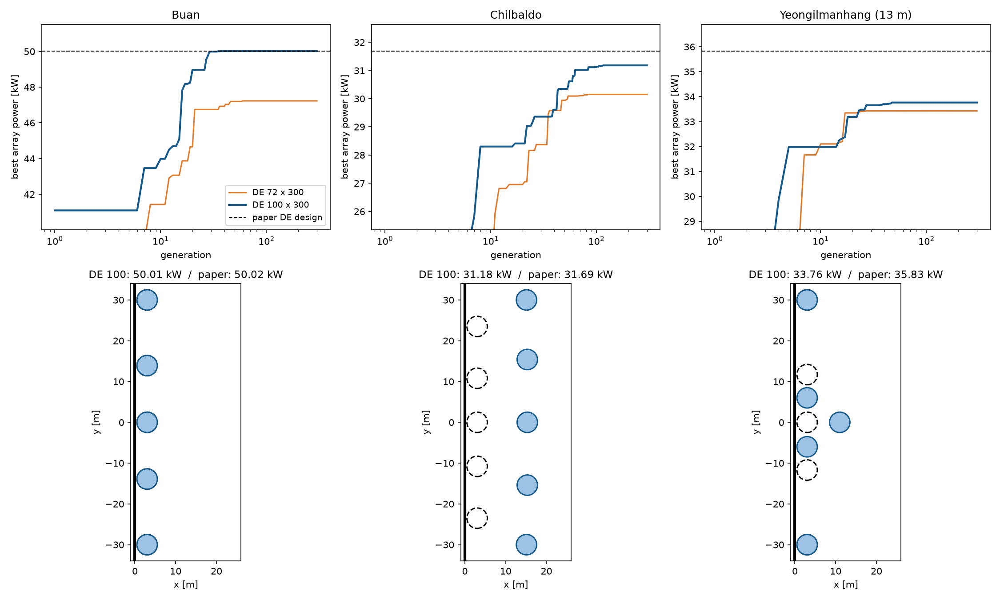

# 친구 100명으로 세 바다 다시 계산

## 무엇을 했나요?

벽 앞에 부표 5개를 놓는다고 생각해 보세요. 이 부표는 파도로 전기를 만드는 장치입니다. 부표의 크기와 놓을 자리를 어떻게 정해야 전기가 가장 많이 나오는지, 컴퓨터가 찾게 했습니다.

찾는 방법은 **DE**입니다. 여러 명의 "설계 친구들"이 서로 좋은 점을 섞어 가며, 300번(세대)에 걸쳐 조금씩 더 좋은 설계를 찾는 방법입니다.

지난번에는 친구 72명으로 계산했습니다. 그 결과는 논문 답보다 5~7% 낮았습니다. 그래서 이번에는 논문과 똑같이 **친구 100명**으로 다시 계산했습니다. 친구가 많으면 처음에 산을 더 넓게 둘러볼 수 있기 때문입니다.

## 결과

| 바다 | 친구 100명 | 지난번 72명 | 논문 답 |
| --- | --- | --- | --- |
| 부안 | **50.0 kW** | 47.2 kW | 50.0 kW |
| 칠발도 | **31.2 kW** | 30.1 kW | 31.7 kW |
| 영일만항 | **33.8 kW** | 33.4 kW | 35.8 kW |

- 세 바다 모두 72명일 때보다 좋아졌습니다.
- **부안은 논문 답과 똑같은 설계를 찾았습니다.** 부표 크기도, 자리도 똑같습니다.
- 칠발도는 논문 답보다 2% 낮고, 영일만항은 6% 낮습니다.

*위 그림: 세대가 지날수록 가장 좋은 값이 어떻게 올라가는지 보여 줍니다. 파란 선이 100명, 주황 선이 72명, 검은 점선이 논문 답입니다. 아래 그림: 동그라미가 부표이고, 왼쪽 굵은 선이 벽입니다. 파란 동그라미가 이번 답, 검은 점선 동그라미가 논문 답입니다.*

## 칠발도와 영일만항은 왜 모자랐을까요?

아래 그림을 보면 차이가 보입니다. 논문 답은 세 바다 모두 부표 5개가 **벽 바로 옆에 한 줄로** 섭니다.

- **칠발도**: 이번 답은 부표 5개가 벽에서 15 m 떨어진 곳에 한 줄로 섰습니다. 컴퓨터가 설계를 1만 개 넘게 살펴봤습니다. 그런데 "5개 모두 벽 옆"인 설계는 **한 번도** 살펴보지 않았습니다.
- **영일만항**: 부표 4개는 벽 옆에 섰습니다. 그런데 가운데 부표 하나가 벽에서 11 m 떨어진 곳으로 밀려났습니다. 이 부표는 전기를 거의 만들지 못합니다(다른 부표의 20분의 1).
  - 밀려난 이유는 바로 옆 부표 2개가 가운데로 너무 바싹 붙어 있어서입니다.
  - 부표끼리는 일정 거리 이상 떨어져야 한다는 규칙이 있습니다. 그래서 가운데 부표가 벽 쪽으로 들어갈 자리가 없었습니다.

비유하면 친구 100명이 산에서 가장 높은 봉우리를 찾다가, 처음 몇십 번 만에 모두 한 봉우리 근처로 모여 버린 것입니다. 부안에서는 그 봉우리가 진짜 가장 높은 봉우리였습니다. 칠발도와 영일만항에서는 옆에 더 높은 봉우리가 있었는데, 거기까지 가 보지 못했습니다.

## 경고 메시지는 걱정해야 할까요?

계산 기록에 가끔 "반복 계산이 끝까지 맞아떨어지지 않았다"는 경고가 나왔습니다.
- WAMIT은 답을 조금씩 고쳐 가며 맞히는 방법(반복 솔버)을 씁니다.
- 100번 고쳐도 다 맞지 않으면 이 경고가 나옵니다.

그래서 세 바다의 최종 답을 한 번에 정확히 푸는 방법(direct solver)으로도 계산해서 비교했습니다.

| 바다 | 반복 솔버 | 한 번에 푸는 방법 | 차이 |
| --- | --- | --- | --- |
| 부안 | 50.014964 kW | 50.014948 kW | 0.00003% |
| 칠발도 | 31.180733 kW | 31.180748 kW | 0.00005% |
| 영일만항 | 33.764256 kW | 33.764257 kW | 0.000003% |

- 세 바다 모두 거의 똑같습니다. 100만 원짜리 물건 값이 1원도 안 되게 다른 정도입니다.
- 칠발도 답은 실제로 한 곳에서 경고가 났습니다. 그곳은 파도가 아주 빠르게 출렁이는 부분입니다. 그런 파도는 바다에 거의 없어서 결과가 달라지지 않았습니다.
- 한 번에 푸는 방법은 2배 느립니다. 그래서 지금처럼 반복 솔버를 계속 씁니다.

## 계산 시간

세 바다를 합쳐 34시간이 걸렸습니다. 논문 때(약 66시간)의 절반쯤입니다.

## 아직 모르는 것

- 바다마다 한 번씩만 계산했습니다. 그래서 칠발도와 영일만항에서 다른 봉우리로 간 것이 운(친구들이 처음 어디서 출발했는지) 때문인지 아직 모릅니다. 출발 자리만 바꿔서 다시 계산해 보려고 합니다.
- 영일만항은 수심 13 m에서 계산했습니다. 논문 답은 수심 33 m에서 찾은 것을 13 m에서 다시 계산한 값입니다. 13 m에서 직접 찾은 답 가운데 논문 답보다 좋은 것은 아직 없습니다.
