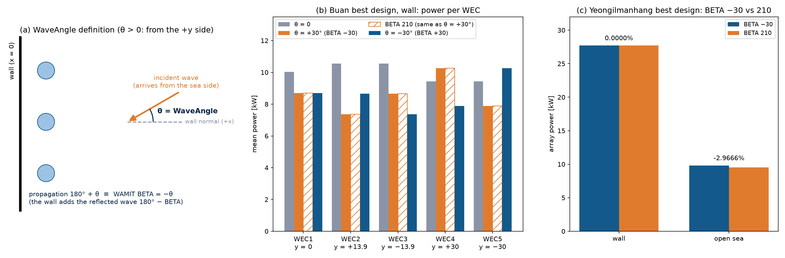

# 파도가 오는 방향 정하기

## 무엇을 바꿨나요?

지금까지 컴퓨터는 파도가 항상 **벽을 정면으로** 향해 온다고만 계산했습니다. 실제 바다에서는 파도가 비스듬히 오기도 합니다. 그래서 이번에 파도가 오는 방향을 설정 파일에서 정할 수 있게 했습니다.

설정 파일(`config.cfg`)에 한 줄이 생겼습니다.

```
0     WaveAngle
```

- **0**: 파도가 벽을 정면으로 향해 옵니다(지금까지와 같음).
- **30**: 파도가 벽 정면에서 30도 비켜서, 위쪽(+y 쪽)에서 비스듬히 옵니다.
- **−30**: 반대쪽(아래쪽, −y 쪽)에서 비스듬히 옵니다.
- 90도는 안 됩니다. 90도면 파도가 벽에 닿지 않고 벽을 따라 옆으로 지나가 버리기 때문입니다.

## "−를 붙인다"는 말이 맞을까?

벽이 있을 때는 각도에 −를 붙여서 넣는다는 이야기가 있었습니다. 정말 그런지 두 가지로 확인했습니다.

**1. 설명서 확인**

WAMIT 설명서에는 이렇게 쓰여 있습니다. "벽이 있으면, 들어오는 파도와 벽에 부딪혀 **튕겨 나오는 파도**를 함께 계산한다."

공을 벽에 비스듬히 던지는 모습을 떠올려 보세요. 공은 거울에 비친 것처럼 반대쪽으로 튕겨 나옵니다. 파도도 똑같습니다.

그래서 WAMIT에게는 "벽 쪽으로 들어오는 파도"를 알려 주든 "벽에서 튕겨 나가는 파도"를 알려 주든 상관없습니다. 어느 쪽을 알려 줘도 WAMIT이 나머지 하나를 스스로 만들어서, 결국 똑같은 바다가 됩니다. 각도에 −를 붙이면 바로 이 "튕겨 나가는 파도"의 방향이 됩니다.

**2. 실제 계산으로 확인**

부안 최적 설계로 두 가지 방법을 모두 계산해 봤습니다.

| 파도를 알려 주는 방법 | 벽이 있을 때 | 벽이 없을 때 (영일만항 설계) |
| --- | --- | --- |
| 튕겨 나가는 방향 (−30도) | 42.859858 kW | 9.80 kW |
| 실제로 들어오는 방향 (210도) | 42.859868 kW | 9.51 kW |
| 차이 | **거의 0** | **3% 다름** |

- 벽이 있으면 두 방법의 답이 똑같습니다. 그래서 **"−를 붙인다"는 말이 맞습니다.**
- 하지만 벽이 없으면 튕겨 나오는 파도가 없으니 답이 달라집니다. 그래서 벽이 없을 때는 이 기능을 쓸 수 없게 막았습니다.



*왼쪽: 파도 방향(θ)의 뜻. 가운데: 부안 설계에서 부표마다 만드는 전기. 주황 막대(−30도)와 빗금 막대(210도)가 똑같습니다. 오른쪽: 벽이 있으면 두 막대가 같고, 벽이 없으면 다릅니다.*

## 방향이 맞게 들어갔는지 어떻게 알까요?

파도가 위쪽(+y)에서 오면, 위쪽 끝에 있는 부표가 파도를 가장 먼저 만납니다. 그러니 그 부표가 전기를 가장 많이 만들어야 합니다.

계산해 보니 정말 위쪽 끝 부표(WEC 4)가 10.3 kW로 가장 많았습니다. 아래쪽 끝 부표(WEC 5)는 7.9 kW였습니다. 방향이 제대로 들어간 것입니다.

## 전과 후는 무엇이 다른가요?

- `WaveAngle`을 0으로 두면 전과 **완전히 똑같습니다.** 컴퓨터에 넣는 파일을 글자 하나까지 비교해서 확인했습니다.
- 파도가 30도 비스듬히 오면, 정면에 맞춰 만든 부안 설계는 전기가 14% 줄었습니다(50.0 → 42.9 kW).

## 아직 남은 것

- 지금은 부표들이 위아래로 거울처럼 대칭인 배치만 찾을 수 있습니다. 파도가 비스듬히 오면 대칭이 아닌 배치가 더 좋을 수도 있습니다.
- 진짜 바다의 파도는 여러 방향에서 섞여서 옵니다. 지금은 한 방향만 계산합니다.
- 비스듬한 파도로 최적화를 실제로 돌려 보지는 않았습니다.
