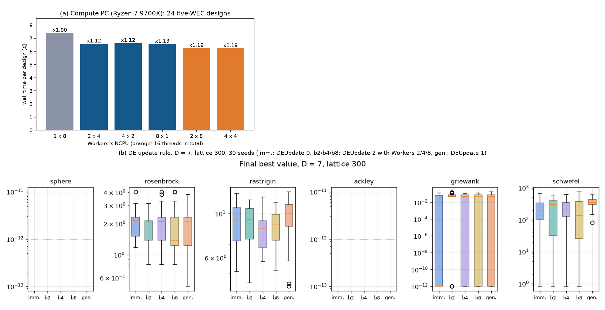

# 계산을 여러 개 동시에

## 무엇을 하고 싶었나요?

컴퓨터가 부표 설계 하나를 계산(WAMIT)하는 데 약 7초가 걸립니다. 설계를 수만 개 계산해야 해서, 한 바다를 끝내는 데 하루 가까이 걸렸습니다.

그래서 계산 담당 컴퓨터에서 WAMIT을 **여러 개 동시에** 돌리기로 했습니다. 빨래방에서 세탁기 한 대 대신 네 대를 쓰는 것과 같은 생각입니다.

## 문제: DE는 줄을 서서 차례로 해야 했어요

이 프로젝트에서 주로 쓰는 찾기 방법은 **DE**입니다. DE에는 "100명의 설계 친구들"이 있습니다. 지금까지는 이렇게 했습니다.

1. 1번 친구가 새 설계를 만들어 계산합니다.
2. 결과가 좋으면 1번 친구를 바로 새 설계로 바꿉니다.
3. 2번 친구는 **바뀐 1번 친구를 보고** 자기 새 설계를 만듭니다.

뒤 친구가 앞 친구의 결과를 봐야 하니, 한 명씩 차례로 해야 합니다. 세탁기가 네 대 있어도 한 대만 쓰는 셈입니다.

## 해결: 네 명씩 묶어서 하기

새로 **"묶음 방식"**(`DEUpdate 2`)을 만들었습니다.

- 친구 4명이 한 묶음이 되어 새 설계를 **동시에** 만들고, 세탁기 4대로 동시에 계산합니다.
- 결과가 나오면 바로 바꾸고, 다음 4명은 바뀐 친구들을 봅니다.
- 같은 묶음 안의 4명끼리만 서로의 결과를 못 봅니다. 100명 중에서는 아주 작은 차이입니다.

예전부터 있던 **"한 세대 통째로"** 방식(`DEUpdate 1`)도 있습니다. 100명이 모두 동시에 하는 방식인데, 서로의 결과를 너무 못 봐서 성적이 떨어졌습니다.

## 성적 비교

여러 시험 문제(수학에서 쓰는 어려운 함수 6가지)를 30번씩 풀게 해서 비교했습니다.

| 방법 | 원래 방식(차례로)과 비교 |
| --- | --- |
| 묶음 2명, 4명, 8명 | **거의 같음** (가끔 조금 좋거나 조금 나쁨) |
| 한 세대 통째로 | 24개 경우 중 11개에서 **확실히 나쁨** |

그래서 묶음 방식을 쓰기로 했습니다.

## 그런데 생각보다 빨라지지 않았어요

계산 담당 컴퓨터에서 실제로 재 보니 이랬습니다.

| 방법 | 설계 하나에 걸린 시간 |
| --- | --- |
| WAMIT 1개 (전) | 7.4초 |
| WAMIT 4개 동시에 (후) | 6.2초 |

**1.19배**밖에 빨라지지 않았습니다. 세탁기를 4대로 늘렸는데 빨래가 조금만 빨리 끝난 셈입니다.

아마 세탁기는 많아도 **수도꼭지(디스크나 메모리)가 하나**라서, 물이 동시에 많이 나오지 못하는 것 같습니다. 아직 확인하지는 않았습니다.

*위: 방법마다 설계 하나에 걸린 시간. 아래: 시험 문제마다 방법별 성적(낮을수록 좋음). 차례로(imm.)와 묶음(b2, b4, b8)은 비슷하고, 통째로(gen.)는 조금 나쁩니다.*

## 앞으로는

- 계산 담당 컴퓨터에서는 WAMIT 4개, 묶음 방식으로 계산합니다. 하루 걸리던 계산이 16% 정도 빨리 끝납니다.
- 왜 더 빨라지지 않는지(수도꼭지가 무엇인지) 알아보면 더 빨리 만들 수 있을지도 모릅니다.
