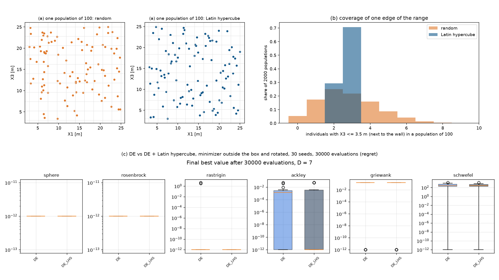

# 처음 친구들을 고르게 뽑기

## 무엇을 바꿨나요?

컴퓨터가 좋은 부표 설계를 찾을 때는 먼저 "설계 친구들" 100명을 아무렇게나 뽑아서 시작합니다. 이것을 **초기 개체군**이라고 합니다.

지금까지는 **제비뽑기**로 뽑았습니다. 그런데 제비뽑기는 운이 나쁘면 어떤 쪽이 텅 비기도 합니다. 예를 들어 "벽 바로 옆에 서는 부표"를 가진 친구가 한 명도 안 뽑힐 수 있습니다.

그래서 **라틴 하이퍼큐브(LHS)**라는 방법을 고를 수 있게 했습니다. 설정 파일에 이 줄이 생겼습니다.

```
0     InitPop      ← 0: 제비뽑기(원래 방식), 1: 라틴 하이퍼큐브
```

## 라틴 하이퍼큐브는 어떻게 뽑나요?

반 친구 100명에게 자리를 정해 준다고 생각해 보세요.

- **제비뽑기**: 모두 아무 자리에나 앉습니다. 앞줄에 몰리거나 뒷줄이 텅 빌 수도 있습니다.
- **라틴 하이퍼큐브**: 교실을 100줄로 나누고 **한 줄에 꼭 한 명씩** 앉힙니다. 그래서 앞줄부터 뒷줄까지 빠짐없이 사람이 있습니다. 이 규칙을 키, 몸무게, 나이처럼 여러 가지에 따로따로 적용합니다.

## 정말 고르게 뽑힐까?

100명을 2000번 뽑아서 세어 봤습니다.

| | 제비뽑기 | 라틴 하이퍼큐브 |
| --- | --- | --- |
| 바깥 부표가 벽 옆인 친구가 **한 명도 없을** 확률 | 7.4% (열네 번에 한 번) | **0%** (항상 2명 이상) |
| 부표 5개가 **모두** 벽 옆인 친구가 있을 확률 | 0.35% | 0.05% |



*왼쪽 위 두 그림: 친구 100명의 위치. 제비뽑기(주황)는 빈 곳과 몰린 곳이 있고, LHS(파랑)는 더 고르게 퍼져 있습니다. 오른쪽 위: 벽 옆 친구가 몇 명 뽑히는지. LHS는 거의 항상 2~3명입니다. 아래: 어려운 시험 문제 6개의 최종 성적. 두 방법이 거의 같습니다.*

LHS는 "바깥 부표가 벽 옆" 같은 **한 가지 조건**은 꼭 챙깁니다. 하지만 "부표 5개 모두 벽 옆"처럼 **여러 조건이 동시에** 맞는 경우는 LHS도 거의 뽑지 못합니다. 키도 크고, 몸무게도 많이 나가고, 나이도 많은 친구를 일부러 챙기지는 않는 것과 같습니다.

## 성적은 좋아졌나요?

어려운 시험 문제 6개를 각각 30번씩 풀게 해서 비교했습니다.

**결과: 거의 똑같았습니다.** 처음에 조금 더 고르게 시작해도, 300세대 동안 친구들이 계속 섞이면서 처음의 차이가 사라집니다.

## 그럼 왜 넣었나요?

- 운이 나빠 한쪽을 통째로 놓치는 일을 막아 줍니다. 손해는 없습니다(계산 횟수가 같습니다).
- 진짜 부표 문제에서도 효과가 없는지는 직접 돌려 봐야 압니다.
- 효과가 없다면, 칠발도와 영일만항에서 좋은 답을 놓친 이유는 "처음 뽑기"가 아니라 친구들이 서로 섞이는 방식(DE의 변이와 교차)에 있다는 뜻입니다. 이것도 알아낼 가치가 있습니다.

## 아직 남은 것

- 칠발도와 영일만항을 LHS로 실제로 계산해서 비교해 봐야 합니다.
- "부표 5개 모두 벽 옆" 같은 조합을 잘 찾도록 친구들이 섞이는 방식을 바꿔 볼 수도 있습니다.
