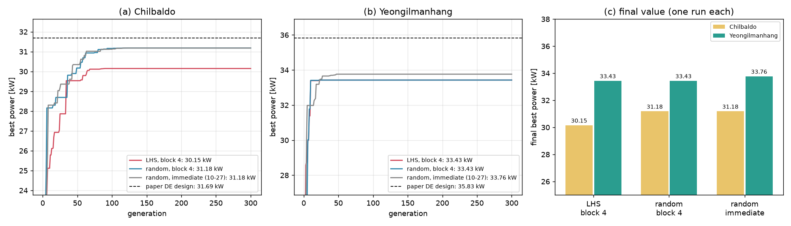

# 고르게 뽑아도 같은 봉우리로

## 무엇을 해 봤나요?

지난번에 처음 친구 100명을 **고르게 뽑는 방법(라틴 하이퍼큐브, LHS)**을 만들었습니다([처음 친구들을 고르게 뽑기](2026-11-01_03_처음%20친구들을%20고르게%20뽑기.md)). 연습 문제에서는 효과가 없었습니다. 그래서 진짜 바다 문제에서도 시험해 봤습니다.

- 바다: 칠발도, 영일만항 (지난번에 논문 답을 못 찾은 두 곳)
- 방법: 처음 친구를 **제비뽑기**로 뽑기 / **고르게(LHS)** 뽑기, 각각 한 번씩
- 계산용 PC가 WAMIT 4개를 동시에 돌려서 약 38시간 걸렸습니다.

## 결과

| 바다 | 고르게 뽑기 (LHS) | 제비뽑기 | 지난번 제비뽑기 | 논문 설계 |
| --- | --- | --- | --- | --- |
| 칠발도 | 30.15 kW | **31.18 kW** | 31.18 kW | 31.69 kW |
| 영일만항 | 33.43 kW | 33.43 kW | **33.76 kW** | 35.83 kW |

- 고르게 뽑아도 **더 좋아지지 않았습니다.** 칠발도는 오히려 조금 낮았고, 영일만항은 똑같았습니다.
- 두 바다 모두 논문 설계보다 낮습니다.

## 신기한 점: 정확히 같은 답이 또 나왔어요

컴퓨터는 매번 다른 친구들로 시작했는데도, **소수점까지 똑같은 설계**에 여러 번 도착했습니다.

| 바다 | 자주 가는 봉우리 | 몇 번 갔나 |
| --- | --- | --- |
| 칠발도 | 30.15 kW 봉우리 | 2번 (지난주 계산, 이번 LHS) |
| 칠발도 | 31.18 kW 봉우리 | 2번 (지난번, 이번 제비뽑기) |
| 영일만항 | 33.43 kW 봉우리 | **3번** (지난주, 이번 LHS, 이번 제비뽑기) |

산에서 길을 찾는 등산객을 떠올려 보세요.
- 산에는 봉우리가 여러 개 있습니다. 가장 높은 봉우리(논문 설계)는 "부표 다섯 개가 모두 벽 옆에 서는 자리"입니다.
- 그런데 등산객 100명은 출발 위치를 바꿔도 늘 **근처의 낮은 봉우리 두어 곳** 중 하나로 모여 버립니다.
- 그리고 한 번 모이면 다른 봉우리를 보러 가지 않습니다. 영일만항은 10세대 만에 거의 다 모였습니다.
- 이번 네 번의 계산은 가장 높은 봉우리 근처에 **한 번도 가 보지 않았습니다.**

그러니까 문제는 "어디서 출발하느냐"가 아니라 **"길을 찾는 방법"**에 있는 것 같습니다.

## 덤으로 알게 된 것

이번 계산은 친구 4명씩 묶어서 동시에 계산했습니다([계산을 여러 개 동시에](2026-11-01_02_계산을%20여러%20개%20동시에.md)).
- 칠발도는 하나씩 계산했던 지난번과 **같은 답**을 찾았습니다. 묶어도 성적은 그대로입니다.
- 걸린 시간은 칠발도 19시간 → 15시간, 영일만항 8시간 → 5시간으로 줄었습니다.

## 아직 남은 문제

- 등산객들이 너무 빨리 한 봉우리에 모이는 것을 막을 방법을 찾아야 합니다. 예를 들면 이런 것들입니다.
  - 길 찾는 규칙(변이 방법)을 바꾸기
  - 모인 뒤에 몇 명을 다른 곳으로 다시 보내기
  - 끝에 도착한 설계에서 한 가지씩 바꿔 보기
- 지난번에 영일만항 설계에서 바깥 부표 위치 하나만 벽 옆으로 옮겼더니 35.37 kW로 올라갔습니다. 바로 옆에 더 높은 곳이 있다는 뜻입니다.
- 한 번만 계산하면 "어느 봉우리에 갔는지" 운이 크게 작용합니다. 그래서 여러 번 계산해서 비교해야 합니다.
