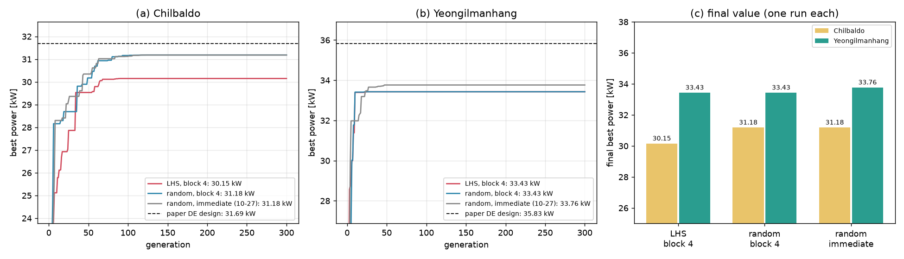

# 고르게 뽑기는 빼기로

## 무엇을 바꿨나요?

처음 친구 100명을 **고르게 뽑는 방법(라틴 하이퍼큐브, LHS)**을 프로그램에서 **지웠습니다.** 이제 처음 친구들은 예전처럼 늘 **제비뽑기**로 뽑습니다.

## 왜 지웠나요?

두 번 시험했는데 두 번 다 도움이 되지 않았습니다.

| 시험 | 고르게 뽑기 | 제비뽑기 | 결론 |
| --- | --- | --- | --- |
| 연습 문제 (30번씩) | 성적 같음 | 성적 같음 | 차이 없음 |
| 칠발도 바다 | 30.15 kW | 31.18 kW | 오히려 조금 낮음 |
| 영일만항 바다 | 33.43 kW | 33.43 kW | 똑같은 설계 |

비유를 들면 이렇습니다.
- 등산객 100명의 출발 위치를 고르게 나눠 줘도, 결국 다들 **근처의 낮은 봉우리**로 모여 버립니다([고르게 뽑아도 같은 봉우리로](2026-11-03_01_고르게%20뽑아도%20같은%20봉우리로.md)).
- 문제는 "어디서 출발하느냐"가 아니라 **"길을 찾는 방법"**에 있습니다.

쓰지 않는 기능을 남겨 두면 설정만 복잡해지고 헷갈립니다. 그래서 지우기로 했습니다.

## 전과 후

| | 전 | 후 |
| --- | --- | --- |
| 설정 파일 | `InitPop` 줄이 있음 (0 또는 1) | 줄이 없음 |
| 처음 친구 뽑기 | 0: 제비뽑기, 1: 고르게 | 항상 제비뽑기 |
| 계산 결과 | `InitPop` 0일 때와 | **똑같음** |

- 예전 설정 파일에 `InitPop` 줄이 남아 있어도 오류는 나지 않습니다. 그 줄을 그냥 무시합니다.

## 아직 남은 문제

- 등산객들이 너무 빨리 한 봉우리로 모이는 문제는 그대로입니다. 다음에는 **길 찾는 규칙**을 바꿔 볼 차례입니다.
