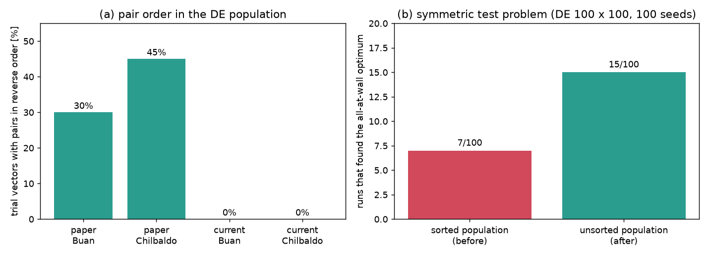

# 짝꿍 순서를 억지로 맞추지 않기

## 무엇을 찾았나요?

논문을 쓸 때 컴퓨터가 남긴 기록을 받아서 지금과 비교해 봤습니다.

- **발전량 계산**: 그때 프로그램으로 논문 설계를 다시 계산하면 논문 숫자가 소수점까지 그대로 나왔습니다. 지금 프로그램은 1% 정도 낮지만, 어느 설계가 더 좋은지 순서는 같습니다. 계산이 고장 난 것은 아니었습니다.
- **그런데 차이가 하나 있었습니다.** 바로 "짝꿍 순서"입니다.

## 짝꿍 순서가 뭔가요?

부표 5개 중 4개는 두 쌍의 짝꿍입니다. 짝꿍 A는 (x2, y2), 짝꿍 B는 (x3, y3) 자리에 적습니다.

A와 B를 바꿔 적어도 바다에 놓이는 모양은 똑같습니다. 그래서 같은 모양을 두 번 계산하지 않으려고, 지금 프로그램은 **항상 작은 쪽을 앞에 적도록 정렬**합니다. 이 생각 자체는 좋은 생각입니다.

| | 논문 때 | 지금 (고치기 전) |
| --- | --- | --- |
| 정렬하기 | 안 함 | 항상 함 |
| 정렬한 것을 친구들 목록에 다시 적기 | — | **함** ← 문제 |

## 왜 문제가 되나요?

반 친구들이 "짝꿍 A 자리에는 키 작은 친구, B 자리에는 키 큰 친구"라고 적는다고 해 봅시다.

- 두 짝꿍의 키가 거의 같으면, 키가 1 cm만 달라져도 A와 B가 서로 자리를 바꿉니다.
- 그러면 친구마다 "A 자리"에 적힌 사람이 다릅니다. 어떤 친구는 철수를, 어떤 친구는 영희를 A에 적었습니다.
- 컴퓨터는 친구들의 기록을 섞어서 새 설계를 만듭니다. 그런데 "A 자리끼리" 섞으면 철수와 영희의 값이 뒤섞여 버립니다.

부표 다섯 개가 모두 벽 옆에 서는 가장 좋은 배치가 바로 이런 경우입니다. 두 짝꿍의 x가 둘 다 3 m로 같기 때문입니다. 그래서 컴퓨터가 이 배치를 잘 다듬지 못했을 수 있습니다.

## 어떻게 고쳤나요?

- **계산할 때와 중복을 찾을 때**는 지금처럼 정렬한 **복사본**을 씁니다. 같은 모양을 두 번 계산하지 않는 장점은 그대로입니다.
- **친구들 목록**에는 정렬하지 않은 원래 기록을 그대로 둡니다. 논문 때와 같습니다.

## 효과가 있을까?

연습 문제로 먼저 시험해 봤습니다. 이 문제에는 높은 봉우리(벽 옆)와 넓고 낮은 봉우리(가운데)가 있습니다. 100번씩 돌려서 높은 봉우리를 찾은 횟수를 셌습니다.

| | 고치기 전 | 고친 후 |
| --- | --- | --- |
| 높은 봉우리를 찾은 횟수 | 7번 | **15번** |

두 배 정도 늘었지만, 우연일 가능성도 아직 남아 있습니다. 그래서 진짜 바다(칠발도, 부안)를 논문과 똑같은 조건으로 계산용 PC에서 돌리고 있습니다. 하루쯤 걸립니다.

## 아직 남은 문제

- 칠발도에서 논문처럼 벽 옆 배치(31.7 kW 근처)를 찾는지 결과를 기다리고 있습니다.
- 영일만항은 수심이 논문 때(33 m)와 지금(13 m)이 달라서, 다른 문제로 보고 나중에 따로 확인합니다.
