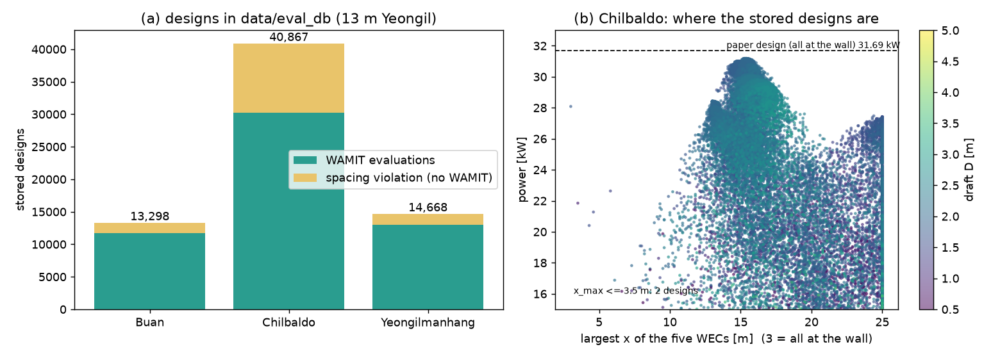

# 계산 결과 저금통

## 무엇을 만들었나요?

지금까지 컴퓨터가 계산한 부표 설계와 그 발전량을 **한 곳에 모아 두는 저금통**을 만들었습니다.

WAMIT 계산은 설계 하나에 7초쯤 걸립니다. 지금까지 모인 설계가 약 5만 5천 개이니, 다시 계산하면 **100시간이 넘게** 걸립니다. 이미 계산한 것을 버리기는 아깝지요.

| 바다 | 모아 둔 설계 | 그중 WAMIT으로 계산한 것 |
| --- | --- | --- |
| 부안 | 13,298개 | 11,751개 |
| 칠발도 | 40,867개 | 30,260개 |
| 영일만항 | 14,668개 | 12,966개 |

나머지는 부표끼리 너무 가까워서 계산하지 않고 벌점만 준 설계입니다.



## 어떻게 쓰나요?

설정 파일에서 한 줄만 바꾸면 됩니다.

```
1     EvalCache     ← 0: 안 씀(기본), 1: 저금통 사용
```

1로 두면, 컴퓨터는 설계를 계산하기 전에 먼저 저금통을 봅니다. 이미 있으면 꺼내 쓰고, 없을 때만 WAMIT을 돌립니다. 화면에는 `Stored` 숫자로 몇 번 꺼내 썼는지 나옵니다.

계산용 PC에서 결과를 가져올 때마다(`fetch`) 새 결과가 저금통에 자동으로 들어갑니다.

## 다른 조건의 값은 섞이지 않나요?

같은 설계라도 바다의 파도, 수심, 계산 방법이 다르면 발전량이 달라집니다. 그래서 저금통 안에 **조건마다 칸을 나눠 두었습니다.**
- 칸의 이름표에는 바다 이름, 파도 높이와 주기, 수심, 메쉬, 솔버, 주파수, 부표 모양, 벽, 파도 방향이 적혀 있습니다.
- 이름표가 하나라도 다르면 그 칸의 값은 쓰지 않습니다.
- 계산 프로그램 자체를 고쳐서 값이 달라지면, 이름표의 "판 번호"를 올려서 옛 칸을 못 쓰게 합니다.

## 같은 값이 정말 나오나요?

- 여러 번 계산된 같은 설계는 값 차이가 100만분의 1보다 작았습니다.
- 오늘 다시 계산한 칠발도 설계(31.181 kW)도 저금통의 값과 같았습니다.

## 대리모델에도 쓸 수 있나요?

**대리모델**은 WAMIT 대신 발전량을 빠르게 어림하는 작은 예측 프로그램입니다. 저금통의 5만 5천 개 설계가 바로 그 공부 자료가 됩니다.

그런데 조심할 점이 있습니다.
- 이 자료는 컴퓨터가 **좋은 곳을 찾아다니면서** 모은 것이라, 자주 간 곳에 몰려 있습니다.
- 칠발도에서 "부표 다섯 개가 모두 벽 옆"인 곳(논문의 정답 근처)은 자료가 **2개**뿐입니다(그림 오른쪽 왼쪽 끝).
- 그래서 대리모델을 만들려면 비어 있는 곳을 일부러 채우는 계산이 더 필요합니다.

## 아직 남은 일

- 논문 때 기록은 계산 방법이 조금 달라서(값이 0.5~1% 높음) 같은 저금통에 넣지 않았습니다. 대리모델에 쓰려면 따로 정리해야 합니다.
- 지금 돌고 있는 칠발도·부안 계산이 끝나면 저금통에 자동으로 더해집니다.
